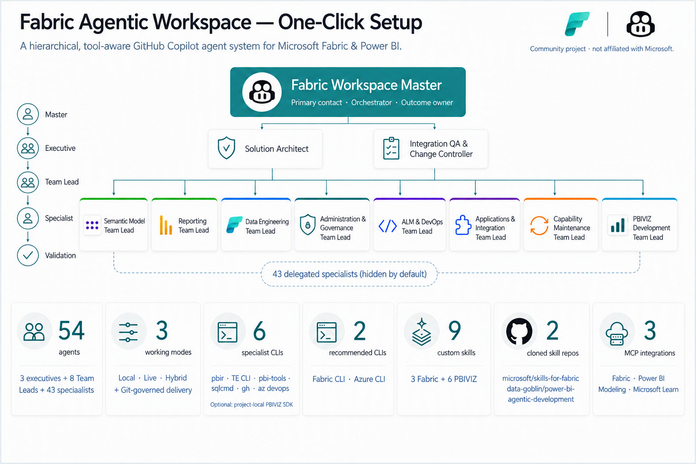
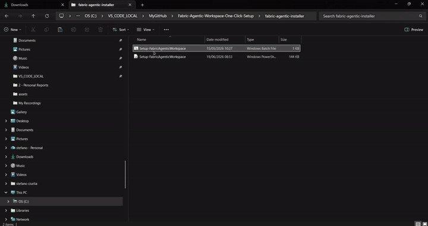
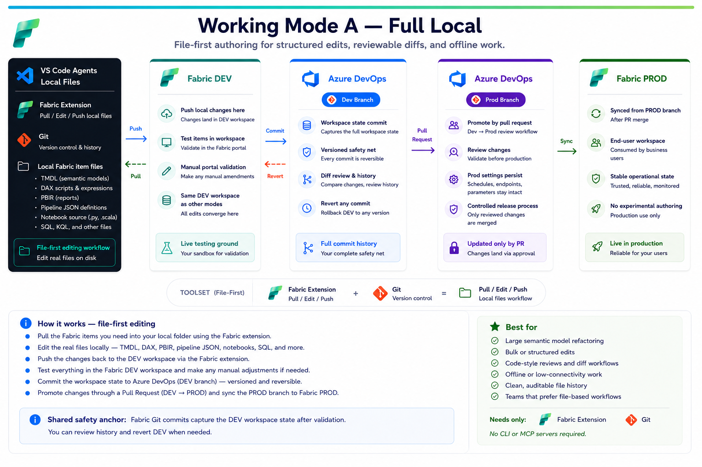
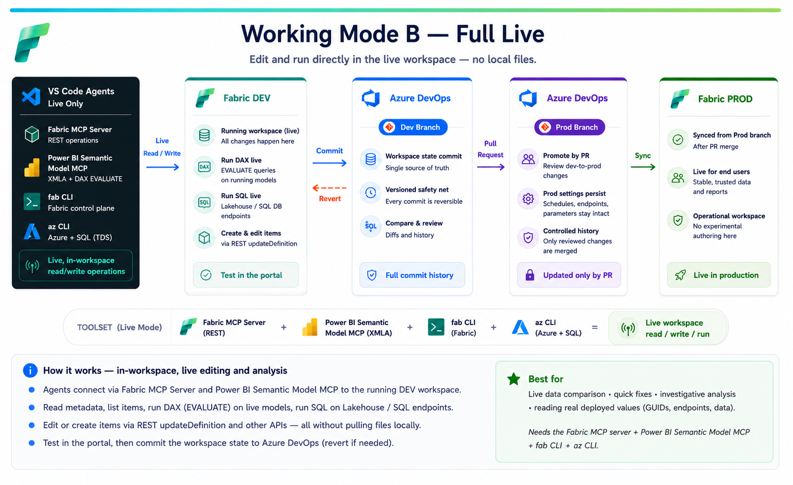
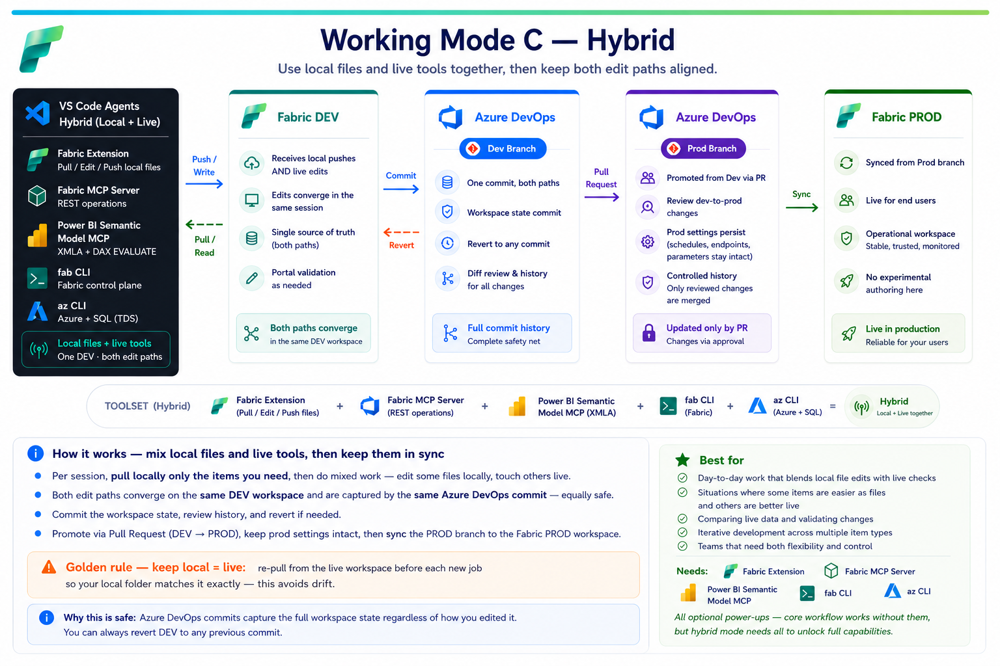
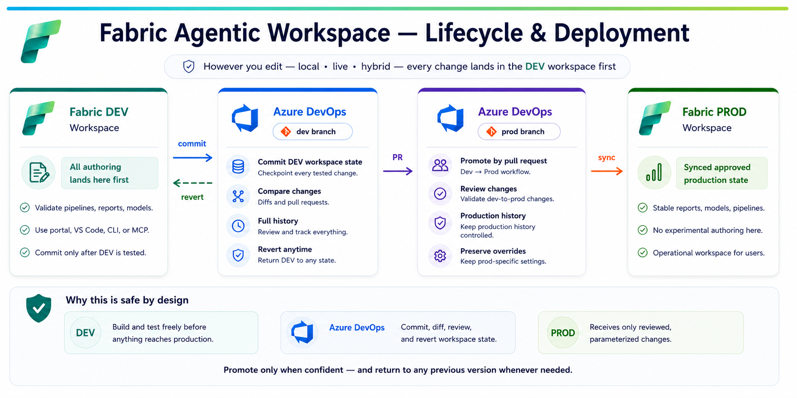
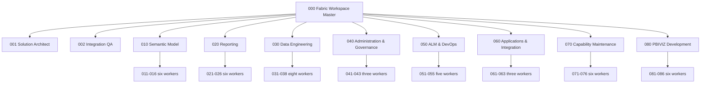

# Fabric Agentic Workspace — One-Click Setup

[](https://github.com/SteCiu01/Fabric-Agentic-Workspace-One-Click-Setup/releases)
[](https://github.com/SteCiu01/Fabric-Agentic-Workspace-One-Click-Setup/actions/workflows/validate.yml)

Pre-release — used regularly by the maintainer in real Fabric work, evolving fast.
Contributions and feedback welcome.

**Bootstrap a Fabric-ready Copilot agent workspace for VS Code.**

> **The 30-second version**
> - **What** — a one-click installer that scaffolds an opinionated Microsoft Fabric development workspace in VS Code.
> - **Who it's for** — anyone working in Fabric (semantic models, data engineering, reports, pipelines, admin, app dev, DevOps) who wants Copilot agents that already know the right tools and house conventions.
> - **How to run** — double-click `Setup-FabricAgenticWorkspace.bat`, answer a few prompts, and let it scaffold.
> - **What you get** — a numbered 54-agent organisation (11 clear dropdown entries + 43 delegated workers), nine embedded skills (three for Fabric, six for Power BI custom visual development), two curated open-source skill sources, optional CLI/MCP tooling, an optional custom visual (`.pbiviz`) folder with its own local Git history, optional GitHub/Azure DevOps repository onboarding, and governed DEV→PROD guidance.

> Windows installer (PowerShell + `.bat`); the workspace itself is OS-agnostic once created.

<p align="center">
  
</p>

> The overview image shows the v0.7 organisation (historical: it predates the PBIVIZ team). The current organisation chart is in [3.4](#34-the-agent-organisation).

---

## Contents

**Part 1 — Install it** *(what you actually do)*
- [1.1 Before you start — checklist](#11-before-you-start--checklist)
- [1.2 What the installer puts on your machine](#12-what-the-installer-puts-on-your-machine)
- [1.3 Get the two files](#13-get-the-two-files)
- [1.4 The installer, step by step (9 steps)](#14-the-installer-step-by-step-9-steps)
  - [Step 1 — Workspace Folder](#step-1-of-9--workspace-folder)
  - [Step 2 — Checking Prerequisites](#step-2-of-9--checking-prerequisites)
  - [Step 3 — Creating Folder Structure](#step-3-of-9--creating-folder-structure)
  - [Step 4 — Business Source-Control Repositories](#step-4-of-9--business-source-control-repositories)
  - [Step 5 — Cloning Skill Repositories](#step-5-of-9--cloning-skill-repositories)
  - [Step 6 — Writing Custom Skills](#step-6-of-9--writing-custom-skills)
  - [Step 7 — Writing Agent Definitions](#step-7-of-9--writing-agent-definitions)
  - [Step 8 — Writing Configuration Files](#step-8-of-9--writing-configuration-files)
  - [Step 9 — Finishing Up](#step-9-of-9--finishing-up)
- [1.5 Your first session](#15-your-first-session)
- [1.6 Updating (re-run the same installer)](#16-updating-re-run-the-same-installer)
- [1.7 Troubleshooting](#17-troubleshooting)

**Part 2 — Use it** *(how you work day to day)*
- [2.1 How a request flows through the team](#21-how-a-request-flows-through-the-team)
- [2.2 Three ways of working](#22-three-ways-of-working)
- [2.3 The Fabric development lifecycle](#23-the-fabric-development-lifecycle)
- [2.4 Optional CLIs and MCP servers — what each unlocks](#24-optional-clis-and-mcp-servers--what-each-unlocks)
- [2.5 Workspace structure](#25-workspace-structure)
- [2.6 FAQ](#26-faq)
- [2.7 Custom visual (.pbiviz) development](#27-custom-visual-pbiviz-development)
- [2.8 Versioning custom visuals — three levels](#28-versioning-custom-visuals--three-levels)

**Part 3 — Understand it** *(background and reference)*
- [3.1 Why this exists](#31-why-this-exists)
- [3.2 What this is / is not](#32-what-this-is--is-not)
- [3.3 Copilot Chat vs CLI/plugin workflows](#33-copilot-chat-vs-cliplugin-workflows)
- [3.4 The agent organisation](#34-the-agent-organisation)
- [3.5 Agent → tools → skills matrix](#35-agent--tools--skills-matrix)
- [3.6 Agentic design principles](#36-agentic-design-principles)
- [3.7 Skills — where they come from](#37-skills--where-they-come-from)
- [3.8 How it works under the hood](#38-how-it-works-under-the-hood)
- [3.9 A bit of history](#39-a-bit-of-history-how-fabricpower-bi-work-used-to-flow)
- [3.10 Quality & validation](#310-quality--validation)
- [3.11 Current status (v0.8.0)](#311-current-status-v080)
- [3.12 Disclaimer](#312-disclaimer)
- [Contributing](#contributing) · [Files in this repository](#files-in-this-repository) · [License](#license) · [Third-party notices](#third-party-notices)

---

# Part 1 — Install it

## 1.1 Before you start — checklist

The installer **stops** if a required item is missing. It **installs** the auto items for you where it can, and only **asks** before installing the optional ones.

| | Item | Who installs it | Notes |
|---|---|---|---|
| ✅ Required | **VS Code 1.117.0+** | You — [code.visualstudio.com](https://code.visualstudio.com) | Older versions have known bugs that break Copilot agent tools. |
| ✅ Required | **Git** | You — [git-scm.com](https://git-scm.com) | Also used to clone the skill repositories (no npm/admin needed). |
| ✅ Required | **GitHub Copilot + Agent Mode** | You — VS Code marketplace | `chat.agent.enabled`; org tenants may need admin to enable it. Not checked by the installer. |
| ✅ Required | **[Microsoft Fabric extension](https://marketplace.visualstudio.com/items?itemName=fabric.vscode-fabric)** | You — `code --install-extension fabric.vscode-fabric` | Pull/push of Fabric items. Installer warns if missing, continues. |
| 👍 Recommended | **[TMDL extension](https://marketplace.visualstudio.com/items?itemName=analysis-services.tmdl)** | You — `code --install-extension analysis-services.tmdl` | Syntax highlighting/validation for `.tmdl`. Installer reminds you. |
| 💡 Nice to have | **[Fabric Data Engineer Remote](https://marketplace.visualstudio.com/items?itemName=synapsevscode.vscode-synapse-remote)** | You | Run notebook cells against remote Spark. Installer mentions it as a tip. |
| 🤖 Auto | **Python 3.10–3.14** | Installer (only if no supported Python is found) | Looks on PATH, then in the PEP 514 registry and the python.org / conda folders — an install that is simply not on PATH is used as-is. Otherwise winget `Python.Python.3.12 --scope user` (bounded to 4 min), then python.org 3.12.10 per-user. An out-of-range Python is left untouched and 3.12 installed alongside. |
| 🤖 Auto | **Fabric CLI `fab`** | Installer | `pip install ms-fabric-cli` (with `--user` retry). Primary CLI for live work. |
| 🤖 Auto | **Azure CLI `az`** | Installer | winget `Microsoft.AzureCLI`, else isolated `%USERPROFILE%\.fabric-az`. Fallback CLI. ⚠️ Slowest install when missing. |
| 🤖 Auto | **Fabric MCP server** `fabric.vscode-fabric-mcp-server` | Installer | VS Code extension; live/hybrid mode. |
| 🤖 Auto | **Power BI semantic-model MCP** `analysis-services.powerbi-modeling-mcp` | Installer | VS Code extension; live DAX/model edits. |
| ❓ Asks Y/N | `pbir`, Tabular Editor CLI, `pbi-tools`, `sqlcmd`, `gh`, `az devops` | Installer, only on **Yes** | See [2.4](#24-optional-clis-and-mcp-servers--what-each-unlocks). Declined = remembered, agents fall back. |
| 🔎 Detected only | **Node.js 20.19+ and npm** | You — [nodejs.org](https://nodejs.org) (LTS) | Only for custom visual (`.pbiviz`) development. Reported in Step 2, never installed. Each visual uses its own project-local `powerbi-visuals-tools`; a global `pbiviz` is not required. |
| 🔎 Detected only | **Git 2.28+ and a Git identity** (`user.name` / `user.email`) | You | Only for the optional PBIVIZ folder: older Git skips its repository; without an identity it is initialised but nothing is committed. |

> **Full-local mode needs none of the 🤖 / ❓ items.** They power the live and hybrid ways of working ([2.2](#22-three-ways-of-working)). If a corporate policy blocks one, the installer prints a warning and continues.

## 1.2 What the installer puts on your machine

> [!WARNING]
> It is **not** just a folder creator. Read once, then run it with confidence.

**In your chosen workspace folder**
- One sub-folder per Fabric workspace you choose to scaffold.
- Installer-managed files: 54 agent definitions, 9 custom skills, `copilot-instructions.md`, `AGENTS.md`, `.vscode/` settings & tasks, `.github/agent-docs/` (status script, PBIVIZ helper `Pbiviz-Alm.ps1`, flow docs, `tool-status.json`). A `.gitignore` is written only if none exists; an existing one gets only the required exclusions appended.
- `.vscode/mcp.json`: the Microsoft Learn documentation MCP server (`microsoftDocs`, `https://learn.microsoft.com/api/mcp`) is **added** when no server with that URL exists. Your servers and inputs are kept; a malformed file is left untouched; the file is yours (never purged).
- Two public clones (gitignored): [`microsoft/skills-for-fabric`](https://github.com/microsoft/skills-for-fabric) and [`data-goblin/power-bi-agentic-development`](https://github.com/data-goblin/power-bi-agentic-development). Already present → force-refreshed to upstream.
- If you opt in: your business repositories under `source-control-repositories/` (independent Git repos, gitignored by the outer repo).
- If you opt in: one PBIVIZ folder for custom visual projects (default `0 - PBIVIZ Developing Environment`), initialised as its **own** local Git repository on `main` and ignored by the outer repo. Existing visuals in it are never imported or committed automatically.
- Git: a new repo gets an initial commit; an existing repo gets a commit limited to installer-owned paths.

**On your system** — exactly the 🤖 and ❓ rows of the checklist above, nothing else. The installer never installs Git, VS Code or the authoring extensions.

**Outside the folder** — a session `.code-workspace` in `%TEMP%` (one per workspace folder) used to open VS Code, and — only if you answer **Y** in Step 8 — **two keys in your VS Code user `settings.json`** (`%APPDATA%\Code\User\settings.json`): the nested-dispatch flag and the workspace-relative skill folders, edited in place. Everything else in that file is left as it is. See [Step 8](#step-8-of-9--writing-configuration-files) for exactly what that enables and where.

**Never touched** — your Fabric item folders, personal files, unrelated Git work, business-repository contents, live Fabric workspaces.

## 1.3 Get the two files

Keep them together in one folder (as in [fabric-agentic-installer](https://github.com/SteCiu01/Fabric-Agentic-Workspace-One-Click-Setup/tree/main/fabric-agentic-installer)):

```
Setup-FabricAgenticWorkspace.bat    ← double-click this
Setup-FabricAgenticWorkspace.ps1    ← the engine (called by the .bat)
```

The `.bat` runs the `.ps1` with a process-scoped `-ExecutionPolicy Bypass`, so the usual local script-policy block does not apply. Application allowlisting can still stop it.

## 1.4 The installer, step by step (9 steps)

Each step prints a banner `STEP n of 9 - <title>` and ends with `Press Enter to continue...`. Below: what you see, what to answer, what happens.

<p align="center">
  
</p>

### Step 1 of 9 — Workspace Folder

| Prompt | Answer | Notes |
|---|---|---|
| `Do you already have a local folder where you work with Fabric? [1] Yes [2] No — Enter 1 or 2:` | `1` or `2` (`y`/`n` also accepted) | Anything else re-asks. |
| *(1)* `Enter the full path to your existing Fabric folder` | full path, e.g. `C:\Users\me\Fabric_Workspaces` | Must be a rooted path. Doesn't exist → `Create it? (y/n)`. |
| *(2)* `Enter a name (default: Fabric Workspaces)` | a folder name, or a full path | A name is created under your user profile; a full path is used as-is. |
| — | — | ⛔ The installer's own folder is refused (it would overwrite itself). |
| *Information screen:* **HOW THIS WORKSPACE WORKS — ONE LIFECYCLE, THREE WAYS** | read | Same content as [2.2](#22-three-ways-of-working) / [2.3](#23-the-fabric-development-lifecycle). |
| `Number of workspaces (default: 1)` | how many Fabric workspaces you'll sync here | `0` is fine. |
| `Name for Workspace n` | e.g. `Sales DEV` | One sub-folder each; the Fabric extension pulls items into them. |
| `Create a dedicated folder for Power BI custom visual development? (y/N)` | `n` unless you build `.pbiviz` visuals | Optional — see [2.7](#27-custom-visual-pbiviz-development). |
| *(y)* `Folder name (default: 0 - PBIVIZ Developing Environment)` | Enter for the default, or a single folder name | Paths, `..`, reserved names (`.github`, `.vscode`, the skill clones, `source-control-repositories`, `scripts`, workspace names from this run) and Windows device names are refused; five invalid answers skip it. An existing folder is reused, its contents untouched. |
| *(re-run)* | — | Enabled and present → `PBIVIZ folder: <name> (kept)`, no question. Disabled → `PBIVIZ folder: not configured. Configure now? (y/N)`. Enabled but missing → `[R]ecreate / [C]hoose another name / [D]isable` (default R). An unreadable mapping file is preserved and PBIVIZ setup skipped. |
| `Set up business source control now? (y/N)` | `n` unless you want Git repos cloned | Optional — see [Step 4](#step-4-of-9--business-source-control-repositories). |
| *(y)* `How many repositories do you want to clone?` then `Clone URL (no PAT or password)` per repo | plain HTTPS/SSH clone URL from GitHub or Azure DevOps | Provider and folder name are derived from the URL. URLs with credentials are rejected. |

### Step 2 of 9 — Checking Prerequisites

Runs mostly on its own. Order of events:

1. **Checks** Git, VS Code ≥ 1.117.0, Fabric extension, TMDL extension. Git/VS Code missing → stops. Extensions missing → warning, continues.
2. **Auto-installs if missing** (best-effort): Python → `fab` → `az` → the two MCP extensions. Python is searched on PATH, in the registry and in the usual install folders first; the winget attempt gives up after 4 minutes instead of waiting forever on a blocked download.
3. **Optional specialist CLIs** — for each missing tool it prints provider + purpose and asks:
   `Install <tool> now? (Y/N)` for `pbir`, Tabular Editor CLI, `pbi-tools`, `sqlcmd`, `gh`, and `Install the azure-devops az extension now? (Y/N)`.
   **No** is remembered: it stays quiet on later runs. A tool you install yourself later is still detected.
4. **Custom visual development (detect only)** — Node.js (warns below 20.19.0, the floor of current `powerbi-visuals-tools`), npm, a global `pbiviz` (not required) and your Git identity. Nothing is installed; results go to `tool-status.json`.
5. `Check installed tools for updates now? (y/N)` — default **No**. **Yes** shows Current / Update / Unverified per installed tool and asks per-tool before updating.
6. Prints `All prerequisites OK.` (or the missing list and exits).

Result: a tool inventory in memory, written to `.github/agent-docs/tool-status.json` in Step 8.

> ⚠️ Locked-down PC and something failed here? It's not blocking — finish the install, then see [1.7](#17-troubleshooting).

### Step 3 of 9 — Creating Folder Structure

No prompts. Creates the workspace folder, the Fabric workspace sub-folders from Step 1, `.github/agents`, `.github/skills`, `.github/agent-docs`, `.vscode`, `source-control-repositories/` if you opted in, and the PBIVIZ folder if you opted in (only the folder: existing contents are never touched).

### Step 4 of 9 — Business Source-Control Repositories

| Situation | What happens | Prompt |
|---|---|---|
| You declined in Step 1 | `Skipped. Existing business repositories and mappings were not changed.` | — |
| New repository | Validated, cloned into `source-control-repositories/<Repo>/`, **live branches mirrored locally** (one working tree per branch, `main`/`master` excluded), recorded in the gitignored `local/repository-map.local.json`. The mirror gets `core.longpaths=true` in its **own** config (your global Git settings are not touched) because Fabric item paths nested this deep exceed Windows' 260-character limit on default Git. A branch that still cannot be mirrored prints git's own error under the `skipped` line. | — |
| Repository already cloned | Fetches remote refs only. | `You already have this repository locally. Pull existing branches so they match online? (y/N)` — **Yes** fast-forwards only branches that are clean *and* strictly behind; dirty or diverged branches are never touched. |

Ends with `Workspace ready (opens unsaved -- use File > Save Workspace As to keep it).` — the multi-root `.code-workspace` for the session was built (or merged, keeping any roots you added before).

No PAT is ever asked or stored; Git uses your credential manager / SSH. Nothing is connected to or changed on a live Fabric workspace.

> Some mirrored files end up with paths longer than 260 characters. Git and VS Code handle them; **Windows PowerShell 5.1 does not** (it cannot list or delete them) — use PowerShell 7 (`pwsh`) or VS Code itself for those folders. The installer prints this note when it applies.

### Step 5 of 9 — Cloning Skill Repositories

No prompts. Clones `skills-for-fabric` and `power-bi-agentic-development`; if they exist, **force-refreshes them to upstream** (local edits are auto-stashed first and the stash name printed — but treat these folders as read-only). Success is only claimed when `HEAD` equals the upstream commit; a failed refresh leaves the clone untouched and warns.

### Step 6 of 9 — Writing Custom Skills

No prompts. Writes the nine maintainer-authored skills under `.github/skills/`: `fabric-tmdl`, `fabric-pipelines`, `fabric-cli-policy`, and six for custom visuals — `pbiviz-pbip-reconstruction`, `pbiviz-source-conversion`, `pbiviz-ibcs-semantic-contract`, `pbiviz-interaction-regression`, `pbiviz-release-safety`, `pbiviz-alm-release`.

### Step 7 of 9 — Writing Agent Definitions

No prompts. Generates the 54 `.agent.md` files (11 visible + 43 workers), resolving each agent's pinned skill paths against the clones just refreshed (renamed folders matched by prefix, new upstream skills auto-attached by keyword). Then self-tests the generated set against the embedded manifest.

### Step 8 of 9 — Writing Configuration Files

Writes/merges `copilot-instructions.md`, `AGENTS.md`, `.gitignore` rules, `.vscode/settings.json` (merge — your keys survive, JSONC comments become values), `.vscode/mcp.json` (adds the Microsoft Learn MCP server only if missing, by inserting text so your comments and formatting are kept; a layout it cannot patch verifiably is left untouched with a manual instruction), `Pbiviz-Alm.ps1`, `tool-status.json`, `guardrail-status.json`, `installed-manifest.json`, and purges files the installer shipped before but no longer ships.

**PBIVIZ folder (only if enabled in Step 1).** The outer `.gitignore` gets `/<folder>/` first, then the folder becomes its own repository (Level 1, see [2.8](#28-versioning-custom-visuals--three-levels)):

| Situation | Result |
|---|---|
| Empty folder, Git identity set | `git init -b main`, `core.longpaths=true`, a `.gitignore`/`.gitattributes` for visual projects, one baseline commit (trailer `Fabric-Agentic-Installer: pbiviz-baseline`) |
| Folder already had files, or no Git identity | Initialised, **no commit** — your files stay untracked until you commit them |
| Already a repository | Reused as is — never re-initialised, never committed to |
| Inside a OneDrive-synced path | Warning, then `Initialize Git here anyway? (y/N)` — default **No** (sync clients can corrupt `.git`) |
| Git older than 2.28, nested repositories, a `.git` file, or files tracked by the outer repo | Stopped/skipped with the reason; nothing in the folder changes |

The decision is recorded in the gitignored `.github/agent-docs/local/pbiviz-workspace.json` (keys added later by agents are preserved).

**The one prompt that matters (v0.7.2):**

```
  AGENT TEAM IN EVERY VS CODE WINDOW (recommended)
  ...
  Enable the agent team in your VS Code user settings now? (Y/n):
```

**Why it exists.** The two settings the team depends on are *window-scoped*. VS Code takes them from the folder's `.vscode/settings.json` **only** in a window opened with *File > Open Folder*. Every window backed by a workspace file — a `.code-workspace` you saved, **or the untitled one VS Code creates the moment you use *Add Folder to Workspace*** — ignores the folder's `settings.json` for them. The only scope that reaches all of those windows is your **user** settings.

**What Y does** — edits `%APPDATA%\Code\User\settings.json` *in place* (comments, order, formatting, line endings, BOM preserved; the file is validated before it is written; a second run changes nothing):

| Key | Value written | Scope of effect |
|---|---|---|
| `chat.subagents.allowInvocationsFromSubagents` | `true` (added, or an explicit `false` flipped) | **Every VS Code window on this machine.** See the table below for what that means. |
| `chat.agentSkillsLocations` | the current **workspace-relative** skill folders merged in (`.github/skills`, `skills-for-fabric/skills`, `power-bi-agentic-development/plugins/<plugin>/skills`); your own entries kept; absolute and `~/` paths never written | **Only windows that contain this workspace.** Relative entries are resolved against the open workspace folders, so an unrelated project or a blank window resolves them to nothing. |

**What the dispatch flag does and does not enable (be precise about this):**

| Situation | Effect |
|---|---|
| Blank VS Code window | None — no workspace agents exist; default Copilot chat is unchanged. |
| Any project where you use **built-in Copilot chat / agent mode** only | None — the flag concerns *custom* agents (`.agent.md`) running as sub-agents. |
| A project with custom agents that **never delegate** | None. |
| **Another agentic workspace** (Power Platform, app building, …) whose custom agents are **designed to delegate to each other** | **Enabled**: their Lead-style agents may now dispatch further sub-agents, just like the Fabric team. If you do not want that there, add `"chat.subagents.allowInvocationsFromSubagents": false` to *that* workspace's `.code-workspace` — workspace scope overrides user scope. |
| This Fabric workspace, opened **any** way | **Enabled** — Master → Team Lead → Worker from the first second. |

It never installs agents or skills anywhere else, never changes what built-in Copilot can do, never grants an agent new tools, and never bypasses the approval tokens in the agent definitions.

**VS Code Profiles:** each profile has its own `settings.json`; the installer lists them so you can add the same two keys there.

**If you answer n** — the team still works in windows opened with *File > Open Folder* or from the installer's own workspace file, and the installer falls back to the v0.7.1 behaviour: it lists your saved `.code-workspace` files that open this folder and lack either setting and offers to add only what is missing to each (`Update their settings block (adds only what is missing)? (Y/n)`). Untitled *Add Folder* workspaces cannot be patched that way.

### Step 9 of 9 — Finishing Up

1. `git init` if needed; initial commit, or an update commit limited to installer-owned paths (skipped with a warning if `git user.name/email` is not set).
2. `Setup complete! v0.8.0` and the workspace path; with a PBIVIZ folder also `PBIVIZ: <folder> | n visual(s) | git: main, 1 commit(s), clean | Level 1 (local only - not an off-device backup)`.
3. `Press Enter to open VS Code...` → opens the multi-root workspace.

> Re-ran with VS Code already open? Run **Developer: Reload Window** so the agent dropdown rebuilds.

## 1.5 Your first session

1. VS Code opens the workspace (unsaved multi-root — *File > Save Workspace As* if you want to keep it).
2. Open **Copilot Chat** (`Ctrl+Shift+I`).
3. Select **000 - Fabric Workspace Master** from the agent dropdown.
4. Say what you need (or just "hi").

> [!IMPORTANT]
> **How you open the folder.** If you answered **Y** to the Step 8 user-settings prompt, open it **any way you like** — *File > Open Folder*, *Add Folder to Workspace* in a blank window, the installer's workspace file, or any `.code-workspace` you saved yourself — and the full team and all skills are there from the first message. A re-run of the installer reaches all of those windows too.
>
> If you answered **n**, two settings the agents depend on (`chat.subagents.allowInvocationsFromSubagents`, `chat.agentSkillsLocations`) are only in the folder's `.vscode/settings.json`, which VS Code ignores in any window backed by a workspace file:
>
> | You open the folder via… | Result |
> |---|---|
> | **File > Open Folder** or the installer's own workspace file | ✅ full dispatch, all skills |
> | *Add Folder to Workspace* (untitled) or **your own** saved `.code-workspace` without the settings | ❌ Leads return nothing; vendor skills not listed natively |
>
> Fix: re-run the installer and answer **Y**, or add `"chat.subagents.allowInvocationsFromSubagents": true` to that workspace file's `settings` block, then *Developer: Reload Window*. The Master's status block says which scope is in effect and names any saved file that lacks it ([1.7](#17-troubleshooting)).

On your first message the Master runs **one** status script and shows **one** block (it starts with a `GENERATED` timestamp; if the Master ever has to fall back to the saved copy, it checks that stamp and re-runs rather than show you a stale block):

| Line | Meaning |
|---|---|
| Skill freshness | Upstream commit dates of the two clones; install date of the custom skills. Maintenance is hinted only when > 30 days old. |
| Skill locations / nested dispatch | What VS Code registers, whether Lead → Worker dispatch is enabled, and a **warning naming any saved `.code-workspace` that opens this folder without the setting**. |
| Identity | `fab auth status` → `az account show`; informational, never blocking. |
| Tools | Live re-check; refreshes `tool-status.json` if something was installed/removed since setup. |
| MCP servers | *installed* vs *connected* — installed is never presented as callable. |
| PBIVIZ | Only with a PBIVIZ folder: visuals found, Git branch/commits/clean state and the derived level (1 local, 2 remote, 3 team). |

Then it routes your request to the owning Team Lead(s). You never switch agent for normal work; the only optional switch is the **Run capability maintenance** handoff.

For a live semantic model, the Master opens the Power BI modeling MCP connection itself in the main chat (where a sign-in prompt can be answered) and hands the connection down; if it cannot connect, the team gets the REST fallback up front.

## 1.6 Updating (re-run the same installer)

1. [Download the latest two files](https://github.com/SteCiu01/Fabric-Agentic-Workspace-One-Click-Setup/tree/main/fabric-agentic-installer).
2. Double-click the `.bat`, point to the **same folder** → **update mode**.
3. Same 9 steps; declined tools stay quiet; the version check in Step 2 is still offered.
4. Reopen / **Developer: Reload Window**.

**The five update rules** (the installer is the source of truth for what it ships):

| # | Rule | Means for you |
|---|---|---|
| 1 | Vendor skill clones are force-refreshed to upstream | **Don't edit** `skills-for-fabric/` or `power-bi-agentic-development/`; edits are stashed, not kept. |
| 2 | Installer-managed files are overwritten | **Don't hand-edit** `.github/agents/*`, `.github/skills/*`, `copilot-instructions.md`, `AGENTS.md`, `.vscode/*`. Change the installer instead. |
| 3 | Obsolete installer files are purged | Strict `old − new` diff over `installed-manifest.json`, never a folder sweep. |
| 4 | Your own files are never touched | Anything the installer never shipped is outside every manifest. |
| 5 | Fabric content and business clones are left alone | Business clones update only via the opt-in `(y/N)` pull, and only clean, strictly-behind branches. |

**Rule of thumb:** to survive updates, a change lives outside the managed files — or in the installer itself.

## 1.7 Troubleshooting

**Team Leads return nothing / the Master says workers can't be dispatched.**
The window you are in does not have `chat.subagents.allowInvocationsFromSubagents: true` in effect. It is *window-scoped*: in a window backed by a workspace file (saved, or untitled after *Add Folder to Workspace*) VS Code ignores the folder's `.vscode/settings.json`. The Master's status block tells you the scope in effect (`enabled at user level` / `enabled in .vscode/settings.json only` / `NOT set`). Fix, best first: re-run the installer and answer **Y** to the Step 8 user-settings prompt (covers every window); or add the line to that workspace file's `"settings"` block (the Master can do this for you after `APPROVED:EDIT:<file>`); or open the folder with *File > Open Folder*. Then **Developer: Reload Window**.

**Vendor skills not in the native skill list in my saved workspace.**
Same cause — `chat.agentSkillsLocations` is window-scoped too. The user-level option writes workspace-relative entries that resolve in any window containing this folder. Agents still find the skills by path in the meantime.

**I want nested delegation off in another workspace.** Add `"chat.subagents.allowInvocationsFromSubagents": false` to that workspace's `.code-workspace` `settings` block; workspace scope overrides user scope.

**Agent dropdown is stale after an update.** **Developer: Reload Window**.

**Step 4 said `Could not create a worktree for '<branch>'; skipped` for every branch.** Fixed in v0.7.3: the cause was Windows' 260-character path limit on default Git (`Filename too long`, now printed under the skipped line). Re-run the installer — it sets `core.longpaths=true` on the existing mirror and creates the missing branch folders; nothing else changes. If a branch is still skipped, the printed git line tells you why.

**Step 2 said `No real Python found` although Python is installed, or sat on `Trying winget: Python.Python.3.12` for ages.** Fixed in v0.7.3: Python is now found off PATH (registry / install folders) and the winget attempt is bounded. If it still reports no Python, yours is older than 3.10 or newer than 3.14 — the installer says so and installs 3.12 alongside, or you can add a supported Python yourself and re-run.

**A tool failed to install on a corporate / locked-down PC.**
TLS inspection, endpoint security, winget policy, PATH delays or missing elevation can interrupt an otherwise valid install. Not blocking for full-local work.
1. Re-run setup once after any pending installer finishes (every run refreshes PATH and re-detects).
2. Still missing → in VS Code select **070 - Capability Maintenance Team Lead**, name the tool and the console message. It re-checks installation, publisher version, PATH and policy, and may install/update **only after your explicit approval** (user-scope or portable), then refreshes `tool-status.json`.
3. Git, VS Code, Fabric and TMDL extensions remain yours/IT's to install.

**Tabular Editor 2 or `pbi-tools` download is empty (0 bytes).** Known on TLS-inspection proxies: both ship only as GitHub-release ZIPs. The installer detects it and prints the exact portable link — download it yourself, drop the ZIP in Downloads, re-run setup to auto-pick it up. `az` had the same class of problem and is handled automatically.

**`az` is slow to install.** Expected when it has to be installed from scratch; let it finish.

**The PBIVIZ line says `local Git NOT initialized`.** The reason is in brackets: `synced path` (you declined Git inside OneDrive — recommended; move the workspace to a non-synced folder and re-run), `git <version> < 2.28.0` (upgrade Git and re-run), or a `stopped:` reason (nested repository, `.git` file, files tracked by the outer repo). Nothing in the folder was changed; ask **080 - PBIVIZ Development Team Lead** to resolve it.

**The PBIVIZ line says `no commits yet`.** The folder already had files, or your Git identity was not set, so the installer made no commit. Ask the 080 team for a checkpoint (or `git add` / `git commit` yourself).

**I want to check the installed workspace wasn't tampered with.** `Setup-FabricAgenticWorkspace.ps1 -VerifyRoot <folder>` re-hashes the managed files against `installed-manifest.json`.

---

# Part 2 — Use it

## 2.1 How a request flows through the team

Every request is delivered *through* the organisation; the Master never edits an artifact itself.

| Loop | When | Path |
|---|---|---|
| **Simple** | one team, one artifact | Master → Team Lead → worker → Lead validates → Master → you |
| **Designed** | cross-domain or a design change | Master → **001 Architect** (PLAN) → Team Lead(s) in plan order → **002 QA** (VERDICT) → Master → you |
| **Blocked** | approval / input / design question mid-work | worker → Lead relays → Master asks **you** → re-dispatch with the answer |

Every hop uses the same **WORK ORDER** (goal, artifact, mode, constraints, expected validation, approvals granted, context) and **WORK RESULT** (`DONE | DONE WITH RISKS | NEEDS APPROVAL | NEEDS INPUT | NEEDS ARCHITECT | OUT OF SCOPE | FAILED`, changed, validation, risks, request) contract, defined in `.github/agent-docs/working-flow-reference.md`. Only the agent *you* selected can talk to you; everyone else bubbles questions up.

**Destructive work needs a token.** Deleting or dropping anything — a measure, a table, a file, a role, a branch, a live item — is destructive even if you asked for it in plain words. The Master states exactly what will be destroyed and asks you to reply with `APPROVED:<ACTION>:<artifact>`; workers without that token stop and return `NEEDS APPROVAL`, and only execute what the token names.

## 2.2 Three ways of working

All three share the same promotion path ([2.3](#23-the-fabric-development-lifecycle)). Live and hybrid still need review, portal testing and drift discipline.

**A — Full local (file-first, the default).** Needs only the Fabric extension + Git.
1. **Pull** items from DEV into the local folder with the Fabric extension.
2. **Edit locally** with the agents or by hand (TMDL, DAX, pipeline JSON, notebooks).
3. **Push** back to DEV via the extension.
4. **Test in the portal**, then commit via Git Integration.

<p align="center"></p>

**B — Full live (in-workspace, no local round-trip).** Needs the two MCP servers + `fab`/`az`.
1. Agents connect via **Fabric REST** (`updateDefinition`) and the **MCP servers**.
2. **Run DAX** (`EVALUATE`) on running models — compare DEV vs PROD, check a measure after a change; run **SQL** on Lakehouse/SQL endpoints; read real GUIDs/endpoints.
3. **Edit definitions in place**, **create items**.
4. **Test in the portal**, commit as usual.

<p align="center"></p>

**C — Hybrid (local + live).** Needs both toolsets.
1. **Pull only what you need** locally.
2. Mixed work — files for some items, live for others; both converge on DEV and one commit.
3. **Re-pull (or clean up local) before a new job.**

> **Golden rule — keep local = live workspace.**

<p align="center"></p>

## 2.3 The Fabric development lifecycle

The shared backbone; only the *editing* step differs between the three ways.

<p align="center"></p>

1. **Fabric DEV workspace** — changes land here first; validate in the portal.
2. **Commit to Azure DevOps (development branch)** — *Workspace Settings → Git Integration*. Versions supported item definitions (not item data, unsupported artifacts or every setting).
3. **Pull Request development → production** — with your verified branch mapping; agents never assume literal `DEV`/`PROD` names.
4. **Production-specific configuration** — parameters, schedules, connections, environment rules.
5. **Sync the production branch to the Fabric PROD workspace.**

> `DEV`/`PROD` labels in the diagram are illustrative.

## 2.4 Optional CLIs and MCP servers — what each unlocks

| Tool | Who uses it | What it unlocks | Without it |
|---|---|---|---|
| `fab` | Semantic, Data Eng, Admin, ALM, Apps | Fabric API, jobs, export/import, OneLake & table ops | Portal + `az rest` fallback |
| `az` | Data Eng, Admin, ALM, Apps | SQL/TDS (`sqlcmd -G`), non-Fabric token audiences | Covered by `fab` for most things |
| Fabric MCP | Data Eng, Admin, ALM | Structured live Fabric ops (items, OneLake, definitions) | REST/CLI |
| Power BI modeling MCP | Semantic, Reporting, Apps | Live XMLA: DAX `EVALUATE`, transactional model edits | REST `executeQueries` → local TMDL |
| `pbir` | Reporting | Explore/edit/format/validate/publish PBIR | Direct PBIR JSON edit |
| Tabular Editor CLI | Semantic | BPA, validation, automation (free TE2) | `fabric-tmdl` + `bpa-rules` checklist |
| `pbi-tools` | ALM & DevOps | PBIX/PBIP extract-compile workflows | Native PBIP/PBIR ALM via `fab`/`pbir` |
| `sqlcmd` | Semantic, Data Eng, Apps | T-SQL over Fabric SQL endpoints | REST / notebooks |
| `gh` | ALM & DevOps | GitHub PRs, Actions, releases | `git` + web |
| `az devops` | ALM & DevOps | Azure DevOps PRs, pipelines, boards | `git` + web |

Routing is always by **topic**; a missing tool never changes the owner — the specialist falls back. Deep dive: [CLI-FUNCTIONALITIES.md](CLI-FUNCTIONALITIES.md).

`tool-status.json` stays current through: re-running the installer, asking **070 - Capability Maintenance**, or an agent's single live re-check before falling back.

## 2.5 Workspace structure

```
Fabric Workspaces/
├── .git/
├── .github/
│   ├── agents/
│   │   ├── 000-fabric-workspace-master.agent.md        ← primary orchestrator
│   │   ├── 001-fabric-solution-architect.agent.md
│   │   ├── 002-integration-qa-change-controller.agent.md
│   │   ├── 010-… 080-…-team-lead.agent.md              ← eight Team Leads
│   │   └── <43 delegated worker .agent.md files>
│   ├── agent-docs/
│   │   ├── starting-flow.md                           ← lean session startup
│   │   ├── working-flow-reference.md                  ← team protocol, routing, WORK ORDER/RESULT
│   │   ├── Get-SessionStatus.ps1                      ← status script
│   │   ├── Pbiviz-Alm.ps1                             ← deterministic PBIVIZ Git helper
│   │   ├── local/repository-map.local.json            ← business-repo map (gitignored)
│   │   ├── local/pbiviz-workspace.json                ← PBIVIZ folder mapping (gitignored)
│   │   └── tool-status.json                           ← tool inventory (gitignored)
│   ├── copilot-instructions.md
│   └── skills/
│       ├── fabric-tmdl/SKILL.md
│       ├── fabric-pipelines/SKILL.md
│       ├── fabric-cli-policy/SKILL.md
│       └── pbiviz-*/SKILL.md                          ← six custom visual skills
├── .gitignore
├── .vscode/  (settings.json, tasks.json, mcp.json)
├── AGENTS.md
├── 0 - PBIVIZ Developing Environment/                 ← optional; its own Git repository (gitignored outside)
├── source-control-repositories/                       ← business clones (gitignored)
├── skills-for-fabric/                                 ← Microsoft skills (gitignored)
├── power-bi-agentic-development/                      ← data-goblin skills (gitignored)
└── <Your Workspace Folders>/                          ← Fabric items synced here
```

## 2.6 FAQ

**What exactly does the Step 8 user-settings option change on my machine?** Two keys in `%APPDATA%\Code\User\settings.json`, edited in place: `chat.subagents.allowInvocationsFromSubagents: true` (in effect in every VS Code window — relevant only to *custom* agents that delegate to sub-agents; built-in Copilot, blank windows and non-delegating agents are unaffected; opt out per workspace with `false` in its `.code-workspace`) and workspace-relative `chat.agentSkillsLocations` entries (resolve only in windows that contain this workspace). Nothing else. Details in [Step 8](#step-8-of-9--writing-configuration-files).

**Can I move the workspace folder after creation?** Yes, it's portable. Open the new location in VS Code (re-run the installer there once so the session workspace file and saved-workspace check point at the new path).

**Does this work on macOS or Linux?** The installer is Windows-only; the workspace (agents, skills) works on any OS once the files exist.

**Why git clone instead of npm install?** Git is already a prerequisite; npm global installs usually need admin/IT approval on corporate machines.

**Can I add my own agents?** Yes — a new `.agent.md` in `.github/agents/` appears in the dropdown and is never overwritten or purged (it's not in the installer's manifest).

**How do I update skills and tools?** Re-run the installer, or select **070 - Capability Maintenance Team Lead**.

**Does setup connect my repository to Fabric?** No. Onboarding is local only: validate URL, clone with your existing auth, mirror branches, open as an independent repo. No PAT, no push, no Fabric Git configuration.

**Can multiple people share the workspace via git?** Yes. Push it; each member clones, re-runs the installer locally (for tool inventory + clones), selects the Master. Clones, business repos, the repository map, the workspace file and machine-specific settings are gitignored.

**What do I need for live / hybrid mode?** The two MCP extensions + `fab`/`az` — all auto-installed where possible. Full-local needs none.

**How does the workspace know which tools I have?** `.github/agent-docs/tool-status.json`, gitignored and machine-specific; agents read `<tool>.found` before invoking anything.

## 2.7 Custom visual (.pbiviz) development

Power BI custom visual SDK projects (TypeScript, `capabilities.json`, `pbiviz.json`, packaged `.pbiviz`) belong to **080 - PBIVIZ Development Team Lead**. In-report Deneb, SVG, Python and R visuals stay with **024** under the Reporting team.

| Worker | Role |
|---|---|
| 081 Planner | Read-only: reconstructs the visual from a PBIP/report or an existing source, returns a `PBIVIZ_PLAN` (data roles, formatting, interactions, acceptance checks) |
| 082 Developer | Scaffolds and edits one visual folder; uses the project-local `powerbi-visuals-tools` |
| 083 Tester | Lint, unit, package and interaction-regression checks; reports anything it cannot run as `NOT RUN` |
| 084 Reviewer | Read-only `REVIEW VERDICT` (semantic contract, IBCS rules, release safety) |
| 085 Maintainer | API/tooling upgrades and dependency hygiene for existing visuals |
| 086 ALM & Release | Every Git action on the PBIVIZ repository, through `Pbiviz-Alm.ps1` |

**Layout.** One folder (default `0 - PBIVIZ Developing Environment`) holds every visual as a sub-folder (`<Visual>/pbiviz.json`, `src/`, `capabilities.json`, ...). Released packages live in `<Visual>/releases/` and are append-only; reports import packages **only** from there.

**MCP.** The `pbiviz` MCP server is per project and never configured by the installer. Rule for every custom-visual tool: **detect first, obtain approval before installation or download, prefer the project-local toolchain, and never silently acquire or execute missing packages.** So the server is started from the visual's own `node_modules` — `<visual>/.vscode/mcp.json` with `"command": "node"` and `"args": ["${workspaceFolder}/node_modules/powerbi-visuals-tools/bin/pbiviz.js", "mcp"]` (full snippet in [CLI-FUNCTIONALITIES.md §28](CLI-FUNCTIONALITIES.md)) — and that folder is opened as a workspace root. `pbiviz mcp --init` generates an `npx -y` command instead, which would download a missing package: never keep it. Creating a visual (`pbiviz new` runs `npm install`) and restoring dependencies need `APPROVED:INSTALL:<visual>` first. The Microsoft Learn MCP (`microsoftDocs/*`) is granted to the executives, the eight Team Leads and the PBIVIZ specialists.

**What you can do right after installation** (Node.js installed; each visual uses its own `node_modules`):
- Ask the Master, or select **080** directly, to plan a visual from a description, a screenshot, an existing PBIP report visual or a Deneb/HTML/D3 prototype. 081 returns a `PBIVIZ_PLAN` (data roles, measure semantics, formatting, interactions, acceptance cases) before anything is written.
- Have 082 create the visual in the PBIVIZ folder (`pbiviz new` downloads the template's dependencies, so it runs only after `APPROVED:INSTALL:<visual>`), or point 080 at a visual folder you already have.
- Ask for tests (083), a review (084), a checkpoint (086, Level 1) or a release (086).

**The workflow.** Plan (081) → develop (082, or 085 for maintenance of an existing visual - never both on one visual) → test (083) and review (084) in parallel → release (086 builds the package with `Invoke-PbivizBuild` and archives it with `Add-PbivizRelease`) → report integration (Reporting team). 080 dispatches each step, keeps one writer per visual and returns one consolidated result. 083 reports every check it could not run as `NOT RUN`; 084 returns `APPROVE`, `BLOCK` or `APPROVE WITH NONBLOCKING NOTES` for one exact source commit.

**Using a packaged visual in a PBIP/PBIR report.** Use only packages from `<Visual>/releases/` whose integrity check is `PASS` with release class `OFFICIAL RELEASE`. 080 never edits reports: it hands the integration back to the Master, who routes it to 020 (022 adds the visual to the PBIR report, 026 runs report QA); in Power BI Desktop the equivalent is *Visualizations → Get more visuals → Import a visual from a file*. A file-imported visual lives inside each report, so every report that uses it has to be re-imported after a new release. This handoff was not demonstrated end to end in the v0.8.0 acceptance ([3.11](#311-current-status-v080)).

**What needs your approval.** Agents stop and ask for an exact token; a request in plain words is not a token.

| Action | Token |
|---|---|
| Install or download packages (creating a visual, restoring or repairing a visual's dependencies) | `APPROVED:INSTALL:<visual>` |
| Connect a remote · push · create the team branches · apply branch policies | `APPROVED:CONNECT:<url>` · `APPROVED:PUSH:<branch>` · `APPROVED:BRANCHES:<repo>` · `APPROVED:POLICY:<branch>` |
| Open a pull request · merge it (also needs every required review and check satisfied) · tag | `APPROVED:PR:<branch>` · `APPROVED:MERGE:<repo>#<pr>` · `APPROVED:TAG:<name>` |
| Archive a package from outside `<Visual>/dist/` (bound to its SHA-256) | `APPROVED:EXTERNAL-PACKAGE:<visual>:<sha256>` |
| Discard an uncommitted release candidate · resolve adoption conflicts in local files | `APPROVED:DISCARD-CANDIDATE:<branch>` · `APPROVED:MERGE-LOCAL:<paths>` |
| Distribute a release (organisational store, SharePoint, ...) | `APPROVED:DISTRIBUTE:<destination>` |

Level 1 checkpoints need no token unless you ask to confirm each commit (`APPROVED:CHECKPOINT`).

**Automated vs agent-guided.**
- *Installer*: the PBIVIZ folder, its Level 1 repository, the outer ignore rule and the status line.
- *Deterministic helper* (`Pbiviz-Alm.ps1`, run by 086): level detection, input validation, remote adoption, promotion candidates, gates G0–G6, release builds with build evidence, release pairs, provenance, integrity checks and candidate cleanup. It never pushes, merges, tags or distributes.
- *Agent-guided, with your approval*: creating visuals and installing dependencies, push, pull requests, merges, tags, distribution, the Test-stage reconciliation (a documented Git procedure, not a helper function) and report integration.
- *Never claimed*: host testing without a Power BI host run, certification readiness without an assessment, Microsoft certification.

## 2.8 Versioning custom visuals — three levels

You choose how far to go; each level adds to the one before and nothing is pushed, merged or published without your explicit approval.

| Level | What you have | Who sets it up | What it protects |
|---|---|---|---|
| **1 — Local** | The PBIVIZ folder is its own Git repository on `main` | Installer (Step 8) | History, checkpoints and restore on this PC. **Not an off-device backup.** |
| **2 — Remote** | The same repository connected to a GitHub or Azure DevOps remote | 086 on request, with approval | Off-device copy. Connecting **keeps both histories**: an independent remote is merged with both root commits preserved; conflicts abort the merge and leave everything as it was; a backup ref is written before any branch moves; tags are never fetched. |
| **3 — Team** | `PBVIZ_Team_Dev` and `PBVIZ_Team_Prod` branches (optionally `PBVIZ_Team_Test`) | Your team (protected branches, PRs) | Selective, reviewable promotion of **one visual at a time** to Prod. |

**Working only on this PC (Level 1).** Nothing else is needed: ask the 080 team to checkpoint a visual (one commit per visual), restore an earlier checkpoint, or add an official release (step 4 below, on `main`). Your history lives only in this folder — copy it elsewhere or move to Level 2 for an off-device backup. Levels 2 and 3 are optional and start only when you ask for them.

**Upgrading an existing local repository.**
- *Level 1 → 2*: ask 080 to connect your GitHub or Azure DevOps repository (`APPROVED:CONNECT:<url>`). 086 writes a backup ref `refs/pbiviz-backup/connect-<utc>`, fetches one branch and handles the three cases: an empty remote (your history is pushed only with `APPROVED:PUSH:main`), a related history (fast-forward only) and an independent remote (merged with both root commits kept; a conflict aborts and leaves everything exactly as it was). A local untracked or ignored file that the remote also tracks stops the adoption — move it aside first.
- *Level 2 → 3*: with a clean, up-to-date `main` and `APPROVED:BRANCHES:<repo>`, 086 creates `PBVIZ_Team_Dev` at `origin/main`, `PBVIZ_Team_Prod` at the commit you confirm (or empty) and, on request, `PBVIZ_Team_Test`; `main` is left untouched. Releases made before Level 3 reach Prod through an archive-only promotion.

**Level 3 promotion** (086, deterministic helper):
1. A candidate branch `release/pbiviz/<visual>/<version>` is created from Prod in a temporary worktree; your own checkout is never touched and an existing branch is never moved.
2. Only that visual's source is copied from Dev (plus explicitly allowlisted shared files); other visuals and every existing release archive are left byte-identical.
3. Gates G0–G6 must all pass: valid input, clean scope, no other visual touched, every dependency of the visual resolving inside it (G4: imports, `import()`/`require()` including template literals and contexts, `new URL(..., import.meta.url)`, LESS/CSS `@import`/`url()` and paths in `tsconfig.json`/`package.json`/`pbiviz.json`; only single allowlisted shared files pass; computed requests, packages the visual's own `package.json`/lockfile does not declare, executable `*.mjs` configuration, links and unreadable files block as an incomplete analysis — a static classification with documented limits, not a proof about the bundle), version above Prod and every archived release, same GUID, and **no existing release file modified, renamed or deleted** — the full staged diff is checked, independent of pathspec settings.
4. The release package is built by the helper (`Invoke-PbivizBuild`) with the visual's own `powerbi-visuals-tools` from exactly the source commit; it records **build evidence** that binds the package bytes to that commit, its fingerprint, the toolchain and the command. The package is then added as a release pair (`<guid>.<version>.pbiviz` + `.release.json` with SHA-256, source commit and fingerprint, allowlisted shared files, package content claims, build evidence, toolchain versions, test results and the review verdict). The package identity is read from the `.pbiviz` **content**, never its file name; a package outside `<Visual>/dist/` needs `APPROVED:EXTERNAL-PACKAGE:<visual>:<sha256>`. The pair is marked `validated: true` only when the build evidence matches, lint and unit tests are recorded as passed and an approving review is recorded for that exact source commit. The test results and the review verdict are **attestations** recorded as the Tester (083) and Reviewer (084) agents report them: the helper checks their form and the reviewed commit but does not run the tests or authenticate the reviewer. Only the build evidence and the package identity are established by the helper itself. *Built* is never claimed from the package metadata alone. **Level 3 accepts only `validated: true`**: anything less is blocked before it is written. *Host tested*, *certification ready* and *Microsoft certified* are separate labels and never implied.
5. The release branch is pushed and the PR to `PBVIZ_Team_Prod` opened only with your explicit approval (`APPROVED:PUSH`, `APPROVED:PR`); a merge needs `APPROVED:MERGE` **and** every required review and check reported satisfied by GitHub/Azure DevOps. The helper itself never pushes, merges, uses admin bypass or rewrites history; after the merge it **derives** the Prod commit (merge, squash or rebase) and verifies the archive at that commit and, separately, against the Dev source commit — it never writes to Prod. Only **PASS** (complete verification) of an **OFFICIAL RELEASE** counts as a verified production release; when the Dev commit is not in the clone the result is **PARTIAL** (commit evidence only), never PASS.
6. The temporary worktree is removed only when its candidate is committed (no force); an uncommitted candidate is discarded only with `APPROVED:DISCARD-CANDIDATE:<branch>`, and unexpected changes are never removed.

At Levels 1 and 2 a release without complete evidence is kept as a **development/test candidate** (`validated: false`, the missing evidence listed): it is never promoted to Prod, presented as an official release or distributed. Legacy packages already in `dist/` can be archived once as `releases/legacy/...` (marked `validated: false`; a package whose content does not match its file name is skipped). Releases are append-only: a rollback is a new, higher version built from the earlier validated source.

**With a Test stage.** There is one release candidate per visual and version, always cut from Prod. Pull request 1 takes it to `PBVIZ_Team_Test`, where it is host-tested from Test's archive; pull request 2 takes the *same, unchanged* branch to Prod. A release rejected in Test is fixed with a new Dev commit and a new version. When Test still holds the rejected source, 086 reconciles only that visual through a local `test-sync/<visual>/<version>` branch and stops if anything else differs; the rejected pair stays in Test's archive as history and never reaches Prod ([CLI-FUNCTIONALITIES.md §29.7](CLI-FUNCTIONALITIES.md)).

**What a release build does on your machine.** `Invoke-PbivizBuild` first refuses (BLOCKED, nothing run) when `pbiviz package` would itself download or change dependencies — a missing or mismatching `powerbi-visuals-api`, no `apiVersion` in `pbiviz.json`, or a lockfile that disagrees with `package.json` or the installed toolchain; the fix needs `APPROVED:INSTALL:<visual>`. It then runs the visual's CLI inside a Windows job object (on exit or timeout every process it started is stopped; a timeout or a process left running is a failed build with no evidence) with a disposable profile, a guard against certificate creation, offline npm and a private TEMP. It does not touch your `%USERPROFILE%\pbiviz-certs` folder or create certificates in your certificate store; any sign that the SDK tried is a failed build with no evidence. It is **not** a sandbox: the visual's toolchain and its packages still run with your rights. Archiving is transactional: a release or legacy archive that fails after writing removes exactly what it wrote and staged (pre-existing files are never touched); if a written file was changed meanwhile it is kept and the result is `FAILED` with `ROLLBACK INCOMPLETE`. Step-by-step commands: [CLI-FUNCTIONALITIES.md §29](CLI-FUNCTIONALITIES.md).

**Known limitations.** Release builds are Windows-only. G4 is a static classification of the visual's own files, not a proof about the bundle, and does not analyse `node_modules`. Lint, unit and review results are recorded as attestations by 083/084, not re-run by the helper. The Test-stage reconciliation is a documented Git procedure, rehearsed on local branches only. Tooltips, context menu, high contrast and the per-project `pbiviz` MCP server were not exercised in the v0.8.0 acceptance.

---

# Part 3 — Understand it

## 3.1 Why this exists

This is a personal project — and like most personal projects, it started from a real need.

I was doing a lot of work across **Microsoft Fabric**: building semantic models, doing ETL with Spark notebooks, designing data pipelines, and managing workspaces — all while adapting my workflow to the dynamic and always evolving agentic development.

The **[Microsoft Fabric](https://marketplace.visualstudio.com/items?itemName=fabric.vscode-fabric)** and **[Fabric Data Engineering - Remote](https://marketplace.visualstudio.com/items?itemName=SynapseVSCode.vscode-synapse-remote)** VS Code extensions are great for syncing items locally and running notebooks against remote Spark. But the AI-assisted development experience felt like it could be improved: GitHub Copilot didn't know about my TMDL and DAX best practices — particularly my own conventions around table naming, measure structures, and folder organization. Furthermore data pipeline JSON authoring wasn't really covered anywhere I looked.

So I built a multi-agent workspace that brings everything together. A **master agent** coordinates session startup and routes into **specialist teams** — each focused on a specific Fabric workload. They all read from what I consider the best skill repositories from the community — Microsoft's [skills-for-fabric](https://github.com/microsoft/skills-for-fabric) and data-goblin's [power-bi-agentic-development](https://github.com/data-goblin/power-bi-agentic-development) — plus **custom embedded skills** for TMDL and data pipeline authoring that I wrote from scratch and keep updating, based on my job and the problems I face there.

As I went deeper I realised the **agent → tools → skills** chain matters as much as the agents themselves. So each agent now owns a **minimum, deterministic set of tools** — the right CLI for its workload and the MCP servers where they help — instead of a vague "all tools to everyone" pile. Tool availability is discovered once and recorded in a machine-specific `tool-status.json` inventory. An agent then checks what's actually installed, uses it if present, and **falls back cleanly when it isn't** — which is what keeps the whole thing working on locked-down corporate PCs. A custom **`fabric-cli-policy`** skill encodes the decision rule: prefer `fab`, with `az` as a documented fallback. And each agent loads **only the skills its current subtask needs**.

This is a **starting point, not a finished system.** V0.6 evolved the previous nine-agent set into a **Master-led organisation**: two cross-domain reviewers, seven Team Leads, and 37 focused workers, plus a **Capability Maintenance** team. V0.7 fine-tunes how that organisation works together: nested delegation is configured by the installer, every agent carries specialist knowledge drawn from the custom, Microsoft and Kurt skills, the teams share one WORK ORDER / WORK RESULT contract, destructive work is gated behind explicit approval tokens, and the vendor skill refresh is more robust. V0.8 adds an eighth team for Power BI custom visual (`.pbiviz`) development, with its own six skills and a deterministic Git helper for local, remote and team-level versioning.

Then I thought: *this should be replicable*. So I packaged everything into a one-click installer and a shareable agent configuration.

## 3.2 What this is / is not

**Is:** a VS Code workspace bootstrapper for Fabric developers · a GitHub Copilot Chat / Agent Mode configuration bundle · a local-first Fabric accelerator with optional live tooling · a repeatable package of the maintainer's real-world workflow.

**Is not:** an official Microsoft product · a hosted service · a Copilot CLI or Claude Code plugin distribution · a replacement for Fabric Git integration, deployment review or governance · a guarantee that AI edits are correct without human review.

## 3.3 Copilot Chat vs CLI/plugin workflows

This workspace targets **VS Code GitHub Copilot Chat / Agent Mode**: the installer creates local agents and embedded skills and clones the Microsoft and data-goblin repositories as local references the agents read at runtime. It does **not** redistribute or install the upstream plugin bundles for GitHub Copilot CLI / Claude Code. For those runtimes, install the upstream projects directly — ideally one focused project folder with only the plugins that fit the task:

| Project scope | Consider installing |
|---|---|
| PBIP / source-controlled Power BI project | [pbip](https://github.com/data-goblin/power-bi-agentic-development/tree/main/plugins/pbip) |
| Semantic model / DAX / TMDL-heavy work | [semantic-models](https://github.com/data-goblin/power-bi-agentic-development/tree/main/plugins/semantic-models), optionally [tabular-editor](https://github.com/data-goblin/power-bi-agentic-development/tree/main/plugins/tabular-editor) |
| Power BI Desktop live-model work | [pbi-desktop](https://github.com/data-goblin/power-bi-agentic-development/tree/main/plugins/pbi-desktop) |
| Report / PBIR / visual work | [reports](https://github.com/data-goblin/power-bi-agentic-development/tree/main/plugins/reports), optionally [pbip](https://github.com/data-goblin/power-bi-agentic-development/tree/main/plugins/pbip) |
| Fabric CLI / service operations | [fabric-cli](https://github.com/data-goblin/power-bi-agentic-development/tree/main/plugins/fabric-cli) |
| Fabric admin / governance work | [fabric-admin](https://github.com/data-goblin/power-bi-agentic-development/tree/main/plugins/fabric-admin) |

> **Tool vs runtime.** The **Fabric CLI (`fab`)** is a *tool* the agents call from Copilot Chat. **Copilot CLI** and **Claude Code** are alternative *runtimes*. This project is a lean, curated Chat / Agent Mode workspace — no plugin hooks, manifests or bundled plugin items.

## 3.4 The agent organisation



11 dropdown entries (Master, two reviewers, eight Team Leads) and 43 delegated workers.

| Component | Description |
|---|---|
| **000 — Fabric Workspace Master** | Startup, intent classification, working-mode choice, minimum-team routing, one-writer ownership, one consolidated result |
| **001 — Fabric Solution Architect** | Cross-domain architecture, dependencies, sequencing, ownership, validation, rollback planning; normally read-only |
| **002 — Integration QA & Change Controller** | Independent cross-artifact, security, source-control and release-readiness validation |
| **010 — Semantic Model Team Lead** | Model architecture, relationships/storage, TMDL, DAX, semantic security/AI metadata, validation, performance |
| **020 — Reporting Team Lead** | Report planning, PBIR authoring, themes, custom visuals, paginated reports, report QA |
| **030 — Data Engineering Team Lead** | Spark/notebooks, Lakehouse/Delta/MLV, Warehouse, SQL Database, Dataflows, pipelines, RTI, ontology |
| **040 — Fabric Administration & Governance Team Lead** | Workspace/capacity administration, access/governance, monitoring, catalog, operations |
| **050 — ALM & DevOps Team Lead** | GitHub, Azure DevOps, Fabric Git Integration, deployments/releases, Power BI ALM |
| **060 — Applications & Integration Team Lead** | Python/Fabric SDK, REST/authentication/XMLA, SQL/ODBC, data-access integrations |
| **070 — Capability Maintenance Team Lead** | Vendor repo refresh, skill and agent coverage, tool lifecycle, failed-install recovery, installer regression |
| **080 — PBIVIZ Development Team Lead** | Power BI custom visual SDK projects: planning, development, testing, review, maintenance, and Git/release work on the PBIVIZ repository ([2.7](#27-custom-visual-pbiviz-development)) |
| **Custom TMDL / Pipelines / CLI-policy skills** *(original to this repo)* | TMDL syntax & validation; pipeline activity reference; `fab`-first / `az`-fallback decision policy |
| **Custom PBIVIZ skills** *(original to this repo)* | PBIP reconstruction, source conversion, IBCS semantic contract, interaction regression, release safety, ALM & release |
| **Microsoft skills-for-fabric** | Spark, SQL, Eventhouse, medallion, and more |
| **Data-goblin skills** by [Kurt Buhler](https://www.linkedin.com/in/kurtbuhler/) | PBIP, DAX, reports, Fabric CLI, Fabric admin |
| **Git version control** · **Business repository onboarding** · **VS Code configuration** | See Part 1 |

Each of the 54 agents is generated from a **knowledge catalog** in the installer: **Knowledge and skills** (owned artifacts, write permission, resolved skill paths + keyword-discovered upstream skills), **Playbook**, **Validation you must run before reporting**, **Tool ladder** (preferred → fallback → last resort, gated by `tool-status.json`), **Avoid** list. Team Leads additionally get a roster and dispatch rules; the Architect returns a PLAN, QA a VERDICT.

## 3.5 Agent → tools → skills matrix

Each agent has a **bounded purpose**, owns a **minimum set of deterministic tools**, and reads **only the skills its current subtask needs**. CLIs are invoked through `execute`, gated on `tool-status.json`. MCP servers *are* Copilot frontmatter tools, so authorised agents list `powerbi-modeling-mcp/*` or `Fabric MCP/*` in their `tools:` allowlist.

| Agent | Tools used (gated) | Skills / docs used (selective) |
|---|---|---|
| **000 Master** | Reads tool status for routing; delegates | Startup docs, working-flow reference, task-relevant skills only |
| **001 Architect** | Read/search; delegates approved plans | Orchestration, working modes, source-control safety |
| **002 QA** | Read/search/execute validation only | Orchestration, working modes, source-control safety |
| **010 Semantic Model** | Tabular Editor 2, Modeling MCP/TOM, TMDL, `fab`, `sqlcmd` | `fabric-tmdl` + selective Microsoft/Kurt semantic skills |
| **020 Reporting** | `pbir`, report JSON, Desktop verification | Selective Kurt PBIR/report/theme/visual skills |
| **030 Data Engineering** | `fab`, `sqlcmd`, Fabric MCP, workload-native tools | `fabric-pipelines` + selective Microsoft engineering skills |
| **040 Administration & Governance** | `fab`, `az`, Fabric MCP/REST | Selective Microsoft admin/governance skills |
| **050 ALM & DevOps** | `git`, `gh`, `az devops`, `fab`, `pbi-tools` | Source-control safety, CLI policy, definition reads |
| **060 Applications & Integration** | `fab`, `az`, REST, Modeling MCP/TOM, `sqlcmd` | CLI policy + selective Microsoft SDK/integration skills |
| **070 Capability Maintenance** | `git`, approved user-scope/portable installers, live detection | Maintenance, tool-policy, source-control safety |
| **080 PBIVIZ Development** | Project-local `pbiviz`/npm, `pbiviz` MCP (per project), `Pbiviz-Alm.ps1` for Git, Microsoft Learn MCP | The six `pbiviz-*` skills + Kurt `powerbi-custom-visuals` |

The 43 workers inherit the same gates and loading rules with a narrower artifact each. Tool ownership is complete — every tool in [2.4](#24-optional-clis-and-mcp-servers--what-each-unlocks) has an agent-level owner; installation/update/recovery belongs to Capability Maintenance with explicit approval.

> `tool-status.json` records `found`, `version`, `command`, `path`, `category`, `installMode` and a `reason` when missing — honouring real command names (Tabular Editor is `TabularEditor.exe`/`TabularEditor2.exe`/`TabularEditor3.exe`, not `te`).

## 3.6 Agentic design principles

| Principle | What it means | How the organisation applies it |
|---|---|---|
| **Bounded scope, single responsibility** | One agent owns one workload | Master assigns one writer per artifact |
| **Deterministic tool gating** | Check first, then use or fall back | Every agent reads `tool-status.json` and uses a tool only when `<key>.found` |
| **Graceful degradation** | A missing tool slows you down, never blocks you | Every owned tool has a documented fallback |
| **Minimum-necessary context (anti-soup)** | Load only what the subtask needs | Pinned skills per role; workers get a lean contract and a self-contained WORK ORDER |
| **Topic-based routing** | Specialist chosen by task type, never by what's installed | A missing tool never changes the owner |
| **Lean, deterministic startup** | One status call, then work | `Get-SessionStatus.ps1` once per session |
| **Safety guardrails** | Irreversible actions need a token; no hardcoded secrets | `APPROVED:<ACTION>:<artifact>`; review agents read-only |
| **Skill precedence on conflict** | Explicit tie-break | House style (`fabric-tmdl`) wins on *how we do it here*; upstream wins on *is this valid* |
| **Resilient discovery** | Don't fail because an upstream folder moved | Paths re-resolved every run; renames matched by prefix; missing → keyword discovery |

> **The standout: the team works as a team.** Nested delegation is configured by the installer, every hop speaks the same contract, only the agent you selected talks to you, and destructive work stops until you hand over a literal token. Verified end-to-end — including a live Fabric publish — for v0.7.0.

## 3.7 Skills — where they come from

| Source | Covers | Updated |
|---|---|---|
| **Custom embedded** (`.github/skills/`) | TMDL syntax, pipeline JSON, CLI policy, six custom visual skills — original to this repo | Re-run installer |
| **Microsoft** (`skills-for-fabric/`) | Spark, SQL Warehouse/Database, Eventhouse/Eventstream/Activator, Dataflows, pipelines, deployment pipelines, Git integration, OneLake governance, medallion, Power BI reports, semantic models, FabricIQ | Mirrored to upstream every run / via Capability Maintenance |
| **Data-goblin** ([Kurt Buhler](https://www.linkedin.com/in/kurtbuhler/), `power-bi-agentic-development/`) | PBIP/TMDL/PBIR, DAX, semantic models, reports, themes, Deneb/custom visuals, paginated, Tabular Editor, Fabric CLI/admin | Mirrored to upstream every run / via Capability Maintenance |

Every skill folder from both clones is registered in `chat.agentSkillsLocations`, so agents see the full catalogue natively and VS Code loads a skill's text on demand. A skill *updated* upstream is used after the next installer run; a *new* skill in a registered folder needs nothing; a *new folder* is registered on the next run (and your saved workspace files are offered the same list in Step 8).

Skills provide exact syntax rules (TMDL tabs-only indentation, property ordering, lineageTag handling), activity references, best practices and file-structure knowledge. Every specialist reads the relevant skill **before** generating code.

**Provenance & licensing.** `skills-for-fabric` is MIT. `power-bi-agentic-development` is **GPL-3.0** and used **only as a locally cloned, gitignored reference** — never copied, AI-rewritten or redistributed here. The custom skills are original maintainer-authored works (`fabric-tmdl` and `fabric-cli-policy` from the maintainer's own practice; `fabric-pipelines` derived from Microsoft sources plus working experience). The agents are resilient to upstream folder renames; a repository renamed/removed at GitHub level breaks the clone step until references are updated.

## 3.8 How it works under the hood

`Setup-FabricAgenticWorkspace.ps1` is fully self-contained: every agent, skill and config is embedded in the script. External content is limited to the two public skill repositories, any business repositories you choose, and the tools it installs. The `.bat` wrapper only supplies `-ExecutionPolicy Bypass` for the process.

**Update mode** refreshes installer-managed files, force-refreshes vendor clones, purges retired managed files via the manifest diff, and commits only declared installer-owned paths ([1.6](#16-updating-re-run-the-same-installer)).

**Dry-run / verification:** `-EmitAgentsTo <dir>` generates agents + config with no prerequisites, cloning, installs or launch (used by the test suite); `-VerifyRoot <folder>` re-hashes an installed workspace against `installed-manifest.json`.

## 3.9 A bit of history: how Fabric/Power BI work used to flow

Before the Fabric VS Code extension and AI agents there were two places to build, neither friendly to source control: **in the portal** (versioning = saving copies and hoping) or **in Power BI Desktop, then publish** (`.pbix` binary blobs — hard to diff, review or keep in Git). Two changes opened things up: **Fabric Git integration** exposed item definitions as readable files (TMDL, JSON, notebook source), and the **Fabric VS Code extension** let you pull/push those files locally. This workspace adds the final layer: **AI agents** that natively understand those formats and can edit either the local files or the running workspace — which is what makes the three ways of working possible.

## 3.10 Quality & validation

- **JSON Schema** (`schema/agent-manifest.schema.json`, draft-07) — shape of every agent entry; validated in CI.
- **Pester suite** (`tests/`) — manifest integrity (54 agents, 3/8/43 tiers, unique ids), hierarchy (single root, no cycles), least-privilege tools, version/doc consistency, generated-file **content** (Knowledge/Playbook/Return-contract, approval-token rule, resolved skill refs, granted tools), emitted settings, vendor refresh failure paths, business-repository branch mirroring under default Git with >260-char paths (plus the phantom `origin` branch and skip diagnostics), Python detection with fake interpreters (Store stub rejected, supported version preferred, cached probe, bounded winget), optional-CLI detection (a warning on stderr is not a missing CLI; an existing CLI is never reinstalled), update-mode safety (JSONC, workspace merge, purge containment, saved-workspace detection/patch idempotency), the status script run offline, and the real installer driven through the Step 1 prompts.
- **Real generator smoke test** (`tests/Generated.Tests.ps1`) — `-EmitAgentsTo` dry-run asserting on actual generated files.
- **PBIVIZ suites** — `PBIVIZ.Alm.Tests.ps1` runs the shipped Git helper against throwaway repositories and bare remotes under TEMP (remote adoption, archive protection, selective promotion, binary-safe file lists, candidate state, post-merge provenance, safe candidate cleanup, package-content identity and evidence-based `validated`, manifest/package/commit integrity, pruned and fail-closed dependency scan with negative cases for every request form G4 classifies, helper builds with build evidence, process-tree termination of a detached child that inherits the build's output handles, failure-injected rollback of release and legacy archiving, the Level 3 `validated: true` gate, external-package approval, complete vs commit-only integrity, and the regressions from the v0.8.0 Canary and final hardening: build isolation from the user profile and certificate store, the toolchain preflight that blocks SDK-initiated downloads, lock-based cleanup of build homes with a parallel build, archive-only integrity, the Test-stage `test-sync` procedure and gate output in Windows PowerShell 5.1). Builds in these suites use a stand-in Node script for the project-local `pbiviz` CLI, not the real `powerbi-visuals-tools` (the real SDK was exercised in the Canary acceptance, [3.11](#311-current-status-v080)); `PBIVIZ.Install.Tests.ps1` drives the Step 1 prompt and exercises the Level 1 decision tree (including the exhaustive nested-repository scan), the outer ignore rule and the comment-preserving `mcp.json` merge.
- **CI** (`.github/workflows/validate.yml`) — PowerShell 7 on every push/PR; badge above.
- **Install-time self-test + integrity manifest** — `guardrail-status.json` and SHA-256 `installed-manifest.json`.

Run locally: double-click `tests/Run-Tests.bat`, or
```powershell
powershell -NoProfile -ExecutionPolicy Bypass -Command "Import-Module Pester; Invoke-Pester -Path '.\tests' -Output Detailed"
```

Not covered: a full end-to-end install against live Fabric/VS Code, and the *behavioural* quality of prompts — validated by real-world use (v0.7.0: single-team TMDL edit, multi-team Architect → Leads → QA with a live publish and regression DAX, and a destructive-action approval bubble).

## 3.11 Current status (v0.8.0)

> **v0.8.0 is an unreleased development candidate** (branch `feature/v0.8.0-pbiviz`). **v0.7.3 is the latest published release.** v0.8.0 stays a development candidate until the final release checks pass and the maintainer authorises the release. Three words are used precisely below: *implemented* = built and covered by the automated suites; *Canary-verified* = exercised once, end to end, in a disposable installation on one Windows machine with the real tools, a real Azure DevOps remote and Power BI Desktop; *not exercised* = neither.

**v0.8.0 manual acceptance (Canary, November 2026).** This is evidence from one real run, not a formal certification:

| Area | Result |
|---|---|
| Installation | Fresh install and installer re-run completed (54 agents, 9 custom skills, PBIVIZ folder; the re-run preserved the PBIVIZ repository and local customisations). The first attempt exposed defect D1 (an existing `az` was reinstalled machine-wide), now fixed. |
| PBIVIZ team | Genuine invocations of every worker 080–086 (080 ×10, 081 ×1, 082 ×7, 083 ×11, 084 ×12, 085 ×1, 086 ×19). Observations: a worker occasionally ended without a WORK RESULT or returned nothing (re-dispatched once, then completed); review findings existed only in WORK RESULTs, so a later re-review could not see them (the Lead now carries them forward). |
| Packaging | Real `powerbi-visuals-tools` 7.2.1 builds with helper build evidence for two visuals (five releases). |
| Power BI Desktop | Import, rendering, visual and page filters, slicer interaction, resizing, empty and edge states and formatting PASS (Desktop 2.158). Accessibility only partially verified (labels and keyboard focusability). Tooltips, context menu and high-contrast behaviour **not exercised**. |
| Levels 1, 2 and 3 | Canary-verified: checkpoints and releases; an Azure DevOps remote with a two-way collaborator round trip; DEV/TEST/PROD with pull requests, selective single-visual promotion, rollback by forward version and isolation of a second visual. The Test-stage reconciliation (`test-sync`) was rehearsed on local branches only. |
| Not exercised | The per-project `pbiviz` MCP server; a complete 080 → Master → 020 Reporting handoff (the test report was integrated by hand); provider branch policies with real reviewers; PowerShell 7. |
| Isolation incident | Before defect D2 was fixed, one early Canary build rewrote the real `%USERPROFILE%\pbiviz-certs` passphrase file (the SDK's own certificate check). Release builds now run isolated from the user profile (D2, hardened again in the final pass); the real certificate store was unchanged throughout. |

Defects found by the Canary and fixed in v0.8.0: D1 `az` probe, D2 build isolation, D3 integrity of archive-only promotions, D4 Test-stage procedure, D11 gate list in Windows PowerShell 5.1 (see [CHANGELOG](CHANGELOG.md)). Each now has a permanent automated regression test.

| Area | Status |
|---|---|
| Custom visual (`.pbiviz`) team | **New in v0.8.0 (candidate)** — 080 Team Lead + six workers, six embedded skills, 024 narrowed to in-report Deneb/SVG/Python/R. Implemented and Canary-verified with the observations above |
| PBIVIZ versioning | **New in v0.8.0 (candidate)** — Level 1 local repository, Level 2 remote adoption that keeps both histories, Level 3 single-visual promotion with append-only release archive and derived provenance, helper builds with build evidence, a Prod gate that admits only validated releases. Implemented (automated suites use a stand-in for the `pbiviz` CLI) and Canary-verified with the real CLI and Azure DevOps |
| Release build safety | **New in v0.8.0 (candidate)** — process-tree supervision, a toolchain preflight that blocks every dependency download `pbiviz package` would start, and isolation from the user profile and certificate store. Implemented and re-verified with the real `powerbi-visuals-tools` 7.2.1 |
| Microsoft Learn MCP | **New in v0.8.0 (candidate)** — inserted into `.vscode/mcp.json` without touching your servers, comments or formatting. Implemented |
| Business repositories on default Git | **Fixed in v0.7.3** — long Fabric item paths check out on any machine (`core.longpaths` set on the mirror the installer owns, not on your Git); phantom `origin` branch gone; a skipped branch now shows git's own error |
| Python detection | **Widened in v0.7.3** — finds Python off PATH (PEP 514 registry, python.org/conda folders), prefers a version the Fabric CLI supports (3.10–3.14), winget attempt bounded (no more frozen installer) |
| Works however the folder is opened | **New in v0.7.2** — opt-in user-level enablement (nested-dispatch flag + workspace-relative skill locations, edited in place); status script reports the scope in effect; v0.7.1 saved-file patching kept as fallback |
| One-click setup | **Validated manually** on Windows 10/11 incl. a locked-down corporate laptop |
| Session startup | **Lean since v0.7.0** — one status call incl. the saved-`.code-workspace` check, then work |
| Hierarchical routing | **Fine-tuned v0.7.0, hardened v0.7.1** — nested delegation configured by the installer; parallel dispatch only for independent artifacts with at most one terminal user; dropped write dispatches resumed inspect-first |
| Agent → tools → skills model | **Implemented** — Knowledge, Playbook, mandatory validation, tool ladder, Avoid list per agent |
| Team protocol | **Implemented v0.7.0** — WORK ORDER / WORK RESULT, three loops, `APPROVED:` tokens, session ledger |
| Tool inventory | **Implemented** — real paths/versions; refreshed every session; Capability Maintenance owns install/update |
| Repository onboarding | **Implemented v0.6.0, fixed v0.7.3** — clone-URL only, live-branch mirroring that survives Windows' 260-char limit, safe re-runs, preserved multi-root workspace |
| Opt-in specialist CLIs | **Implemented** — detect → explain → Y/N → best-effort; declines remembered |
| Manifest schema + CI tests | **Implemented v0.6.1, widened v0.7.0/v0.7.1** |
| Custom skills (TMDL, Pipelines, CLI policy) | **Used in real work** |
| Three ways of working | **Documented and verified** — live mode exercised in v0.7.0 |
| Vendor skill integration | **Refresh hardened v0.7.0/v0.7.1** — verified repo root + expected `origin`, explicit success/failure |
| Idempotent re-run | **Hardened v0.7.1** — merged session workspace and JSONC settings, user-saved workspace files detected and patched merge-only, commits limited to owned paths incl. staged deletions |
| Authoritative install + self-pruning | **v0.6.2, hardened v0.7.1** — strict manifest diff, canonical path containment |
| Portable download/rollback safety | **v0.6.0, hardened v0.7.1** — staged extraction, checksums, rollback, cleanup after activation, winget exit-0 only |

Pre-release: genuinely useful today, expect rough edges. [Open an issue](https://github.com/SteCiu01/Fabric-Agentic-Workspace-One-Click-Setup/issues).

## 3.12 Disclaimer

This is a **personal and community project**, not an official Microsoft product and not affiliated with Microsoft; no guarantees of any kind.

**AI involvement:** built with significant help from **GitHub Copilot** — installer scripts, agent files, skills, documentation and much of the heavy lifting. The core ideas, design decisions and testing are the maintainer's.

**Early stage — use with care:** pre-release. **Do not use in production without understanding what the scripts do.** Review the code before running it.

**Third-party dependencies:** the two cloned repositories are independent open-source projects; this project has no control over their content or availability. See [3.7](#37-skills--where-they-come-from) for licensing.

Used regularly by the maintainer in real Fabric work — local, live and hybrid — on a locked-down corporate Windows machine. Structure is covered by the automated suite; agent *behaviour* is prompt-driven and keeps being tuned from real use.

---

## Contributing

Feedback, ideas and improvements welcome — from typo fixes to new agent workflows to cross-platform support. See **[CONTRIBUTING.md](CONTRIBUTING.md)**.
[Report a bug](https://github.com/SteCiu01/Fabric-Agentic-Workspace-One-Click-Setup/issues/new?template=bug_report.yml) · [Request a feature](https://github.com/SteCiu01/Fabric-Agentic-Workspace-One-Click-Setup/issues/new?template=feature_request.yml) · [Open issues](https://github.com/SteCiu01/Fabric-Agentic-Workspace-One-Click-Setup/issues)

## Files in this repository

| File | Purpose |
|---|---|
| `fabric-agentic-installer/Setup-FabricAgenticWorkspace.bat` | Double-click entry point — share this with your team |
| `fabric-agentic-installer/Setup-FabricAgenticWorkspace.ps1` | The full installer — same folder as the .bat |
| `CHANGELOG.md` | Version history |
| `CLI-FUNCTIONALITIES.md` | Per-CLI deep dive |
| `CONTRIBUTING.md` · `CODE_OF_CONDUCT.md` · `SECURITY.md` | Community and security |
| `schema/` · `tests/` | Manifest schema and Pester suite |
| `LICENSE` | MIT |

## License

MIT — see [LICENSE](https://github.com/SteCiu01/Fabric-Agentic-Workspace-One-Click-Setup/blob/main/LICENSE).

## Third-party notices

Third-party skill repositories remain the property of their authors and are licensed separately. See [THIRD_PARTY_NOTICES.md](THIRD_PARTY_NOTICES.md).
