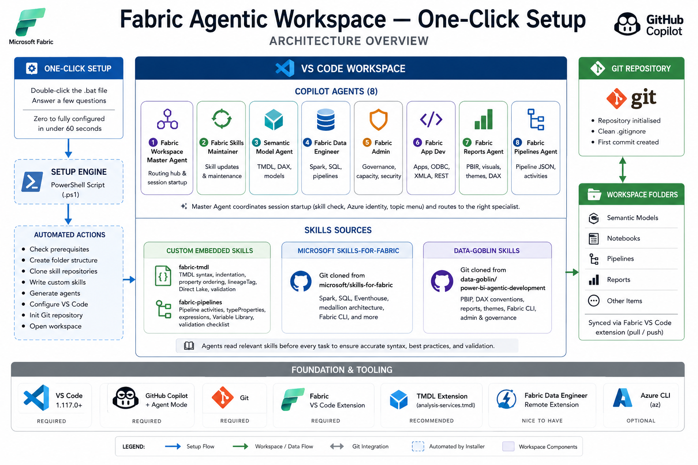
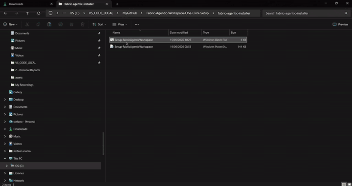
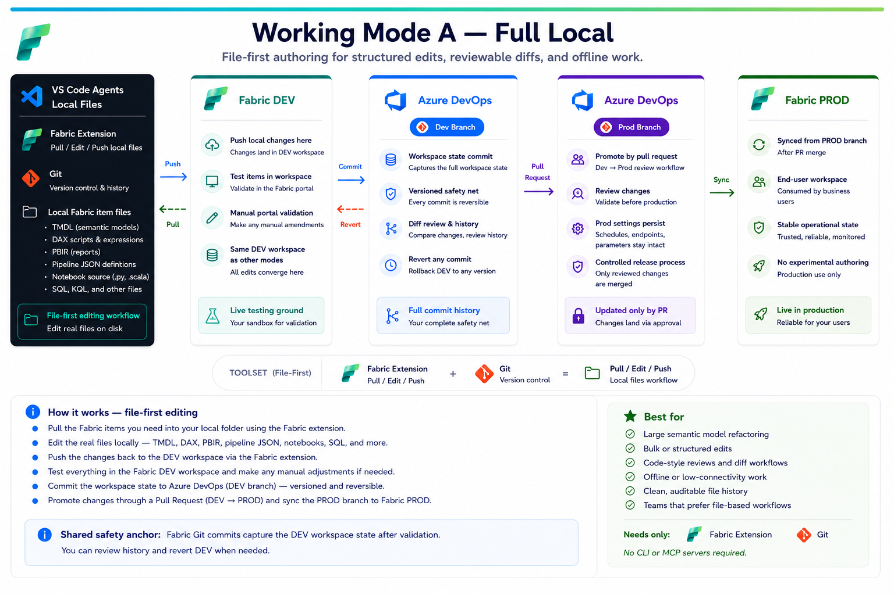
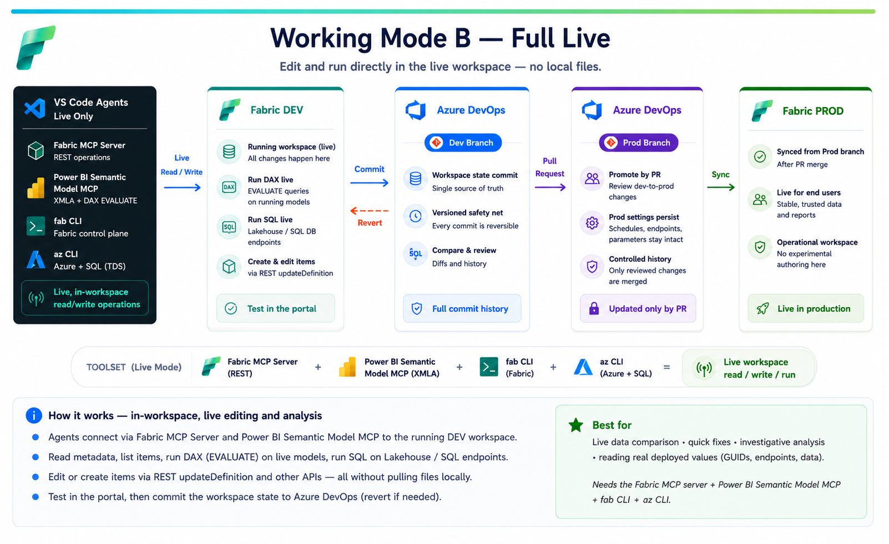
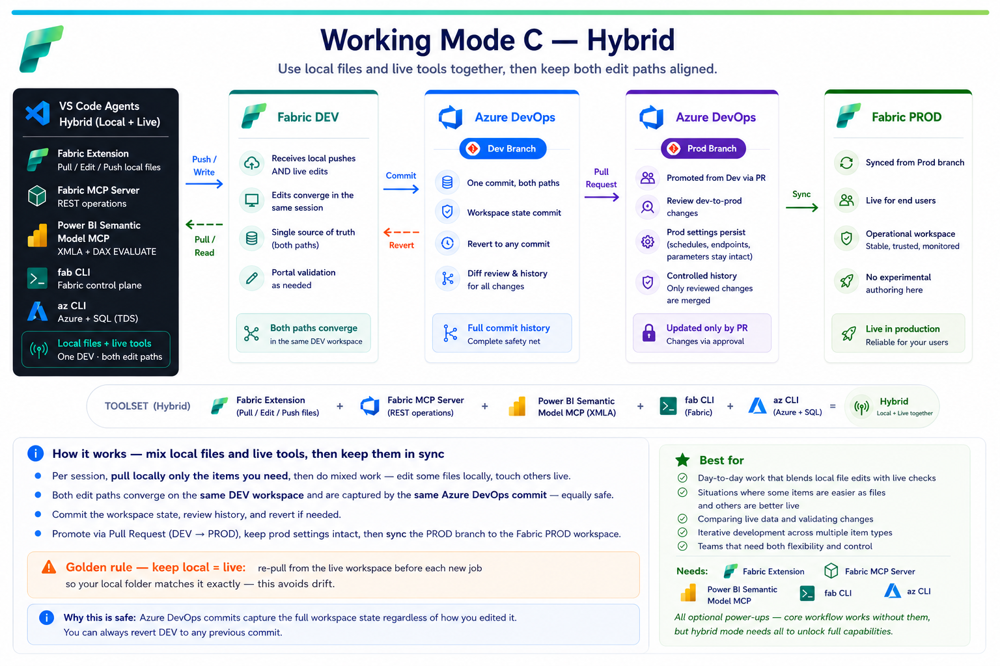
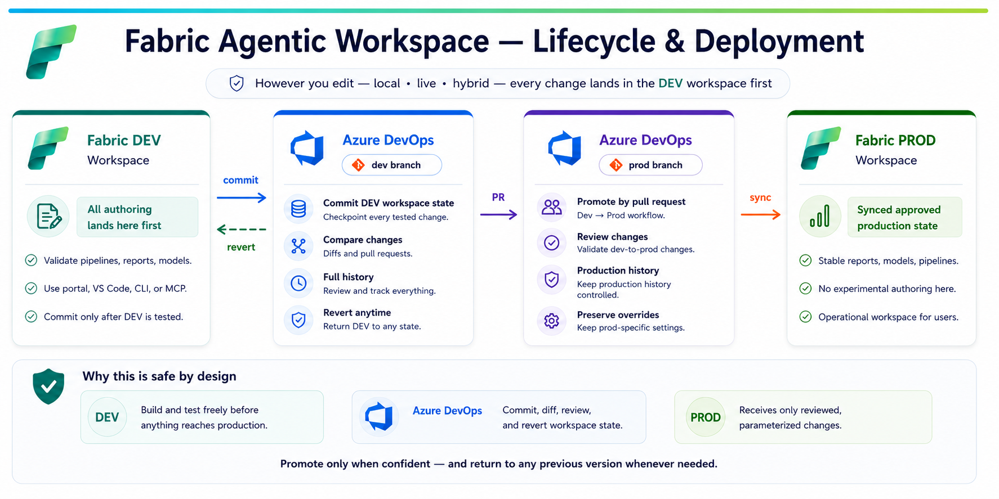

# Fabric Agentic Workspace — One-Click Setup

[](https://github.com/SteCiu01/Fabric-Agentic-Workspace-One-Click-Setup/releases)
[](https://github.com/SteCiu01/Fabric-Agentic-Workspace-One-Click-Setup/actions/workflows/validate.yml)

Pre-release — used regularly by the maintainer in real Fabric work, evolving fast.
Contributions and feedback welcome.

**Bootstrap a Fabric-ready Copilot agent workspace for VS Code.**

> **The 30-second version**
> - **What** — a one-click installer that scaffolds an opinionated Microsoft Fabric development workspace in VS Code.
> - **Who it's for** — anyone working in Fabric (semantic models, data engineering, reports, pipelines, admin, app dev, DevOps) who wants Copilot agents that already know the right tools and house conventions.
> - **How to run** — double-click `Setup-FabricAgenticWorkspace.bat`, answer a few prompts, and let it scaffold.
> - **What you get** — a numbered 47-agent organisation (10 clear dropdown entries + 37 delegated workers), three embedded Fabric skills, two curated open-source skill sources, optional CLI/MCP tooling, optional GitHub/Azure DevOps repository onboarding, and governed DEV→PROD guidance.

> Windows installer (PowerShell + `.bat`); the workspace itself is OS-agnostic once created.

<p align="center">
  
</p>

---

## Contents

**Part 1 — Install it** *(what you actually do)*
- [1.1 Before you start — checklist](#11-before-you-start--checklist)
- [1.2 What the installer puts on your machine](#12-what-the-installer-puts-on-your-machine)
- [1.3 Get the two files](#13-get-the-two-files)
- [1.4 The installer, step by step (9 steps)](#14-the-installer-step-by-step-9-steps)
  - [Step 1 — Workspace Folder](#step-1-of-9--workspace-folder)
  - [Step 2 — Checking Prerequisites](#step-2-of-9--checking-prerequisites)
  - [Step 3 — Creating Folder Structure](#step-3-of-9--creating-folder-structure)
  - [Step 4 — Business Source-Control Repositories](#step-4-of-9--business-source-control-repositories)
  - [Step 5 — Cloning Skill Repositories](#step-5-of-9--cloning-skill-repositories)
  - [Step 6 — Writing Custom Skills](#step-6-of-9--writing-custom-skills)
  - [Step 7 — Writing Agent Definitions](#step-7-of-9--writing-agent-definitions)
  - [Step 8 — Writing Configuration Files](#step-8-of-9--writing-configuration-files)
  - [Step 9 — Finishing Up](#step-9-of-9--finishing-up)
- [1.5 Your first session](#15-your-first-session)
- [1.6 Updating (re-run the same installer)](#16-updating-re-run-the-same-installer)
- [1.7 Troubleshooting](#17-troubleshooting)

**Part 2 — Use it** *(how you work day to day)*
- [2.1 How a request flows through the team](#21-how-a-request-flows-through-the-team)
- [2.2 Three ways of working](#22-three-ways-of-working)
- [2.3 The Fabric development lifecycle](#23-the-fabric-development-lifecycle)
- [2.4 Optional CLIs and MCP servers — what each unlocks](#24-optional-clis-and-mcp-servers--what-each-unlocks)
- [2.5 Workspace structure](#25-workspace-structure)
- [2.6 FAQ](#26-faq)

**Part 3 — Understand it** *(background and reference)*
- [3.1 Why this exists](#31-why-this-exists)
- [3.2 What this is / is not](#32-what-this-is--is-not)
- [3.3 Copilot Chat vs CLI/plugin workflows](#33-copilot-chat-vs-cliplugin-workflows)
- [3.4 The agent organisation](#34-the-agent-organisation)
- [3.5 Agent → tools → skills matrix](#35-agent--tools--skills-matrix)
- [3.6 Agentic design principles](#36-agentic-design-principles)
- [3.7 Skills — where they come from](#37-skills--where-they-come-from)
- [3.8 How it works under the hood](#38-how-it-works-under-the-hood)
- [3.9 A bit of history](#39-a-bit-of-history-how-fabricpower-bi-work-used-to-flow)
- [3.10 Quality & validation](#310-quality--validation)
- [3.11 Current status (v0.7.1)](#311-current-status-v071)
- [3.12 Disclaimer](#312-disclaimer)
- [Contributing](#contributing) · [Files in this repository](#files-in-this-repository) · [License](#license) · [Third-party notices](#third-party-notices)

---

# Part 1 — Install it

## 1.1 Before you start — checklist

The installer **stops** if a required item is missing. It **installs** the auto items for you where it can, and only **asks** before installing the optional ones.

| | Item | Who installs it | Notes |
|---|---|---|---|
| ✅ Required | **VS Code 1.117.0+** | You — [code.visualstudio.com](https://code.visualstudio.com) | Older versions have known bugs that break Copilot agent tools. |
| ✅ Required | **Git** | You — [git-scm.com](https://git-scm.com) | Also used to clone the skill repositories (no npm/admin needed). |
| ✅ Required | **GitHub Copilot + Agent Mode** | You — VS Code marketplace | `chat.agent.enabled`; org tenants may need admin to enable it. Not checked by the installer. |
| ✅ Required | **[Microsoft Fabric extension](https://marketplace.visualstudio.com/items?itemName=fabric.vscode-fabric)** | You — `code --install-extension fabric.vscode-fabric` | Pull/push of Fabric items. Installer warns if missing, continues. |
| 👍 Recommended | **[TMDL extension](https://marketplace.visualstudio.com/items?itemName=analysis-services.tmdl)** | You — `code --install-extension analysis-services.tmdl` | Syntax highlighting/validation for `.tmdl`. Installer reminds you. |
| 💡 Nice to have | **[Fabric Data Engineer Remote](https://marketplace.visualstudio.com/items?itemName=synapsevscode.vscode-synapse-remote)** | You | Run notebook cells against remote Spark. Installer mentions it as a tip. |
| 🤖 Auto | **Python 3.10–3.13** | Installer (only if no Python 3 found) | winget `Python.Python.3.12 --scope user`, then python.org 3.12.10 per-user. Skipped if you have Anaconda etc. |
| 🤖 Auto | **Fabric CLI `fab`** | Installer | `pip install ms-fabric-cli` (with `--user` retry). Primary CLI for live work. |
| 🤖 Auto | **Azure CLI `az`** | Installer | winget `Microsoft.AzureCLI`, else isolated `%USERPROFILE%\.fabric-az`. Fallback CLI. ⚠️ Slowest install when missing. |
| 🤖 Auto | **Fabric MCP server** `fabric.vscode-fabric-mcp-server` | Installer | VS Code extension; live/hybrid mode. |
| 🤖 Auto | **Power BI semantic-model MCP** `analysis-services.powerbi-modeling-mcp` | Installer | VS Code extension; live DAX/model edits. |
| ❓ Asks Y/N | `pbir`, Tabular Editor CLI, `pbi-tools`, `sqlcmd`, `gh`, `az devops` | Installer, only on **Yes** | See [2.4](#24-optional-clis-and-mcp-servers--what-each-unlocks). Declined = remembered, agents fall back. |

> **Full-local mode needs none of the 🤖 / ❓ items.** They power the live and hybrid ways of working ([2.2](#22-three-ways-of-working)). If a corporate policy blocks one, the installer prints a warning and continues.

## 1.2 What the installer puts on your machine

> [!WARNING]
> It is **not** just a folder creator. Read once, then run it with confidence.

**In your chosen workspace folder**
- One sub-folder per Fabric workspace you choose to scaffold.
- Installer-managed files: 47 agent definitions, 3 custom skills, `copilot-instructions.md`, `AGENTS.md`, `.vscode/` settings & tasks, `.github/agent-docs/` (status script, flow docs, `tool-status.json`). A `.gitignore` is written only if none exists; an existing one gets only the required exclusions appended.
- Two public clones (gitignored): [`microsoft/skills-for-fabric`](https://github.com/microsoft/skills-for-fabric) and [`data-goblin/power-bi-agentic-development`](https://github.com/data-goblin/power-bi-agentic-development). Already present → force-refreshed to upstream.
- If you opt in: your business repositories under `source-control-repositories/` (independent Git repos, gitignored by the outer repo).
- Git: a new repo gets an initial commit; an existing repo gets a commit limited to installer-owned paths.

**On your system** — exactly the 🤖 and ❓ rows of the checklist above, nothing else. The installer never installs Git, VS Code or the authoring extensions.

**Outside the folder** — a session `.code-workspace` in `%TEMP%` (one per workspace folder) used to open VS Code, and — only if you say yes in Step 8 — one setting block added to your *own* saved `.code-workspace` files that open this folder.

**Never touched** — your Fabric item folders, personal files, unrelated Git work, business-repository contents, live Fabric workspaces.

## 1.3 Get the two files

Keep them together in one folder (as in [fabric-agentic-installer](https://github.com/SteCiu01/Fabric-Agentic-Workspace-One-Click-Setup/tree/main/fabric-agentic-installer)):

```
Setup-FabricAgenticWorkspace.bat    ← double-click this
Setup-FabricAgenticWorkspace.ps1    ← the engine (called by the .bat)
```

The `.bat` runs the `.ps1` with a process-scoped `-ExecutionPolicy Bypass`, so the usual local script-policy block does not apply. Application allowlisting can still stop it.

## 1.4 The installer, step by step (9 steps)

Each step prints a banner `STEP n of 9 - <title>` and ends with `Press Enter to continue...`. Below: what you see, what to answer, what happens.

<p align="center">
  
</p>

### Step 1 of 9 — Workspace Folder

| Prompt | Answer | Notes |
|---|---|---|
| `Do you already have a local folder where you work with Fabric? [1] Yes [2] No — Enter 1 or 2:` | `1` or `2` (`y`/`n` also accepted) | Anything else re-asks. |
| *(1)* `Enter the full path to your existing Fabric folder` | full path, e.g. `C:\Users\me\Fabric_Workspaces` | Must be a rooted path. Doesn't exist → `Create it? (y/n)`. |
| *(2)* `Enter a name (default: Fabric Workspaces)` | a folder name, or a full path | A name is created under your user profile; a full path is used as-is. |
| — | — | ⛔ The installer's own folder is refused (it would overwrite itself). |
| *Information screen:* **HOW THIS WORKSPACE WORKS — ONE LIFECYCLE, THREE WAYS** | read | Same content as [2.2](#22-three-ways-of-working) / [2.3](#23-the-fabric-development-lifecycle). |
| `Number of workspaces (default: 1)` | how many Fabric workspaces you'll sync here | `0` is fine. |
| `Name for Workspace n` | e.g. `Sales DEV` | One sub-folder each; the Fabric extension pulls items into them. |
| `Set up business source control now? (y/N)` | `n` unless you want Git repos cloned | Optional — see [Step 4](#step-4-of-9--business-source-control-repositories). |
| *(y)* `How many repositories do you want to clone?` then `Clone URL (no PAT or password)` per repo | plain HTTPS/SSH clone URL from GitHub or Azure DevOps | Provider and folder name are derived from the URL. URLs with credentials are rejected. |

### Step 2 of 9 — Checking Prerequisites

Runs mostly on its own. Order of events:

1. **Checks** Git, VS Code ≥ 1.117.0, Fabric extension, TMDL extension. Git/VS Code missing → stops. Extensions missing → warning, continues.
2. **Auto-installs if missing** (best-effort): Python → `fab` → `az` → the two MCP extensions.
3. **Optional specialist CLIs** — for each missing tool it prints provider + purpose and asks:
   `Install <tool> now? (Y/N)` for `pbir`, Tabular Editor CLI, `pbi-tools`, `sqlcmd`, `gh`, and `Install the azure-devops az extension now? (Y/N)`.
   **No** is remembered: it stays quiet on later runs. A tool you install yourself later is still detected.
4. `Check installed tools for updates now? (y/N)` — default **No**. **Yes** shows Current / Update / Unverified per installed tool and asks per-tool before updating.
5. Prints `All prerequisites OK.` (or the missing list and exits).

Result: a tool inventory in memory, written to `.github/agent-docs/tool-status.json` in Step 8.

> ⚠️ Locked-down PC and something failed here? It's not blocking — finish the install, then see [1.7](#17-troubleshooting).

### Step 3 of 9 — Creating Folder Structure

No prompts. Creates the workspace folder, the Fabric workspace sub-folders from Step 1, `.github/agents`, `.github/skills`, `.github/agent-docs`, `.vscode`, and `source-control-repositories/` if you opted in.

### Step 4 of 9 — Business Source-Control Repositories

| Situation | What happens | Prompt |
|---|---|---|
| You declined in Step 1 | `Skipped. Existing business repositories and mappings were not changed.` | — |
| New repository | Validated, cloned into `source-control-repositories/<Repo>/`, **live branches mirrored locally** (one working tree per branch, `main`/`master` excluded), recorded in the gitignored `local/repository-map.local.json`. | — |
| Repository already cloned | Fetches remote refs only. | `You already have this repository locally. Pull existing branches so they match online? (y/N)` — **Yes** fast-forwards only branches that are clean *and* strictly behind; dirty or diverged branches are never touched. |

Ends with `Workspace ready (opens unsaved -- use File > Save Workspace As to keep it).` — the multi-root `.code-workspace` for the session was built (or merged, keeping any roots you added before).

No PAT is ever asked or stored; Git uses your credential manager / SSH. Nothing is connected to or changed on a live Fabric workspace.

### Step 5 of 9 — Cloning Skill Repositories

No prompts. Clones `skills-for-fabric` and `power-bi-agentic-development`; if they exist, **force-refreshes them to upstream** (local edits are auto-stashed first and the stash name printed — but treat these folders as read-only). Success is only claimed when `HEAD` equals the upstream commit; a failed refresh leaves the clone untouched and warns.

### Step 6 of 9 — Writing Custom Skills

No prompts. Writes the three maintainer-authored skills: `fabric-tmdl`, `fabric-pipelines`, `fabric-cli-policy` under `.github/skills/`.

### Step 7 of 9 — Writing Agent Definitions

No prompts. Generates the 47 `.agent.md` files (10 visible + 37 workers), resolving each agent's pinned skill paths against the clones just refreshed (renamed folders matched by prefix, new upstream skills auto-attached by keyword). Then self-tests the generated set against the embedded manifest.

### Step 8 of 9 — Writing Configuration Files

Writes/merges `copilot-instructions.md`, `AGENTS.md`, `.gitignore` rules, `.vscode/settings.json` (merge — your keys survive, JSONC comments become values), `tool-status.json`, `guardrail-status.json`, `installed-manifest.json`, and purges files the installer shipped before but no longer ships.

**One possible prompt** — only if you keep your *own* saved `.code-workspace` files that open this folder:

```
  Saved VS Code workspace file(s) that open this folder are out of date
  (opened from one, VS Code ignores .vscode/settings.json):
    C:\...\My Project.code-workspace
      nested-dispatch setting missing (Team Leads cannot dispatch workers); 12 skill location(s) missing
  Update their settings block (adds only what is missing)? (Y/n):
```

Answer **Y** (default). It adds only `chat.subagents.allowInvocationsFromSubagents: true` and the missing `chat.agentSkillsLocations` entries; everything else in your file stays. A re-run afterwards lists nothing until the vendor skill folders change again. Answer **n** → open the folder with *File > Open Folder* instead, or add the setting by hand ([1.7](#17-troubleshooting)).

### Step 9 of 9 — Finishing Up

1. `git init` if needed; initial commit, or an update commit limited to installer-owned paths (skipped with a warning if `git user.name/email` is not set).
2. `Setup complete! v0.7.1` and the workspace path.
3. `Press Enter to open VS Code...` → opens the multi-root workspace.

> Re-ran with VS Code already open? Run **Developer: Reload Window** so the agent dropdown rebuilds.
> Prefer opening from your **own saved `.code-workspace`**? Read the caveat in [1.5](#15-your-first-session) first.

## 1.5 Your first session

1. VS Code opens the workspace (unsaved multi-root — *File > Save Workspace As* if you want to keep it).
2. Open **Copilot Chat** (`Ctrl+Shift+I`).
3. Select **000 - Fabric Workspace Master** from the agent dropdown.
4. Say what you need (or just "hi").

> [!IMPORTANT]
> **How you open the folder matters.** Two settings the agents depend on are *window-scoped* in VS Code:
> `chat.subagents.allowInvocationsFromSubagents` (lets Team Leads dispatch their workers) and
> `chat.agentSkillsLocations` (registers the Microsoft and data-goblin skill folders).
> When a window is opened **from a `.code-workspace` file**, VS Code ignores the folder's `.vscode/settings.json` for them.
>
> | You open the folder via… | Settings in effect | Result |
> |---|---|---|
> | The workspace the installer just opened (or saved it with *Save Workspace As*) | ✅ both present | Full Master → Lead → Worker dispatch; all skills listed |
> | **File > Open Folder** | ✅ `.vscode/settings.json` applies | Same |
> | **Your own** `.code-workspace` saved earlier (e.g. a session file with several roots) | ❌ unless the file contains them | Leads silently return nothing; vendor skills not listed natively |
>
> The installer handles the third case for you: Step 8 lists any saved file that opens this folder and lacks either setting and offers (`Y/n`) to add only what is missing. The Master's status block also names such a file if it is still missing the dispatch setting. Manual fix in [1.7](#17-troubleshooting).

On your first message the Master runs **one** status script and shows **one** block:

| Line | Meaning |
|---|---|
| Skill freshness | Upstream commit dates of the two clones; install date of the custom skills. Maintenance is hinted only when > 30 days old. |
| Skill locations / nested dispatch | What VS Code registers, whether Lead → Worker dispatch is enabled, and a **warning naming any saved `.code-workspace` that opens this folder without the setting**. |
| Identity | `fab auth status` → `az account show`; informational, never blocking. |
| Tools | Live re-check; refreshes `tool-status.json` if something was installed/removed since setup. |
| MCP servers | *installed* vs *connected* — installed is never presented as callable. |

Then it routes your request to the owning Team Lead(s). You never switch agent for normal work; the only optional switch is the **Run capability maintenance** handoff.

For a live semantic model, the Master opens the Power BI modeling MCP connection itself in the main chat (where a sign-in prompt can be answered) and hands the connection down; if it cannot connect, the team gets the REST fallback up front.

## 1.6 Updating (re-run the same installer)

1. [Download the latest two files](https://github.com/SteCiu01/Fabric-Agentic-Workspace-One-Click-Setup/tree/main/fabric-agentic-installer).
2. Double-click the `.bat`, point to the **same folder** → **update mode**.
3. Same 9 steps; declined tools stay quiet; the version check in Step 2 is still offered.
4. Reopen / **Developer: Reload Window**.

**The five update rules** (the installer is the source of truth for what it ships):

| # | Rule | Means for you |
|---|---|---|
| 1 | Vendor skill clones are force-refreshed to upstream | **Don't edit** `skills-for-fabric/` or `power-bi-agentic-development/`; edits are stashed, not kept. |
| 2 | Installer-managed files are overwritten | **Don't hand-edit** `.github/agents/*`, `.github/skills/*`, `copilot-instructions.md`, `AGENTS.md`, `.vscode/*`. Change the installer instead. |
| 3 | Obsolete installer files are purged | Strict `old − new` diff over `installed-manifest.json`, never a folder sweep. |
| 4 | Your own files are never touched | Anything the installer never shipped is outside every manifest. |
| 5 | Fabric content and business clones are left alone | Business clones update only via the opt-in `(y/N)` pull, and only clean, strictly-behind branches. |

**Rule of thumb:** to survive updates, a change lives outside the managed files — or in the installer itself.

## 1.7 Troubleshooting

**Team Leads return nothing / the Master says workers can't be dispatched.**
You opened VS Code from your own saved `.code-workspace` that lacks the setting. `chat.subagents.allowInvocationsFromSubagents` is *window-scoped*: in a window opened from a workspace file, VS Code ignores the folder's `.vscode/settings.json`. Fix: add `"chat.subagents.allowInvocationsFromSubagents": true` inside that file's `"settings"` block (or re-run the installer and answer **Y** in Step 8), then **Developer: Reload Window**. The Master's status block names the exact file.

**Vendor skills not in the native skill list in my saved workspace.**
Same cause — `chat.agentSkillsLocations` is window-scoped too. Re-run the installer and accept the Step 8 prompt. Agents still find the skills by path in the meantime.

**Agent dropdown is stale after an update.** **Developer: Reload Window**.

**A tool failed to install on a corporate / locked-down PC.**
TLS inspection, endpoint security, winget policy, PATH delays or missing elevation can interrupt an otherwise valid install. Not blocking for full-local work.
1. Re-run setup once after any pending installer finishes (every run refreshes PATH and re-detects).
2. Still missing → in VS Code select **070 - Capability Maintenance Team Lead**, name the tool and the console message. It re-checks installation, publisher version, PATH and policy, and may install/update **only after your explicit approval** (user-scope or portable), then refreshes `tool-status.json`.
3. Git, VS Code, Fabric and TMDL extensions remain yours/IT's to install.

**Tabular Editor 2 or `pbi-tools` download is empty (0 bytes).** Known on TLS-inspection proxies: both ship only as GitHub-release ZIPs. The installer detects it and prints the exact portable link — download it yourself, drop the ZIP in Downloads, re-run setup to auto-pick it up. `az` had the same class of problem and is handled automatically.

**`az` is slow to install.** Expected when it has to be installed from scratch; let it finish.

**I want to check the installed workspace wasn't tampered with.** `Setup-FabricAgenticWorkspace.ps1 -VerifyRoot <folder>` re-hashes the managed files against `installed-manifest.json`.

---

# Part 2 — Use it

## 2.1 How a request flows through the team

Every request is delivered *through* the organisation; the Master never edits an artifact itself.

| Loop | When | Path |
|---|---|---|
| **Simple** | one team, one artifact | Master → Team Lead → worker → Lead validates → Master → you |
| **Designed** | cross-domain or a design change | Master → **001 Architect** (PLAN) → Team Lead(s) in plan order → **002 QA** (VERDICT) → Master → you |
| **Blocked** | approval / input / design question mid-work | worker → Lead relays → Master asks **you** → re-dispatch with the answer |

Every hop uses the same **WORK ORDER** (goal, artifact, mode, constraints, expected validation, approvals granted, context) and **WORK RESULT** (`DONE | DONE WITH RISKS | NEEDS APPROVAL | NEEDS INPUT | NEEDS ARCHITECT | OUT OF SCOPE | FAILED`, changed, validation, risks, request) contract, defined in `.github/agent-docs/working-flow-reference.md`. Only the agent *you* selected can talk to you; everyone else bubbles questions up.

**Destructive work needs a token.** Deleting or dropping anything — a measure, a table, a file, a role, a branch, a live item — is destructive even if you asked for it in plain words. The Master states exactly what will be destroyed and asks you to reply with `APPROVED:<ACTION>:<artifact>`; workers without that token stop and return `NEEDS APPROVAL`, and only execute what the token names.

## 2.2 Three ways of working

All three share the same promotion path ([2.3](#23-the-fabric-development-lifecycle)). Live and hybrid still need review, portal testing and drift discipline.

**A — Full local (file-first, the default).** Needs only the Fabric extension + Git.
1. **Pull** items from DEV into the local folder with the Fabric extension.
2. **Edit locally** with the agents or by hand (TMDL, DAX, pipeline JSON, notebooks).
3. **Push** back to DEV via the extension.
4. **Test in the portal**, then commit via Git Integration.

<p align="center"></p>

**B — Full live (in-workspace, no local round-trip).** Needs the two MCP servers + `fab`/`az`.
1. Agents connect via **Fabric REST** (`updateDefinition`) and the **MCP servers**.
2. **Run DAX** (`EVALUATE`) on running models — compare DEV vs PROD, check a measure after a change; run **SQL** on Lakehouse/SQL endpoints; read real GUIDs/endpoints.
3. **Edit definitions in place**, **create items**.
4. **Test in the portal**, commit as usual.

<p align="center"></p>

**C — Hybrid (local + live).** Needs both toolsets.
1. **Pull only what you need** locally.
2. Mixed work — files for some items, live for others; both converge on DEV and one commit.
3. **Re-pull (or clean up local) before a new job.**

> **Golden rule — keep local = live workspace.**

<p align="center"></p>

## 2.3 The Fabric development lifecycle

The shared backbone; only the *editing* step differs between the three ways.

<p align="center"></p>

1. **Fabric DEV workspace** — changes land here first; validate in the portal.
2. **Commit to Azure DevOps (development branch)** — *Workspace Settings → Git Integration*. Versions supported item definitions (not item data, unsupported artifacts or every setting).
3. **Pull Request development → production** — with your verified branch mapping; agents never assume literal `DEV`/`PROD` names.
4. **Production-specific configuration** — parameters, schedules, connections, environment rules.
5. **Sync the production branch to the Fabric PROD workspace.**

> `DEV`/`PROD` labels in the diagram are illustrative.

## 2.4 Optional CLIs and MCP servers — what each unlocks

| Tool | Who uses it | What it unlocks | Without it |
|---|---|---|---|
| `fab` | Semantic, Data Eng, Admin, ALM, Apps | Fabric API, jobs, export/import, OneLake & table ops | Portal + `az rest` fallback |
| `az` | Data Eng, Admin, ALM, Apps | SQL/TDS (`sqlcmd -G`), non-Fabric token audiences | Covered by `fab` for most things |
| Fabric MCP | Data Eng, Admin, ALM | Structured live Fabric ops (items, OneLake, definitions) | REST/CLI |
| Power BI modeling MCP | Semantic, Reporting, Apps | Live XMLA: DAX `EVALUATE`, transactional model edits | REST `executeQueries` → local TMDL |
| `pbir` | Reporting | Explore/edit/format/validate/publish PBIR | Direct PBIR JSON edit |
| Tabular Editor CLI | Semantic | BPA, validation, automation (free TE2) | `fabric-tmdl` + `bpa-rules` checklist |
| `pbi-tools` | ALM & DevOps | PBIX/PBIP extract-compile workflows | Native PBIP/PBIR ALM via `fab`/`pbir` |
| `sqlcmd` | Semantic, Data Eng, Apps | T-SQL over Fabric SQL endpoints | REST / notebooks |
| `gh` | ALM & DevOps | GitHub PRs, Actions, releases | `git` + web |
| `az devops` | ALM & DevOps | Azure DevOps PRs, pipelines, boards | `git` + web |

Routing is always by **topic**; a missing tool never changes the owner — the specialist falls back. Deep dive: [CLI-FUNCTIONALITIES.md](CLI-FUNCTIONALITIES.md).

`tool-status.json` stays current through: re-running the installer, asking **070 - Capability Maintenance**, or an agent's single live re-check before falling back.

## 2.5 Workspace structure

```
Fabric Workspaces/
├── .git/
├── .github/
│   ├── agents/
│   │   ├── 000-fabric-workspace-master.agent.md        ← primary orchestrator
│   │   ├── 001-fabric-solution-architect.agent.md
│   │   ├── 002-integration-qa-change-controller.agent.md
│   │   ├── 010-… 070-…-team-lead.agent.md              ← seven Team Leads
│   │   └── <37 delegated worker .agent.md files>
│   ├── agent-docs/
│   │   ├── starting-flow.md                           ← lean session startup
│   │   ├── working-flow-reference.md                  ← team protocol, routing, WORK ORDER/RESULT
│   │   ├── Get-SessionStatus.ps1                      ← status script
│   │   ├── local/repository-map.local.json            ← business-repo map (gitignored)
│   │   └── tool-status.json                           ← tool inventory (gitignored)
│   ├── copilot-instructions.md
│   └── skills/
│       ├── fabric-tmdl/SKILL.md
│       ├── fabric-pipelines/SKILL.md
│       └── fabric-cli-policy/SKILL.md
├── .gitignore
├── .vscode/  (settings.json, tasks.json)
├── AGENTS.md
├── source-control-repositories/                       ← business clones (gitignored)
├── skills-for-fabric/                                 ← Microsoft skills (gitignored)
├── power-bi-agentic-development/                      ← data-goblin skills (gitignored)
└── <Your Workspace Folders>/                          ← Fabric items synced here
```

## 2.6 FAQ

**Can I move the workspace folder after creation?** Yes, it's portable. Open the new location in VS Code (re-run the installer there once so the session workspace file and saved-workspace check point at the new path).

**Does this work on macOS or Linux?** The installer is Windows-only; the workspace (agents, skills) works on any OS once the files exist.

**Why git clone instead of npm install?** Git is already a prerequisite; npm global installs usually need admin/IT approval on corporate machines.

**Can I add my own agents?** Yes — a new `.agent.md` in `.github/agents/` appears in the dropdown and is never overwritten or purged (it's not in the installer's manifest).

**How do I update skills and tools?** Re-run the installer, or select **070 - Capability Maintenance Team Lead**.

**Does setup connect my repository to Fabric?** No. Onboarding is local only: validate URL, clone with your existing auth, mirror branches, open as an independent repo. No PAT, no push, no Fabric Git configuration.

**Can multiple people share the workspace via git?** Yes. Push it; each member clones, re-runs the installer locally (for tool inventory + clones), selects the Master. Clones, business repos, the repository map, the workspace file and machine-specific settings are gitignored.

**What do I need for live / hybrid mode?** The two MCP extensions + `fab`/`az` — all auto-installed where possible. Full-local needs none.

**How does the workspace know which tools I have?** `.github/agent-docs/tool-status.json`, gitignored and machine-specific; agents read `<tool>.found` before invoking anything.

---

# Part 3 — Understand it

## 3.1 Why this exists

This is a personal project — and like most personal projects, it started from a real need.

I was doing a lot of work across **Microsoft Fabric**: building semantic models, doing ETL with Spark notebooks, designing data pipelines, and managing workspaces — all while adapting my workflow to the dynamic and always evolving agentic development.

The **[Microsoft Fabric](https://marketplace.visualstudio.com/items?itemName=fabric.vscode-fabric)** and **[Fabric Data Engineering - Remote](https://marketplace.visualstudio.com/items?itemName=SynapseVSCode.vscode-synapse-remote)** VS Code extensions are great for syncing items locally and running notebooks against remote Spark. But the AI-assisted development experience felt like it could be improved: GitHub Copilot didn't know about my TMDL and DAX best practices — particularly my own conventions around table naming, measure structures, and folder organization. Furthermore data pipeline JSON authoring wasn't really covered anywhere I looked.

So I built a multi-agent workspace that brings everything together. A **master agent** coordinates session startup and routes into **specialist teams** — each focused on a specific Fabric workload. They all read from what I consider the best skill repositories from the community — Microsoft's [skills-for-fabric](https://github.com/microsoft/skills-for-fabric) and data-goblin's [power-bi-agentic-development](https://github.com/data-goblin/power-bi-agentic-development) — plus **custom embedded skills** for TMDL and data pipeline authoring that I wrote from scratch and keep updating, based on my job and the problems I face there.

As I went deeper I realised the **agent → tools → skills** chain matters as much as the agents themselves. So each agent now owns a **minimum, deterministic set of tools** — the right CLI for its workload and the MCP servers where they help — instead of a vague "all tools to everyone" pile. Tool availability is discovered once and recorded in a machine-specific `tool-status.json` inventory. An agent then checks what's actually installed, uses it if present, and **falls back cleanly when it isn't** — which is what keeps the whole thing working on locked-down corporate PCs. A custom **`fabric-cli-policy`** skill encodes the decision rule: prefer `fab`, with `az` as a documented fallback. And each agent loads **only the skills its current subtask needs**.

This is a **starting point, not a finished system.** V0.6 evolved the previous nine-agent set into a **Master-led organisation**: two cross-domain reviewers, seven Team Leads, and 37 focused workers, plus a **Capability Maintenance** team. V0.7 fine-tunes how that organisation works together: nested delegation is configured by the installer, every agent carries specialist knowledge drawn from the custom, Microsoft and Kurt skills, the teams share one WORK ORDER / WORK RESULT contract, destructive work is gated behind explicit approval tokens, and the vendor skill refresh is more robust.

Then I thought: *this should be replicable*. So I packaged everything into a one-click installer and a shareable agent configuration.

## 3.2 What this is / is not

**Is:** a VS Code workspace bootstrapper for Fabric developers · a GitHub Copilot Chat / Agent Mode configuration bundle · a local-first Fabric accelerator with optional live tooling · a repeatable package of the maintainer's real-world workflow.

**Is not:** an official Microsoft product · a hosted service · a Copilot CLI or Claude Code plugin distribution · a replacement for Fabric Git integration, deployment review or governance · a guarantee that AI edits are correct without human review.

## 3.3 Copilot Chat vs CLI/plugin workflows

This workspace targets **VS Code GitHub Copilot Chat / Agent Mode**: the installer creates local agents and embedded skills and clones the Microsoft and data-goblin repositories as local references the agents read at runtime. It does **not** redistribute or install the upstream plugin bundles for GitHub Copilot CLI / Claude Code. For those runtimes, install the upstream projects directly — ideally one focused project folder with only the plugins that fit the task:

| Project scope | Consider installing |
|---|---|
| PBIP / source-controlled Power BI project | [pbip](https://github.com/data-goblin/power-bi-agentic-development/tree/main/plugins/pbip) |
| Semantic model / DAX / TMDL-heavy work | [semantic-models](https://github.com/data-goblin/power-bi-agentic-development/tree/main/plugins/semantic-models), optionally [tabular-editor](https://github.com/data-goblin/power-bi-agentic-development/tree/main/plugins/tabular-editor) |
| Power BI Desktop live-model work | [pbi-desktop](https://github.com/data-goblin/power-bi-agentic-development/tree/main/plugins/pbi-desktop) |
| Report / PBIR / visual work | [reports](https://github.com/data-goblin/power-bi-agentic-development/tree/main/plugins/reports), optionally [pbip](https://github.com/data-goblin/power-bi-agentic-development/tree/main/plugins/pbip) |
| Fabric CLI / service operations | [fabric-cli](https://github.com/data-goblin/power-bi-agentic-development/tree/main/plugins/fabric-cli) |
| Fabric admin / governance work | [fabric-admin](https://github.com/data-goblin/power-bi-agentic-development/tree/main/plugins/fabric-admin) |

> **Tool vs runtime.** The **Fabric CLI (`fab`)** is a *tool* the agents call from Copilot Chat. **Copilot CLI** and **Claude Code** are alternative *runtimes*. This project is a lean, curated Chat / Agent Mode workspace — no plugin hooks, manifests or bundled plugin items.

## 3.4 The agent organisation

| Component | Description |
|---|---|
| **000 — Fabric Workspace Master** | Startup, intent classification, working-mode choice, minimum-team routing, one-writer ownership, one consolidated result |
| **001 — Fabric Solution Architect** | Cross-domain architecture, dependencies, sequencing, ownership, validation, rollback planning; normally read-only |
| **002 — Integration QA & Change Controller** | Independent cross-artifact, security, source-control and release-readiness validation |
| **010 — Semantic Model Team Lead** | Model architecture, relationships/storage, TMDL, DAX, semantic security/AI metadata, validation, performance |
| **020 — Reporting Team Lead** | Report planning, PBIR authoring, themes, custom visuals, paginated reports, report QA |
| **030 — Data Engineering Team Lead** | Spark/notebooks, Lakehouse/Delta/MLV, Warehouse, SQL Database, Dataflows, pipelines, RTI, ontology |
| **040 — Fabric Administration & Governance Team Lead** | Workspace/capacity administration, access/governance, monitoring, catalog, operations |
| **050 — ALM & DevOps Team Lead** | GitHub, Azure DevOps, Fabric Git Integration, deployments/releases, Power BI ALM |
| **060 — Applications & Integration Team Lead** | Python/Fabric SDK, REST/authentication/XMLA, SQL/ODBC, data-access integrations |
| **070 — Capability Maintenance Team Lead** | Vendor repo refresh, skill and agent coverage, tool lifecycle, failed-install recovery, installer regression |
| **Custom TMDL / Pipelines / CLI-policy skills** *(original to this repo)* | TMDL syntax & validation; pipeline activity reference; `fab`-first / `az`-fallback decision policy |
| **Microsoft skills-for-fabric** | Spark, SQL, Eventhouse, medallion, and more |
| **Data-goblin skills** by [Kurt Buhler](https://www.linkedin.com/in/kurtbuhler/) | PBIP, DAX, reports, Fabric CLI, Fabric admin |
| **Git version control** · **Business repository onboarding** · **VS Code configuration** | See Part 1 |

Each of the 47 agents is generated from a **knowledge catalog** in the installer: **Knowledge and skills** (owned artifacts, write permission, resolved skill paths + keyword-discovered upstream skills), **Playbook**, **Validation you must run before reporting**, **Tool ladder** (preferred → fallback → last resort, gated by `tool-status.json`), **Avoid** list. Team Leads additionally get a roster and dispatch rules; the Architect returns a PLAN, QA a VERDICT.

## 3.5 Agent → tools → skills matrix

Each agent has a **bounded purpose**, owns a **minimum set of deterministic tools**, and reads **only the skills its current subtask needs**. CLIs are invoked through `execute`, gated on `tool-status.json`. MCP servers *are* Copilot frontmatter tools, so authorised agents list `powerbi-modeling-mcp/*` or `Fabric MCP/*` in their `tools:` allowlist.

| Agent | Tools used (gated) | Skills / docs used (selective) |
|---|---|---|
| **000 Master** | Reads tool status for routing; delegates | Startup docs, working-flow reference, task-relevant skills only |
| **001 Architect** | Read/search; delegates approved plans | Orchestration, working modes, source-control safety |
| **002 QA** | Read/search/execute validation only | Orchestration, working modes, source-control safety |
| **010 Semantic Model** | Tabular Editor 2, Modeling MCP/TOM, TMDL, `fab`, `sqlcmd` | `fabric-tmdl` + selective Microsoft/Kurt semantic skills |
| **020 Reporting** | `pbir`, report JSON, Desktop verification | Selective Kurt PBIR/report/theme/visual skills |
| **030 Data Engineering** | `fab`, `sqlcmd`, Fabric MCP, workload-native tools | `fabric-pipelines` + selective Microsoft engineering skills |
| **040 Administration & Governance** | `fab`, `az`, Fabric MCP/REST | Selective Microsoft admin/governance skills |
| **050 ALM & DevOps** | `git`, `gh`, `az devops`, `fab`, `pbi-tools` | Source-control safety, CLI policy, definition reads |
| **060 Applications & Integration** | `fab`, `az`, REST, Modeling MCP/TOM, `sqlcmd` | CLI policy + selective Microsoft SDK/integration skills |
| **070 Capability Maintenance** | `git`, approved user-scope/portable installers, live detection | Maintenance, tool-policy, source-control safety |

The 37 workers inherit the same gates and loading rules with a narrower artifact each. Tool ownership is complete — every tool in [2.4](#24-optional-clis-and-mcp-servers--what-each-unlocks) has an agent-level owner; installation/update/recovery belongs to Capability Maintenance with explicit approval.

> `tool-status.json` records `found`, `version`, `command`, `path`, `category`, `installMode` and a `reason` when missing — honouring real command names (Tabular Editor is `TabularEditor.exe`/`TabularEditor2.exe`/`TabularEditor3.exe`, not `te`).

## 3.6 Agentic design principles

| Principle | What it means | How the organisation applies it |
|---|---|---|
| **Bounded scope, single responsibility** | One agent owns one workload | Master assigns one writer per artifact |
| **Deterministic tool gating** | Check first, then use or fall back | Every agent reads `tool-status.json` and uses a tool only when `<key>.found` |
| **Graceful degradation** | A missing tool slows you down, never blocks you | Every owned tool has a documented fallback |
| **Minimum-necessary context (anti-soup)** | Load only what the subtask needs | Pinned skills per role; workers get a lean contract and a self-contained WORK ORDER |
| **Topic-based routing** | Specialist chosen by task type, never by what's installed | A missing tool never changes the owner |
| **Lean, deterministic startup** | One status call, then work | `Get-SessionStatus.ps1` once per session |
| **Safety guardrails** | Irreversible actions need a token; no hardcoded secrets | `APPROVED:<ACTION>:<artifact>`; review agents read-only |
| **Skill precedence on conflict** | Explicit tie-break | House style (`fabric-tmdl`) wins on *how we do it here*; upstream wins on *is this valid* |
| **Resilient discovery** | Don't fail because an upstream folder moved | Paths re-resolved every run; renames matched by prefix; missing → keyword discovery |

> **The standout: the team works as a team.** Nested delegation is configured by the installer, every hop speaks the same contract, only the agent you selected talks to you, and destructive work stops until you hand over a literal token. Verified end-to-end — including a live Fabric publish — for v0.7.0.

## 3.7 Skills — where they come from

| Source | Covers | Updated |
|---|---|---|
| **Custom embedded** (`.github/skills/`) | TMDL syntax, pipeline JSON, CLI policy — original to this repo | Re-run installer |
| **Microsoft** (`skills-for-fabric/`) | Spark, SQL Warehouse/Database, Eventhouse/Eventstream/Activator, Dataflows, pipelines, deployment pipelines, Git integration, OneLake governance, medallion, Power BI reports, semantic models, FabricIQ | Mirrored to upstream every run / via Capability Maintenance |
| **Data-goblin** ([Kurt Buhler](https://www.linkedin.com/in/kurtbuhler/), `power-bi-agentic-development/`) | PBIP/TMDL/PBIR, DAX, semantic models, reports, themes, Deneb/custom visuals, paginated, Tabular Editor, Fabric CLI/admin | Mirrored to upstream every run / via Capability Maintenance |

Every skill folder from both clones is registered in `chat.agentSkillsLocations`, so agents see the full catalogue natively and VS Code loads a skill's text on demand. A skill *updated* upstream is used after the next installer run; a *new* skill in a registered folder needs nothing; a *new folder* is registered on the next run (and your saved workspace files are offered the same list in Step 8).

Skills provide exact syntax rules (TMDL tabs-only indentation, property ordering, lineageTag handling), activity references, best practices and file-structure knowledge. Every specialist reads the relevant skill **before** generating code.

**Provenance & licensing.** `skills-for-fabric` is MIT. `power-bi-agentic-development` is **GPL-3.0** and used **only as a locally cloned, gitignored reference** — never copied, AI-rewritten or redistributed here. The custom skills are original maintainer-authored works (`fabric-tmdl` and `fabric-cli-policy` from the maintainer's own practice; `fabric-pipelines` derived from Microsoft sources plus working experience). The agents are resilient to upstream folder renames; a repository renamed/removed at GitHub level breaks the clone step until references are updated.

## 3.8 How it works under the hood

`Setup-FabricAgenticWorkspace.ps1` is fully self-contained: every agent, skill and config is embedded in the script. External content is limited to the two public skill repositories, any business repositories you choose, and the tools it installs. The `.bat` wrapper only supplies `-ExecutionPolicy Bypass` for the process.

**Update mode** refreshes installer-managed files, force-refreshes vendor clones, purges retired managed files via the manifest diff, and commits only declared installer-owned paths ([1.6](#16-updating-re-run-the-same-installer)).

**Dry-run / verification:** `-EmitAgentsTo <dir>` generates agents + config with no prerequisites, cloning, installs or launch (used by the test suite); `-VerifyRoot <folder>` re-hashes an installed workspace against `installed-manifest.json`.

## 3.9 A bit of history: how Fabric/Power BI work used to flow

Before the Fabric VS Code extension and AI agents there were two places to build, neither friendly to source control: **in the portal** (versioning = saving copies and hoping) or **in Power BI Desktop, then publish** (`.pbix` binary blobs — hard to diff, review or keep in Git). Two changes opened things up: **Fabric Git integration** exposed item definitions as readable files (TMDL, JSON, notebook source), and the **Fabric VS Code extension** let you pull/push those files locally. This workspace adds the final layer: **AI agents** that natively understand those formats and can edit either the local files or the running workspace — which is what makes the three ways of working possible.

## 3.10 Quality & validation

- **JSON Schema** (`schema/agent-manifest.schema.json`, draft-07) — shape of every agent entry; validated in CI.
- **Pester suite** (`tests/`) — manifest integrity (47 agents, 3/7/37 tiers, unique ids), hierarchy (single root, no cycles), least-privilege tools, version/doc consistency, generated-file **content** (Knowledge/Playbook/Return-contract, approval-token rule, resolved skill refs, granted tools), emitted settings, vendor refresh failure paths, update-mode safety (JSONC, workspace merge, purge containment, saved-workspace detection/patch idempotency), the status script run offline, and the real installer driven through the Step 1 prompts.
- **Real generator smoke test** (`tests/Generated.Tests.ps1`) — `-EmitAgentsTo` dry-run asserting on actual generated files.
- **CI** (`.github/workflows/validate.yml`) — PowerShell 7 on every push/PR; badge above.
- **Install-time self-test + integrity manifest** — `guardrail-status.json` and SHA-256 `installed-manifest.json`.

Run locally: double-click `tests/Run-Tests.bat`, or
```powershell
powershell -NoProfile -ExecutionPolicy Bypass -Command "Import-Module Pester; Invoke-Pester -Path '.\tests' -Output Detailed"
```

Not covered: a full end-to-end install against live Fabric/VS Code, and the *behavioural* quality of prompts — validated by real-world use (v0.7.0: single-team TMDL edit, multi-team Architect → Leads → QA with a live publish and regression DAX, and a destructive-action approval bubble).

## 3.11 Current status (v0.7.1)

| Area | Status |
|---|---|
| One-click setup | **Validated manually** on Windows 10/11 incl. a locked-down corporate laptop |
| Session startup | **Lean since v0.7.0** — one status call incl. the saved-`.code-workspace` check, then work |
| Hierarchical routing | **Fine-tuned v0.7.0, hardened v0.7.1** — nested delegation configured by the installer; parallel dispatch only for independent artifacts with at most one terminal user; dropped write dispatches resumed inspect-first |
| Agent → tools → skills model | **Implemented** — Knowledge, Playbook, mandatory validation, tool ladder, Avoid list per agent |
| Team protocol | **Implemented v0.7.0** — WORK ORDER / WORK RESULT, three loops, `APPROVED:` tokens, session ledger |
| Tool inventory | **Implemented** — real paths/versions; refreshed every session; Capability Maintenance owns install/update |
| Repository onboarding | **Implemented v0.6.0** — clone-URL only, live-branch mirroring, safe re-runs, preserved multi-root workspace |
| Opt-in specialist CLIs | **Implemented** — detect → explain → Y/N → best-effort; declines remembered |
| Manifest schema + CI tests | **Implemented v0.6.1, widened v0.7.0/v0.7.1** |
| Custom skills (TMDL, Pipelines, CLI policy) | **Used in real work** |
| Three ways of working | **Documented and verified** — live mode exercised in v0.7.0 |
| Vendor skill integration | **Refresh hardened v0.7.0/v0.7.1** — verified repo root + expected `origin`, explicit success/failure |
| Idempotent re-run | **Hardened v0.7.1** — merged session workspace and JSONC settings, user-saved workspace files detected and patched merge-only, commits limited to owned paths incl. staged deletions |
| Authoritative install + self-pruning | **v0.6.2, hardened v0.7.1** — strict manifest diff, canonical path containment |
| Portable download/rollback safety | **v0.6.0, hardened v0.7.1** — staged extraction, checksums, rollback, cleanup after activation, winget exit-0 only |

Pre-release: genuinely useful today, expect rough edges. [Open an issue](https://github.com/SteCiu01/Fabric-Agentic-Workspace-One-Click-Setup/issues).

## 3.12 Disclaimer

This is a **personal and community project**, not an official Microsoft product and not affiliated with Microsoft; no guarantees of any kind.

**AI involvement:** built with significant help from **GitHub Copilot** — installer scripts, agent files, skills, documentation and much of the heavy lifting. The core ideas, design decisions and testing are the maintainer's.

**Early stage — use with care:** pre-release. **Do not use in production without understanding what the scripts do.** Review the code before running it.

**Third-party dependencies:** the two cloned repositories are independent open-source projects; this project has no control over their content or availability. See [3.7](#37-skills--where-they-come-from) for licensing.

Used regularly by the maintainer in real Fabric work — local, live and hybrid — on a locked-down corporate Windows machine. Structure is covered by the automated suite; agent *behaviour* is prompt-driven and keeps being tuned from real use.

---

## Contributing

Feedback, ideas and improvements welcome — from typo fixes to new agent workflows to cross-platform support. See **[CONTRIBUTING.md](CONTRIBUTING.md)**.
[Report a bug](https://github.com/SteCiu01/Fabric-Agentic-Workspace-One-Click-Setup/issues/new?template=bug_report.yml) · [Request a feature](https://github.com/SteCiu01/Fabric-Agentic-Workspace-One-Click-Setup/issues/new?template=feature_request.yml) · [Open issues](https://github.com/SteCiu01/Fabric-Agentic-Workspace-One-Click-Setup/issues)

## Files in this repository

| File | Purpose |
|---|---|
| `fabric-agentic-installer/Setup-FabricAgenticWorkspace.bat` | Double-click entry point — share this with your team |
| `fabric-agentic-installer/Setup-FabricAgenticWorkspace.ps1` | The full installer — same folder as the .bat |
| `CHANGELOG.md` | Version history |
| `CLI-FUNCTIONALITIES.md` | Per-CLI deep dive |
| `CONTRIBUTING.md` · `CODE_OF_CONDUCT.md` · `SECURITY.md` | Community and security |
| `schema/` · `tests/` | Manifest schema and Pester suite |
| `LICENSE` | MIT |

## License

MIT — see [LICENSE](https://github.com/SteCiu01/Fabric-Agentic-Workspace-One-Click-Setup/blob/main/LICENSE).

## Third-party notices

Third-party skill repositories remain the property of their authors and are licensed separately. See [THIRD_PARTY_NOTICES.md](THIRD_PARTY_NOTICES.md).
