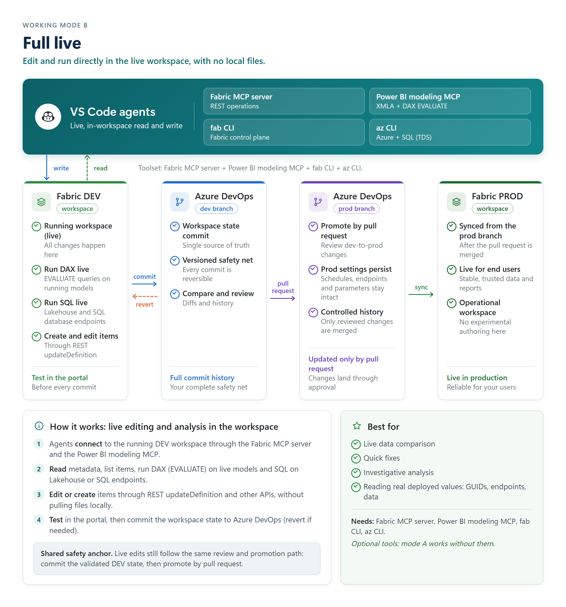
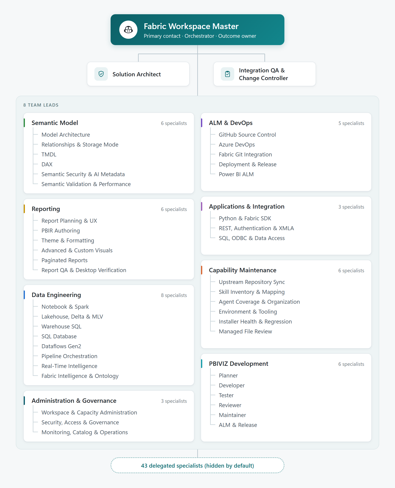

# Fabric Agentic Workspace — One-Click Setup

[](https://github.com/SteCiu01/Fabric-Agentic-Workspace-One-Click-Setup/releases)
[](https://github.com/SteCiu01/Fabric-Agentic-Workspace-One-Click-Setup/actions/workflows/validate.yml)

**Version:** v0.9.0

**A one-click installer that sets up a Microsoft Fabric development workspace for GitHub Copilot agents in VS Code.**

> **The 30-second version**
> - **What** — a Windows installer (`.bat` + PowerShell). The agent and skill files it writes are Markdown and not Windows-specific.
> - **Who it's for** — anyone working in Fabric (semantic models, data engineering, reports, pipelines, admin, app dev, DevOps) who wants Copilot agents that know the tools and the house conventions.
> - **What you get** — a numbered 54-agent organisation (11 dropdown entries + 43 delegated workers), eleven embedded skills (five for Fabric, six for Power BI custom visual development), two open-source skill repositories cloned as local reference, and governed DEV→PROD guidance.
> - **Optional, each only on your Yes** — CLI and MCP tooling, a custom visual (`.pbiviz`) folder with its own local Git history, and your GitHub/Azure DevOps repositories cloned into the workspace.
> - **How to start** — check the [prerequisites](#11-before-you-start--checklist), [get the two installer files](#13-get-the-two-files), double-click `Setup-FabricAgenticWorkspace.bat` and answer the prompts. When VS Code opens, select **000 - Fabric Workspace Master** in Copilot Chat ([1.5](#15-your-first-session)).

<p align="center">
  
</p>

---

## Contents

**Part 1 — Install it** *(what you actually do)*
- [1.1 Before you start — checklist](#11-before-you-start--checklist)
- [1.2 What the installer puts on your machine](#12-what-the-installer-puts-on-your-machine)
- [1.3 Get the two files](#13-get-the-two-files)
- [1.4 The installer, step by step (9 steps)](#14-the-installer-step-by-step-9-steps)
  - [Step 1 — Workspace Folder](#step-1-of-9--workspace-folder)
  - [Step 2 — Checking Prerequisites](#step-2-of-9--checking-prerequisites)
  - [Step 3 — Creating Folder Structure](#step-3-of-9--creating-folder-structure)
  - [Step 4 — Business Source-Control Repositories](#step-4-of-9--business-source-control-repositories)
  - [Step 5 — Cloning Skill Repositories](#step-5-of-9--cloning-skill-repositories)
  - [Step 6 — Writing Custom Skills](#step-6-of-9--writing-custom-skills)
  - [Step 7 — Writing Agent Definitions](#step-7-of-9--writing-agent-definitions)
  - [Step 8 — Writing Configuration Files](#step-8-of-9--writing-configuration-files)
  - [Step 9 — Finishing Up](#step-9-of-9--finishing-up)
- [1.5 Your first session](#15-your-first-session)
- [1.6 Updating (re-run the same installer)](#16-updating-re-run-the-same-installer)
- [1.7 Troubleshooting](#17-troubleshooting)

**Part 2 — Use it** *(how you work day to day)*
- [2.1 How a request flows through the team](#21-how-a-request-flows-through-the-team)
- [2.2 Three ways of working](#22-three-ways-of-working)
- [2.3 The Fabric development lifecycle](#23-the-fabric-development-lifecycle)
- [2.4 Optional CLIs and MCP servers — what each unlocks](#24-optional-clis-and-mcp-servers--what-each-unlocks)
- [2.5 Workspace structure](#25-workspace-structure)
- [2.6 FAQ](#26-faq)
- [2.7 Custom visual (.pbiviz) development](#27-custom-visual-pbiviz-development)
- [2.8 Versioning custom visuals — three levels](#28-versioning-custom-visuals--three-levels)

**Part 3 — Understand it** *(background and reference)*
- [3.1 Why this exists](#31-why-this-exists)
- [3.2 What this is / is not](#32-what-this-is--is-not)
- [3.3 Copilot Chat vs CLI/plugin workflows](#33-copilot-chat-vs-cliplugin-workflows)
- [3.4 The agent organisation](#34-the-agent-organisation)
- [3.5 Agent → tools → skills matrix](#35-agent--tools--skills-matrix)
- [3.6 Agentic design principles](#36-agentic-design-principles)
- [3.7 Skills — where they come from](#37-skills--where-they-come-from)
- [3.8 How it works under the hood](#38-how-it-works-under-the-hood)
- [3.9 A bit of history](#39-a-bit-of-history-how-fabricpower-bi-work-used-to-flow)
- [3.10 Quality & validation](#310-quality--validation)
- [3.11 Validation, compatibility and known limitations](#311-validation-compatibility-and-known-limitations)
- [3.12 Disclaimer](#312-disclaimer)
- [Contributing](#contributing) · [Files in this repository](#files-in-this-repository) · [License](#license) · [Third-party notices](#third-party-notices)

---

# Part 1 — Install it

## 1.1 Before you start — checklist

**Windows only.** The installer and the PowerShell helper scripts it writes need Windows with Windows PowerShell 5.1 ([3.11](#311-validation-compatibility-and-known-limitations)).

The installer **stops** when Git or VS Code is missing. It **asks** before every optional install, and only a typed `Y` or `YES` installs. Any other answer, or no answer, installs nothing ([what counts as Yes](#step-2-of-9--checking-prerequisites)).

**You install these yourself**

| | Item | Where to get it | Notes |
|---|---|---|---|
| ✅ Required | **VS Code 1.117.0+** | [code.visualstudio.com](https://code.visualstudio.com) | The installer stops on an older version. |
| ✅ Required | **Git** | [git-scm.com](https://git-scm.com) | Also clones the skill repositories, so no npm or administrator rights are needed. |
| ✅ Required | **GitHub Copilot + Agent Mode** | VS Code marketplace | `chat.agent.enabled`; an organisation may need an admin to enable it. Not checked by the installer. |
| ✅ Required | **[Microsoft Fabric extension](https://marketplace.visualstudio.com/items?itemName=fabric.vscode-fabric)** | `code --install-extension fabric.vscode-fabric` | Pulls and pushes Fabric items. The installer warns when it is missing and continues. |
| 👍 Recommended | **[TMDL extension](https://marketplace.visualstudio.com/items?itemName=analysis-services.tmdl)** | `code --install-extension analysis-services.tmdl` | Syntax highlighting and validation for `.tmdl`. The installer reminds you. |
| 💡 Nice to have | **[Fabric Data Engineer Remote](https://marketplace.visualstudio.com/items?itemName=synapsevscode.vscode-synapse-remote)** | `code --install-extension synapsevscode.vscode-synapse-remote` | Runs notebook cells against remote Spark. The installer mentions it as a tip. |
| 🔎 Custom visuals only | **Node.js 20.19+ and npm** | [nodejs.org](https://nodejs.org) (LTS) | Reported in Step 2, never installed. Each visual uses its own project-local `powerbi-visuals-tools`; a global `pbiviz` is not required. |
| 🔎 Custom visuals only | **Git 2.28+ and a Git identity** (`user.name` / `user.email`) | — | Older Git skips the PBIVIZ repository; without an identity it is initialised but nothing is committed. |

**The installer offers these, each with its own question** — installed only on **Yes**

| Item | How it is installed | Notes |
|---|---|---|
| **Fabric CLI `fab`** (recommended) | `pip install ms-fabric-cli`, retried with `--user` | Primary CLI for live work. Needs Python 3.10–3.14. |
| **Python 3.12** | winget `Python.Python.3.12 --scope user` (gives up after 4 minutes), then python.org 3.12.10 per-user | Asked only after a Yes to `fab`, and only when no supported Python is found ([where the installer looks](#17-troubleshooting)). A Python that is not on PATH is used as it is; an out-of-range one is left untouched and 3.12 is installed alongside. |
| **Azure CLI `az`** | winget `Microsoft.AzureCLI` (a system-wide package that can fail without administrator rights), else an isolated Python environment in `%USERPROFILE%\.fabric-az` | Fallback CLI. ⚠️ The slowest install. |
| **Fabric MCP server** `fabric.vscode-fabric-mcp-server` | VS Code extension | Live and hybrid work. |
| **Power BI semantic-model MCP** `analysis-services.powerbi-modeling-mcp` | VS Code extension | Live DAX and model edits. |
| `sqlcmd`, Tabular Editor CLI (Tabular Editor 2), `pbir`, `pbi-tools`, `gh`, `az devops` | Portable or per-user | See [2.4](#24-optional-clis-and-mcp-servers--what-each-unlocks). Agents fall back when one is missing. |

A **No** is not remembered: a missing tool is offered again on the next run.

**Detected only** — Tabular Editor 3, the `te` CLI, `powerbi-report-author` and the remote **Fabric IQ** and **Fabric Data Warehouse** MCP servers are reported and recorded for the agents when present. The installer never installs or configures them.

**MCP and your data** — the public Microsoft Learn documentation server is added to `.vscode/mcp.json` when the file can be patched safely ([1.2](#12-what-the-installer-puts-on-your-machine)). The two MCP extensions reach your Fabric data only after you sign in, with the permissions your account has: installing one does not connect it ([1.5](#15-your-first-session)).

> **Full-local mode needs none of the optional tools.** They power the live and hybrid ways of working ([2.2](#22-three-ways-of-working)). "Recommended" is advice, not consent. If company policy blocks an install you agreed to, the installer prints a warning and continues.

## 1.2 What the installer puts on your machine

> [!WARNING]
> The installer does more than create a folder. Read this section once before you run it.

**In your chosen workspace folder**
- One sub-folder per Fabric workspace you name.
- Installer-managed files: 54 agent definitions, 11 custom skills, `copilot-instructions.md`, `AGENTS.md`, `.vscode/` settings and tasks, and `.github/agent-docs/` (status script, helper scripts, flow documents, `tool-status.json`). The layout is in [2.5](#25-workspace-structure).
- `.gitignore`: written only if none exists; an existing one gets only the required exclusions appended.
- `0 - Team of Agents Local Files/` (gitignored): where the agents keep their working files. Existing content in a folder of that name is never moved or removed. A root `scripts/` folder is never moved or emptied; it is added to `.gitignore` only when it exists and holds nothing tracked.
- `.vscode/mcp.json`: the Microsoft Learn documentation MCP server (`microsoftDocs`, `https://learn.microsoft.com/api/mcp`) is added when no server with that URL exists. Your servers and inputs are kept, a malformed file is left untouched, and the file is never purged.
- Two public clones (gitignored): [`microsoft/skills-for-fabric`](https://github.com/microsoft/skills-for-fabric) and [`data-goblin/power-bi-agentic-development`](https://github.com/data-goblin/power-bi-agentic-development). On a re-run they are refreshed to upstream, or kept at the last compatible version when upstream dropped a skill the agents use.
- Only if you opt in: your business repositories under `source-control-repositories/`, and one PBIVIZ folder for custom visual projects (default `0 - PBIVIZ Developing Environment`) with its own local Git repository on `main`. Both are independent of, and ignored by, the outer repository. Existing visuals are never imported or committed for you.
- Git: a new repository gets an initial commit; an existing one gets a commit limited to installer-owned paths.

**On your system** — only the optional tools from [1.1](#11-before-you-start--checklist) that you answered **Yes** to. Looking for tools changes nothing: a tool found outside PATH is used for that run only, and your PATH is extended only by an install you approved. The installer never installs Git, VS Code or the authoring extensions.

**Outside the folder**
- A session `.code-workspace` file in `%TEMP%` (one per workspace folder), used to open VS Code.
- Only if you answer **Y** in [Step 8](#step-8-of-9--writing-configuration-files): two keys in your VS Code user `settings.json` (`%APPDATA%\Code\User\settings.json`), edited in place. Everything else in that file stays as it is.

**Never touched** — your Fabric item folders, personal files, unrelated Git work, business-repository contents, live Fabric workspaces.

## 1.3 Get the two files

Download both files from [fabric-agentic-installer](https://github.com/SteCiu01/Fabric-Agentic-Workspace-One-Click-Setup/tree/main/fabric-agentic-installer) and keep them in one folder:

```
Setup-FabricAgenticWorkspace.bat    ← double-click this
Setup-FabricAgenticWorkspace.ps1    ← the engine (called by the .bat)
```

The `.bat` runs the `.ps1` with a process-scoped `-ExecutionPolicy Bypass`, so the usual local script-policy block does not apply. Application allowlisting can still stop it. If setup does not complete, including when PowerShell cannot be started at all, the window says `Setup did NOT complete: exit code <n>` and the launcher returns that exit code. A window that shows only the banner means nothing was installed.

## 1.4 The installer, step by step (9 steps)

Each step prints a banner `STEP n of 9 - <title>`, and most end with `Press Enter to continue...`. For each step: what you see, what to answer, what happens.

### Step 1 of 9 — Workspace Folder

| Prompt | Answer | Notes |
|---|---|---|
| `Do you already have a local folder where you work with Fabric?`, then `Enter 1 or 2` | `1` (existing folder) or `2` (create one); `y`/`n` also accepted | Anything else re-asks. |
| *(1)* `Enter the full path to your existing Fabric folder` | full path, e.g. `C:\Users\me\Fabric_Workspaces` | Must be a rooted path. Doesn't exist → `Create it? (y/n)`. |
| *(2)* `Enter a name (default: Fabric Workspaces)` | a folder name, or a full path | A name is created under your user profile; a full path is used as-is. |
| *Information screen:* `HOW THIS WORKSPACE WORKS -- ONE LIFECYCLE, THREE WAYS` | read | Same content as [2.2](#22-three-ways-of-working) / [2.3](#23-the-fabric-development-lifecycle). |
| `Number of workspaces (default: 1)` | how many Fabric workspace folders to create | `0` is fine, and the usual answer on a re-run. |
| `Name for Workspace n` | e.g. `Sales DEV` | One sub-folder each; the Fabric extension pulls items into them. A name whose folder already exists is refused: workspace folders are never overwritten. |
| `Create a dedicated folder for Power BI custom visual development? (y/N)` | `n` unless you build `.pbiviz` visuals | Optional — see [2.7](#27-custom-visual-pbiviz-development). |
| *(y)* `Folder name (default: 0 - PBIVIZ Developing Environment)` | Enter for the default, or a single folder name | Paths, `..`, Windows device names and reserved names (`.git`, `.github`, `.vscode`, `scripts`, the skill clones, `source-control-repositories`, the agents' working folder, workspace names from this run) are refused; five invalid answers skip it. An existing folder is reused, its contents untouched. |
| *(re-run)* | — | Enabled and present → `PBIVIZ folder: <name> (kept)`, no question. Disabled → `PBIVIZ folder: not configured.` then `Configure now? (y/N)`. Enabled but missing → `[R]ecreate / [C]hoose another name / [D]isable (default: R)`. An unreadable mapping file is preserved and PBIVIZ setup skipped. |
| `Set up business source control now? (y/N)` | `n` unless you want Git repos cloned | Optional — see [Step 4](#step-4-of-9--business-source-control-repositories). |
| *(y)* `How many repositories do you want to clone?` then `Clone URL (no PAT or password)` per repo | plain HTTPS/SSH clone URL from GitHub or Azure DevOps | Provider and folder name are derived from the URL. URLs with credentials are rejected. |

⛔ The installer's own folder is refused as the workspace folder: the installer would overwrite itself.

### Step 2 of 9 — Checking Prerequisites

The installer checks first, then asks. Only tools that are missing are offered.

1. **Checks** Git, VS Code 1.117.0+, the Fabric extension and the TMDL extension. Git or VS Code missing → the step ends with the list of what is missing and setup stops. An extension missing → a warning, and setup continues.
2. **Recommended tools**, in this order:
   - `Install Fabric CLI (fab) now? (Y/N)`
   - `Install Python 3.12 for the current user now? (Y/N)` — only after a Yes to `fab`, and only when no supported Python exists.
   - `Install Azure CLI (az) now? (Y/N)`
   - `Install the VS Code extension <id> now? (Y/N)` — once for each of the two MCP extensions.
3. **Specialist CLIs** — for each one the installer prints its purpose and provider, then asks `Install <tool> now? (Y/N)`: `sqlcmd`, Tabular Editor 2, `pbir` CLI, `pbi-tools`, GitHub CLI (`gh`). With `az` present it also asks `Install the azure-devops az extension now? (Y/N)`. A tool you install yourself later is detected on the next run.
4. **Custom visual development (detect only)** — Node.js (a warning below 20.19.0, the minimum for current `powerbi-visuals-tools`), npm, a global `pbiviz` (not required) and your Git identity. Nothing is installed.
5. `Check installed tools for updates now? (y/N)` — on **Yes**, each installed tool is shown as Current, Update or Unverified, and `Update <tool> now? (Y/N)` is asked before each update.
6. Prints `All prerequisites OK.`, or the warnings followed by `Required prerequisites are present`.

> **What counts as Yes.** Only `Y` or `YES` (any case, surrounding spaces ignored). Enter, `N`, `NO`, any other text, and *no answer at all* — the window was closed, input was redirected, the run is unattended — all mean **No**: the tool is skipped and setup continues. The same rule applies to every update question.

The result is a tool inventory, written to `.github/agent-docs/tool-status.json` in Step 8.

> ⚠️ A tool install that fails here does not block setup. Let setup finish, then see [1.7](#17-troubleshooting).

### Step 3 of 9 — Creating Folder Structure

No prompts. Creates the Fabric workspace sub-folders from Step 1, `.github/agents`, `.github/skills`, `.github/agent-docs`, `.vscode` and, if you opted in, the PBIVIZ folder (only the folder: existing contents are never touched).

### Step 4 of 9 — Business Source-Control Repositories

| Situation | What happens |
|---|---|
| You declined in Step 1 | `Skipped. Existing business repositories and mappings were not changed.` |
| New repository | Cloned into `source-control-repositories/<Repo>/` with your existing Git credentials. Every live branch except `main`/`master` gets its own working folder. The repository is recorded in the gitignored `.github/agent-docs/local/repository-map.local.json`. |
| Repository already cloned | Remote refs are fetched, then the installer asks `You already have this repository locally. Pull existing branches so they match online? (y/N)`. **Yes** fast-forwards only branches that are clean *and* strictly behind; dirty or diverged branches are never touched. |
| The destination holds another repository or unrelated files | Preserved and skipped. |
| The repository map is unreadable | Preserved exactly; onboarding is skipped. |

The step ends with `Workspace ready (opens unsaved -- use File > Save Workspace As to keep it).`: the multi-root `.code-workspace` for the session was built, or merged with the roots you added before.

- **Credentials.** No PAT is ever asked for or stored; Git uses your credential manager or SSH. Nothing is connected to, or changed on, a live Fabric workspace.
- **Long paths.** The mirror gets `core.longpaths=true` in its own config (your global Git settings are not touched), because deeply nested Fabric item paths exceed Windows' 260-character limit. A branch that still cannot be mirrored prints Git's own error under the `skipped` line. Git and VS Code handle such paths; **Windows PowerShell 5.1 cannot list or delete them**, so use PowerShell 7 (`pwsh`) or VS Code for those folders. The installer prints this note when it applies.

### Step 5 of 9 — Cloning Skill Repositories

No prompts. Clones `skills-for-fabric` and `power-bi-agentic-development`. If they already exist, it **force-refreshes them to upstream**: local edits are stashed first (recover them with `git stash list` inside the clone), so treat these folders as read-only. A refresh counts as done only when `HEAD` equals the upstream commit; a failed refresh leaves the clone untouched and warns. Step 7 decides whether the refreshed catalogue is kept.

### Step 6 of 9 — Writing Custom Skills

No prompts. Writes the eleven maintainer-authored skills under `.github/skills/`: five for Fabric (`fabric-tmdl`, `fabric-pipelines`, `fabric-cli-policy`, `fabric-housekeeping`, `fabric-ai-readiness`) and six for custom visuals (`pbiviz-pbip-reconstruction`, `pbiviz-source-conversion`, `pbiviz-ibcs-semantic-contract`, `pbiviz-interaction-regression`, `pbiviz-release-safety`, `pbiviz-alm-release`).

### Step 7 of 9 — Writing Agent Definitions

No prompts. Generates the 54 `.agent.md` files (11 visible + 43 workers) and resolves each agent's pinned skill paths against the clones from Step 5.

The step then checks that every pinned skill still exists upstream. You are never asked to map, rename or choose a skill.

- **A skill moved** — followed only when the move is certain: a verified upstream rename in the installer's alias table, or the same skill name in exactly one other folder of the same provider (a `skills-for-fabric` skill never replaces a `power-bi-agentic-development` one, or the reverse).
- **A reference file moved** inside a skill that still exists — the agent is pointed at the skill folder.
- **A skill was renamed, removed or split in any other way** — the whole clone goes back to the commit it was on before this run (on a first install, the commit this release was validated against), and the console says it is *kept at the last compatible version*. A later run takes upstream again as soon as it fits.
- **No known commit fits** — the reference is written as *not resolved*, with candidates listed for a maintainer. A similarly named skill is never substituted.

Keyword matches against the catalogue are added as a separate, reference-only list.

### Step 8 of 9 — Writing Configuration Files

The step writes or merges:

- `copilot-instructions.md`, `AGENTS.md`, `Pbiviz-Alm.ps1`, `tool-status.json`, `guardrail-status.json` and `installed-manifest.json`.
- `.gitignore` — the required rules.
- `.vscode/settings.json` — merged: your keys and values survive, comments in the file do not. A file that cannot be parsed is backed up as `settings.json.bak` and rewritten.
- `.vscode/mcp.json` — the Microsoft Learn MCP server is added only if missing, as inserted text, so your comments and formatting are kept. A layout the installer cannot patch verifiably is left untouched, with a manual instruction.

It then removes files the installer shipped before but no longer ships.

**PBIVIZ folder (only if enabled in Step 1).** The outer `.gitignore` gets `/<folder>/` first, then the folder becomes its own repository (Level 1, see [2.8](#28-versioning-custom-visuals--three-levels)):

| Situation | Result |
|---|---|
| Empty folder, Git identity set | `git init -b main`, `core.longpaths=true`, a `.gitignore`/`.gitattributes` for visual projects, one baseline commit (trailer `Fabric-Agentic-Installer: pbiviz-baseline`) |
| Folder already had files, or no Git identity | Initialised, **no commit** — your files stay untracked until you commit them |
| Already a repository | Reused as is — never re-initialised, never committed to |
| Inside a OneDrive-synced path | Warning, then `Initialize Git here anyway? (y/N)` — default **No** (sync clients can corrupt `.git`) |
| Git older than 2.28, nested repositories, a `.git` file, or files tracked by the outer repo | Stopped/skipped with the reason; nothing in the folder changes |

The decision is recorded in the gitignored `.github/agent-docs/local/pbiviz-workspace.json` (keys added later by agents are preserved).

**The main prompt of this step:**

```
  AGENT TEAM IN EVERY VS CODE WINDOW (recommended)
  ...
  Enable the agent team in your VS Code user settings now? (Y/n):
```

**Why it exists.** The two settings the team depends on are *window-scoped*. VS Code reads them from the folder's `.vscode/settings.json` only in a window opened with *File > Open Folder*. A window backed by a workspace file (a `.code-workspace` you saved, or the untitled one VS Code creates for *Add Folder to Workspace*) ignores them there. Only your **user** settings reach every window.

**What Y does** — edits `%APPDATA%\Code\User\settings.json` *in place* (comments, order, formatting, line endings, BOM preserved; the file is validated before it is written; a second run changes nothing):

| Key | Value written | Scope of effect |
|---|---|---|
| `chat.subagents.allowInvocationsFromSubagents` | `true` (added, or an explicit `false` flipped) | **Every VS Code window on this machine.** See the next table. |
| `chat.agentSkillsLocations` | the current **workspace-relative** skill folders merged in (`.github/skills`, `skills-for-fabric/skills`, `power-bi-agentic-development/plugins/<plugin>/skills`); your own entries kept; absolute and `~/` paths never written | **Only windows that contain this workspace.** Relative entries are resolved against the open workspace folders, so an unrelated project or a blank window resolves them to nothing. |

**What the dispatch flag enables, and what it does not:**

| Situation | Effect |
|---|---|
| Blank VS Code window | None — no workspace agents exist; default Copilot chat is unchanged. |
| Any project where you use **built-in Copilot chat / agent mode** only | None — the flag concerns *custom* agents (`.agent.md`) running as sub-agents. |
| A project with custom agents that **never delegate** | None. |
| **Another agentic workspace** (Power Platform, app building, …) whose custom agents are **designed to delegate to each other** | **Enabled**: their agents may dispatch further sub-agents, as the Fabric team does. To switch it off for that workspace, see [1.7](#17-troubleshooting). |
| This Fabric workspace, opened **any** way | **Enabled** — Master → Team Lead → Worker. |

It never installs agents or skills anywhere else, never changes what built-in Copilot can do, never grants an agent new tools, and never bypasses the approval tokens in the agent definitions.

**VS Code Profiles:** each profile has its own `settings.json`; the installer lists them so you can add the same two keys there.

**If you answer n** — the team still works in windows opened with *File > Open Folder* or from the installer's own workspace file. The installer then lists your saved `.code-workspace` files that open this folder and lack either setting, and asks `Update their settings block (adds only what is missing)? (Y/n)`. Untitled *Add Folder* workspaces cannot be patched that way.

### Step 9 of 9 — Finishing Up

1. `git init` if needed; initial commit, or an update commit limited to installer-owned paths (skipped with a warning if `git user.name/email` is not set, or if Git does not accept the folder as a repository — the workspace files are complete either way).
2. `Setup complete! v<version>` and the workspace path; with a PBIVIZ folder also `PBIVIZ: <folder> | n visual(s) | git: main, 1 commit(s), clean | Level 1 (local only - not an off-device backup)`.
3. `Press Enter to open VS Code...` → opens the multi-root workspace.

> Re-ran with VS Code already open? Run **Developer: Reload Window** so the agent dropdown rebuilds.

## 1.5 Your first session

1. VS Code opens the workspace (unsaved multi-root — *File > Save Workspace As* if you want to keep it).
2. Open **Copilot Chat** (`Ctrl+Shift+I`).
3. Select **000 - Fabric Workspace Master** from the agent dropdown.
4. Say what you need (or just "hi").

> [!IMPORTANT]
> **How you open the folder.** If you answered **Y** to the [Step 8](#step-8-of-9--writing-configuration-files) user-settings prompt, open it any way you like: the full team and all skills are available in every window.
>
> If you answered **n**, the two settings the agents depend on exist only in the folder's `.vscode/settings.json`, which VS Code ignores in a window backed by a workspace file:
>
> | You open the folder via… | Result |
> |---|---|
> | **File > Open Folder** or the installer's own workspace file | ✅ full dispatch, all skills |
> | *Add Folder to Workspace* (untitled) or **your own** saved `.code-workspace` without the settings | ❌ Leads return nothing; vendor skills not listed natively |
>
> Fix: re-run the installer and answer **Y**, or add `"chat.subagents.allowInvocationsFromSubagents": true` to that workspace file's `settings` block, then *Developer: Reload Window*. The Master's status block says which scope is in effect and names any saved file that lacks it ([1.7](#17-troubleshooting)).

On your first message the Master runs one status script and shows one block. The block starts with a `GENERATED` timestamp. If the Master has to fall back to the copy saved for its session, it checks that stamp and re-runs the script when the copy is stale.

| Line | Meaning |
|---|---|
| Skill freshness | Upstream commit dates of the two clones; install date of the custom skills. Maintenance is hinted only when > 30 days old. A clone *kept at the last compatible version* is named as such and not flagged for maintenance; new skill folders are registered on the spot. |
| Skill locations / nested dispatch | What VS Code registers, whether Lead → Worker dispatch is enabled, and a **warning naming any saved `.code-workspace` that opens this folder without the setting**. |
| Identity | `fab auth status` → `az account show`; informational, never blocking. |
| Tools | Live re-check; refreshes `tool-status.json` if something was installed/removed since setup. |
| MCP servers | *installed* vs *connected* — installed is never presented as callable. Remote servers (Fabric IQ, Fabric Data Warehouse) are listed as *configured* or *not configured* in `.vscode/mcp.json`, never as connected. |
| PBIVIZ | Only with a PBIVIZ folder: visuals found, Git branch/commits/clean state and the derived level (1 local, 2 remote, 3 team). |

Then it routes your request to the owning Team Lead(s). You never switch agent for normal work; the only optional switch is the **Run capability maintenance** handoff.

For a live semantic model, the Master opens the Power BI modeling MCP connection in the main chat, where you can answer a sign-in prompt, and hands the connection down. If it cannot connect, the team uses the REST fallback from the start.

## 1.6 Updating (re-run the same installer)

1. [Download the latest two files](https://github.com/SteCiu01/Fabric-Agentic-Workspace-One-Click-Setup/tree/main/fabric-agentic-installer).
2. Double-click the `.bat` and point it to the **same folder**: the installer runs in **update mode**.
3. The same 9 steps run. Optional tools that are still missing are offered again, and so is the update check in Step 2.
4. Reopen VS Code, or run **Developer: Reload Window**.

**The five update rules** (the installer is the source of truth for what it ships):

| # | Rule | Means for you |
|---|---|---|
| 1 | Vendor skill clones are force-refreshed to upstream, then kept only if every skill the agents use is still there (otherwise the clone returns to its last compatible commit) | **Don't edit** `skills-for-fabric/` or `power-bi-agentic-development/`; edits are stashed, not kept. A held clone needs nothing from you. |
| 2 | Installer-managed files are overwritten | **Don't hand-edit** `.github/agents/*`, `.github/skills/*`, `copilot-instructions.md`, `AGENTS.md`, `.vscode/tasks.json`. Change the installer instead. `.vscode/settings.json` and `.vscode/mcp.json` are merged: your own entries stay. |
| 3 | Obsolete installer files are purged | Strict `old − new` diff over `installed-manifest.json`, never a folder sweep. |
| 4 | Your own files are never touched | Anything the installer never shipped is outside every manifest. |
| 5 | Fabric content and business clones are left alone | Business clones update only via the opt-in `(y/N)` pull, and only clean, strictly-behind branches. |

**Rule of thumb:** to survive updates, a change lives outside the managed files — or in the installer itself.

## 1.7 Troubleshooting

**Team Leads return nothing / the Master says workers can't be dispatched.**
`chat.subagents.allowInvocationsFromSubagents: true` is not in effect in this window ([why](#step-8-of-9--writing-configuration-files)). The Master's status block names the scope in effect: `enabled at user level`, `enabled in .vscode/settings.json only` or `NOT set`. Fix, best first:
1. Re-run the installer and answer **Y** to the Step 8 user-settings prompt (covers every window).
2. Or add the line to that workspace file's `"settings"` block (the Master can do this for you after `APPROVED:EDIT:<file>`).
3. Or open the folder with *File > Open Folder*.

Then run **Developer: Reload Window**.

**Vendor skills not in the native skill list in my saved workspace.**
Same cause: `chat.agentSkillsLocations` is window-scoped too. Fix 1 or 3 above applies. Until then, agents still find the skills by path.

**I want nested delegation off in another workspace.** Add `"chat.subagents.allowInvocationsFromSubagents": false` to that workspace's `.code-workspace` `settings` block; workspace scope overrides user scope.

**Agent dropdown is stale after an update.** **Developer: Reload Window**.

**Step 4 said `Could not create a worktree for '<branch>'; skipped` for every branch.** The usual cause is Windows' 260-character path limit on default Git (`Filename too long`, printed under the skipped line). Re-run the installer — it sets `core.longpaths=true` on the existing mirror and creates the missing branch folders; nothing else changes. If a branch is still skipped, the printed git line tells you why.

**Step 2 said `No real Python found` although Python is installed.** The installer looks on PATH, in the PEP 514 registry and in the usual install folders (python.org, conda). If it still reports no Python, yours is older than 3.10 or newer than 3.14. The installer says so and offers to install 3.12 alongside, only on **Yes**. You can also add a supported Python yourself and re-run. The question appears only after a Yes to the Fabric CLI, the one tool that needs it.

**A tool failed to install where company policy blocks installs.**
TLS inspection, endpoint security, winget policy, PATH delays or missing elevation can interrupt an install you agreed to. Not blocking for full-local work.
1. Re-run setup once after any pending installer finishes (every run re-detects, and offers a still-missing tool again).
2. Still missing → in VS Code select **070 - Capability Maintenance Team Lead**, name the tool and the console message. It re-checks installation, publisher version, PATH and policy, and may install/update **only after your explicit approval** (user-scope or portable), then refreshes `tool-status.json`.
3. Git, VS Code, Fabric and TMDL extensions remain yours/IT's to install.

**Tabular Editor 2 or `pbi-tools` download is empty (0 bytes).** Known on TLS-inspection proxies: both ship only as GitHub-release ZIPs. The installer detects it and prints the exact portable link: download the ZIP yourself, put it in Downloads and re-run setup, which picks it up. An `az` install can hit the same problem; the installer then switches to its second route.

**`az` is slow to install.** Expected when you agreed to install it from scratch; let it finish.

**I ran the installer unattended and it installed no tools.** By design. An unanswered question is a No, so a run without a person at the keyboard (redirected or closed input) only detects tools. Run it interactively and answer `Y` to the tools you want, or install them yourself and re-run.

**The PBIVIZ line says `local Git NOT initialized`.** The reason is in brackets: `synced path` (you declined Git inside OneDrive — recommended; move the workspace to a non-synced folder and re-run), `git <version> < 2.28.0` (upgrade Git and re-run), or a `stopped:` reason (nested repository, `.git` file, files tracked by the outer repo). Nothing in the folder was changed; ask **080 - PBIVIZ Development Team Lead** to resolve it.

**The PBIVIZ line says `no commits yet`.** The folder already had files, or your Git identity was not set, so the installer made no commit. Ask the 080 team for a checkpoint (or `git add` / `git commit` yourself).

**I want to check the installed workspace wasn't tampered with.** `Setup-FabricAgenticWorkspace.ps1 -VerifyRoot <folder>` re-hashes the managed files against `installed-manifest.json`.

---

# Part 2 — Use it

## 2.1 How a request flows through the team

The Master routes every request through the team and never edits an artifact itself.

| Loop | When | Path |
|---|---|---|
| **Simple** | one team, one artifact | Master → Team Lead → worker → Lead validates → Master → you |
| **Designed** | cross-domain or a design change | Master → **001 Architect** (PLAN) → Team Lead(s) in plan order → **002 QA** (VERDICT) → Master → you |
| **Blocked** | approval / input / design question mid-work | worker → Lead relays → Master asks **you** → re-dispatch with the answer |

Every hop uses one contract, defined in `.github/agent-docs/working-flow-reference.md`:
- a **WORK ORDER**: goal, artifact, mode, constraints, expected validation, approvals granted, task folder, context;
- a **WORK RESULT**: status (`DONE | DONE WITH RISKS | NEEDS APPROVAL | NEEDS INPUT | NEEDS ARCHITECT | OUT OF SCOPE | FAILED`), changed, validation, risks, housekeeping, request.

Only the agent you selected can talk to you; the others pass their questions up.

**Destructive work needs a token.** Deleting or dropping anything (a measure, a table, a file, a role, a branch, a live item) is destructive, even when you asked for it in plain words. The Master states what will be destroyed and asks you to reply with `APPROVED:<ACTION>:<artifact>`. A worker without that token stops and returns `NEEDS APPROVAL`; with it, the worker executes only what the token names.

## 2.2 Three ways of working

All three share one promotion path ([2.3](#23-the-fabric-development-lifecycle)). Live and hybrid work still needs review and portal testing.

**A — Full local (file-first, the default).** Needs only the Fabric extension + Git.
1. **Pull** items from DEV into the local folder with the Fabric extension.
2. **Edit locally** with the agents or by hand (TMDL, DAX, pipeline JSON, notebooks).
3. **Push** back to DEV via the extension.
4. **Test in the portal**, then commit via Git Integration.

<p align="center"></p>

**B — Full live (in-workspace, no local round-trip).** Needs the two MCP servers + `fab`/`az`.
1. Agents connect via **Fabric REST** (`updateDefinition`) and the **MCP servers**.
2. **Run DAX** (`EVALUATE`) on running models and **SQL** on Lakehouse/SQL endpoints; read real GUIDs and endpoints.
3. **Edit definitions in place** and **create items**.
4. **Test in the portal**, commit as usual.

<p align="center"></p>

**C — Hybrid (local + live).** Needs both toolsets.
1. **Pull only what you need** locally.
2. Work on files for some items and live for others; both end in DEV and one commit.
3. **Re-pull (or clean up local) before a new job.**

> **Golden rule: keep the local copy equal to the live workspace.**

<p align="center"></p>

## 2.3 The Fabric development lifecycle

The path is the same for all three ways of working; only the editing step differs.

<p align="center"></p>

1. **Fabric DEV workspace** — changes land here first; validate in the portal.
2. **Commit to Azure DevOps (development branch)** — *Workspace Settings → Git Integration*. Git versions the supported item definitions, not item data, unsupported items or every setting.
3. **Pull Request development → production** — with your verified branch mapping. The `DEV` and `PROD` labels in the diagram are illustrative; agents never assume those names.
4. **Production-specific configuration** — parameters, schedules, connections, environment rules.
5. **Sync the production branch to the Fabric PROD workspace.**

## 2.4 Optional CLIs and MCP servers — what each unlocks

| Tool | Who uses it | What it unlocks | Without it |
|---|---|---|---|
| `fab` | Semantic, Data Eng, Admin, ALM, Apps | Fabric API, jobs, export/import, OneLake & table ops | Portal + `az rest` fallback |
| `az` | Data Eng, Admin, ALM, Apps | SQL/TDS (`sqlcmd -G`), non-Fabric token audiences | Covered by `fab` for most things |
| Fabric MCP | Data Eng, Admin, ALM, Apps | Structured live Fabric ops (items, OneLake, definitions) | REST/CLI |
| Power BI modeling MCP | Semantic (the Master opens the connection) | Live XMLA: DAX `EVALUATE`, transactional model edits | REST `executeQueries` → local TMDL |
| `pbir` | Reporting | Explore, edit, format, validate and publish PBIR; Desktop refresh and screenshots for report QA | Direct PBIR JSON edit, only with `APPROVED:PBIR-DIRECT-EDIT:<report>` |
| Tabular Editor CLI | Semantic | BPA, validation, automation (free TE2) | `fabric-tmdl` + `bpa-rules` checklist |
| `pbi-tools` | ALM & DevOps | PBIX/PBIP extract-compile workflows | Native PBIP/PBIR ALM via `fab`/`pbir` |
| `sqlcmd` | Semantic, Data Eng, Apps | T-SQL over Fabric SQL endpoints | Fabric Data Warehouse MCP (033 only, when callable) → notebook, pipeline or portal |
| `gh` | ALM & DevOps | GitHub PRs, Actions, releases | `git` + web |
| `az devops` | ALM & DevOps | Azure DevOps PRs, pipelines, boards | `git` + web |
| Tabular Editor 3, `te` CLI *(detected only)* | Semantic | Recorded separately from TE2 and never inferred from it | TE2 CLI, then the checklist |
| **Fabric IQ MCP** *(remote, detected only)* | 038 Fabric Intelligence & Ontology, 043 Monitoring, Catalog & Operations | Read-only questions over existing semantic models and reports; no ontology authoring | REST `executeQueries` or the Power BI modeling MCP |
| **Fabric Data Warehouse MCP** *(remote, preview, detected only)* | 033 Warehouse SQL only | T-SQL on a Warehouse or SQL analytics endpoint, write statements included; the agent takes the tool from the server's tool list | `sqlcmd` (preferred anyway) |

Requests are routed by **topic**. A missing tool never changes the owner: the specialist falls back. Commands and examples: [CLI-FUNCTIONALITIES.md](CLI-FUNCTIONALITIES.md).

> **Remote MCP servers.** The public Microsoft Learn documentation MCP can be configured automatically where supported. MCP integrations accessing a user's Fabric data require the appropriate environment configuration and permissions.
>
> The installer never adds, configures or signs in to the Fabric IQ or Fabric Data Warehouse MCP server; it only records whether **your** `.vscode/mcp.json` already has an entry for one. Agents report the highest state they can prove: *documented* (Microsoft describes the server) → *configured* (an entry is in `mcp.json`) → *callable* (its tools are listed in this chat) → *signed in* (a call was accepted) → *executed* (an operation returned a result).
>
> Support for Fabric IQ and Project Osmos is included. Availability depends on your Fabric environment, permissions and required configuration.
>
> Fabric Agentic Workspace names no tool for the Fabric Data Warehouse server: agent 033 reads the tools the server lists in the session and calls only one whose description and input schema say it runs a T-SQL statement.
>
> **SQL: permission class first, tool second.** Agents class every statement before they pick a tool: `S0` offline (no connection), `S1` metadata read, `S2` data read, `S3` data or schema change (needs your approval token for the named object), `S4` administration (never inferred, separately approved). A write-capable tool grants nothing by itself. Route: `sqlcmd -G` → Fabric Data Warehouse MCP (033 only, when callable) → documented alternates → the script returned unrun. Details: [CLI-FUNCTIONALITIES.md §8](CLI-FUNCTIONALITIES.md).

> **`pbir` licence.** The `pbir-cli` package has a custom non-commercial licence. Whether your use is covered is for you or your organisation to decide; the installer only offers it.
>
> **Microsoft `powerbi-report-author`** (npm `@microsoft/powerbi-report-authoring-cli`) is **detected only** (`powerbiReportAuthor` in `tool-status.json`), never offered or installed. It cannot change a report's pages, visuals or bindings, so it does not replace `pbir`. When present, agents use it for metadata lookup, a second validation, a service preview and definition packaging, and apply every fix through `pbir`.

`tool-status.json` is refreshed when you re-run the installer or ask **070 - Capability Maintenance Team Lead**. An agent that finds a tool missing makes one live re-check before it falls back.

## 2.5 Workspace structure

```
Fabric Workspaces/
├── .git/
├── .github/
│   ├── agents/
│   │   ├── 000-fabric-workspace-master.agent.md        ← primary orchestrator
│   │   ├── 001-fabric-solution-architect.agent.md
│   │   ├── 002-integration-qa-change-controller.agent.md
│   │   ├── 010-… 080-…-team-lead.agent.md              ← eight Team Leads
│   │   └── <43 delegated worker .agent.md files>
│   ├── agent-docs/
│   │   ├── starting-flow.md                           ← lean session startup
│   │   ├── working-flow-reference.md                  ← team protocol, routing, WORK ORDER/RESULT
│   │   ├── Get-SessionStatus.ps1                      ← status script
│   │   ├── Skill-Compat.ps1                           ← skills refresh + compatibility hold (installer's own code)
│   │   ├── Agent-Workspace.ps1                        ← task folders + housekeeping preview/execute
│   │   ├── Test-PipelineDefinition.ps1                ← offline check of a pipeline definition before it is saved
│   │   ├── Pbiviz-Alm.ps1                             ← deterministic PBIVIZ Git helper
│   │   ├── local/repository-map.local.json            ← business-repo map (gitignored)
│   │   ├── local/pbiviz-workspace.json                ← PBIVIZ folder mapping (gitignored)
│   │   ├── skill-catalog-state.json                   ← catalogue state + pinned skill paths (gitignored)
│   │   └── tool-status.json                           ← tool inventory (gitignored)
│   ├── copilot-instructions.md
│   └── skills/
│       ├── fabric-tmdl/SKILL.md
│       ├── fabric-pipelines/SKILL.md
│       ├── fabric-cli-policy/SKILL.md
│       ├── fabric-housekeeping/SKILL.md
│       ├── fabric-ai-readiness/SKILL.md               ← semantic model AI readiness: who may change what, validation levels
│       └── pbiviz-*/SKILL.md                          ← six custom visual skills
├── .gitignore
├── .vscode/  (settings.json, tasks.json, mcp.json)
├── AGENTS.md
├── 0 - PBIVIZ Developing Environment/                 ← optional; its own Git repository (gitignored outside)
├── 0 - Team of Agents Local Files/                    ← agent working files: <Project>/tasks, scripts, _archive; _shared-tools; _housekeeping (gitignored)
├── source-control-repositories/                       ← business clones (gitignored)
├── skills-for-fabric/                                 ← Microsoft skills (gitignored)
├── power-bi-agentic-development/                      ← data-goblin skills (gitignored)
└── <Your Workspace Folders>/                          ← Fabric items synced here
```

## 2.6 FAQ

**What exactly does the Step 8 user-settings option change on my machine?** Two keys in `%APPDATA%\Code\User\settings.json`, edited in place: `chat.subagents.allowInvocationsFromSubagents: true`, which applies in every VS Code window but matters only to *custom* agents that delegate to sub-agents, and workspace-relative `chat.agentSkillsLocations` entries, which resolve only in windows that contain this workspace. Nothing else. Effects and opt-out: [Step 8](#step-8-of-9--writing-configuration-files).

**Can I move the workspace folder after creation?** Yes. Re-run the installer once in the new location, so the session workspace file and the saved-workspace check point at the new path.

**Does this work on macOS or Linux?** The installer and the PowerShell helper scripts it writes are Windows-only. The agent and skill files are Markdown and not Windows-specific.

**Why git clone instead of npm install?** Git is already a prerequisite; npm global installs often need administrator approval.

**Can I add my own agents?** Yes. A new `.agent.md` in `.github/agents/` appears in the dropdown. It is not in the installer's manifest, so the installer never overwrites or removes it.

**How do I update skills and tools?** Re-run the installer, or select **070 - Capability Maintenance Team Lead**.

**Where do the agents put their scripts and scratch files?** In `0 - Team of Agents Local Files/<Project>/tasks/<date>-<topic>-<id>/`: one folder per request, created by the agent you selected and cleaned up when the request ends. Reusable utilities go to `<Project>/scripts/` or `_shared-tools/`. Nothing is written to the workspace root, your Fabric item folders or your repositories. The folder is gitignored, which does not protect it, so agents never keep tokens in files.

**My workspace is already full of old agent files. How do I clean it?** Ask **070 - Capability Maintenance Team Lead** for a *housekeeping preview*. It changes nothing: it inventories `0 - Team of Agents Local Files/` and a legacy root `scripts/` folder and reports four classes:
- *safe*: closed task folders and agent scratch files older than 14 days;
- *ambiguous*: untracked files of unknown origin;
- *secret-flagged*: reported by path and pattern, never by value; rotate the credential;
- *protected*: Git-tracked files, open or unknown task folders, backups, archives, reusable tools, links.

A cleanup runs only with the approval token the preview prints. It **moves** files to `_housekeeping/quarantine/`, can be undone with a restore, and deletes for good only after a second token. Ambiguous files need their own token naming their count and size; flagged files are moved one at a time.

**Does setup connect my repository to Fabric?** No. Onboarding is local only: validate URL, clone with your existing auth, mirror branches, open as an independent repo. No PAT, no push, no Fabric Git configuration.

**Can multiple people share the workspace via git?** Yes. Push it; each member clones it, re-runs the installer (tool inventory and skill clones) and selects the Master. Skill clones, business repos, the repository map, the workspace file and machine-specific settings are gitignored.

**What do I need for live / hybrid mode?** The two MCP extensions and `fab`/`az` ([2.2](#22-three-ways-of-working)). [Step 2](#step-2-of-9--checking-prerequisites) offers each one and installs it only when you answer Yes. Full-local mode needs none.

**Can the agents make my semantic model "AI ready"?** They do the modelling part and tell you what is left. The house skill `fabric-ai-readiness` splits the work in three:
- **Agents edit** the model definition through the normal semantic-model workflow: descriptions, format strings, explicit measures, data categories; renames and hiding only with your approval token.
- **Agents draft, you enter**: AI instructions, verified answers, and the AI data schema with its synonyms (Power BI's *Prep data for AI*, a preview feature).
- **Only a person sets**: *Approved for Copilot*, Q&A and tenant settings.

The model's `Copilot/` folder and linguistic metadata are left byte-identical. Every finding names the level it was checked at: `L0` offline files, `L1` a local tool, `L2` a live model connection, `L3` Power BI Desktop or the service. An agent never reports a model as *AI ready* or *approved*.

**How does the workspace know which tools I have?** `.github/agent-docs/tool-status.json`, gitignored and machine-specific; agents read `<tool>.found` before invoking anything ([2.4](#24-optional-clis-and-mcp-servers--what-each-unlocks)).

## 2.7 Custom visual (.pbiviz) development

Power BI custom visual SDK projects (TypeScript, `capabilities.json`, `pbiviz.json`, packaged `.pbiviz`) belong to **080 - PBIVIZ Development Team Lead**. In-report Deneb, SVG, Python and R visuals stay with **024** under the Reporting team.

| Worker | Role |
|---|---|
| 081 Planner | Read-only. Returns a `PBIVIZ_PLAN`: data roles, measure semantics, formatting, interactions, acceptance cases |
| 082 Developer | Scaffolds and edits one visual folder with the project-local `powerbi-visuals-tools` |
| 083 Tester | Lint, unit, package and interaction-regression checks; a check it cannot run is reported as `NOT RUN` |
| 084 Reviewer | Read-only `REVIEW VERDICT` (semantic contract, IBCS rules, release safety): `APPROVE`, `BLOCK` or `APPROVE WITH NONBLOCKING NOTES` for one exact source commit |
| 085 Maintainer | API/tooling upgrades and dependency hygiene for existing visuals |
| 086 ALM & Release | Every Git action on the PBIVIZ repository, through `Pbiviz-Alm.ps1` |

**Layout.** One folder (default `0 - PBIVIZ Developing Environment`) holds every visual as a sub-folder (`<Visual>/pbiviz.json`, `src/`, `capabilities.json`, ...). Released packages live in `<Visual>/releases/`, which is append-only; reports import packages **only** from there.

**MCP.** The installer never configures the `pbiviz` MCP server; you set it up per visual. One rule covers every custom-visual tool: **detect first, obtain approval before installation or download, prefer the project-local toolchain, and never silently acquire or execute missing packages.**

So the server starts from the visual's own `node_modules`. Put `"command": "node"` and `"args": ["${workspaceFolder}/node_modules/powerbi-visuals-tools/bin/pbiviz.js", "mcp"]` in `<visual>/.vscode/mcp.json` and open that folder as a workspace root (full snippet: [CLI-FUNCTIONALITIES.md §28](CLI-FUNCTIONALITIES.md)). `pbiviz mcp --init` generates an `npx -y` command instead, which would download a missing package: never keep it.

The Microsoft Learn MCP (`microsoftDocs/*`) is granted to the executives, the eight Team Leads and the PBIVIZ specialists.

**What you can do right after installation** (Node.js installed; each visual uses its own `node_modules`):
- Ask the Master, or select **080**, to plan a visual from a description, a screenshot, an existing PBIP report visual or a Deneb/HTML/D3 prototype. 081 returns the `PBIVIZ_PLAN` before anything is written.
- Have 082 create the visual in the PBIVIZ folder (`pbiviz new` downloads the template's dependencies, so it runs only after `APPROVED:INSTALL:<visual>`), or point 080 at a visual folder you already have.
- Ask for tests (083), a review (084), a checkpoint (086, Level 1) or a release (086).

**The workflow.** Plan (081) → develop (082, or 085 for an existing visual; never both on one visual) → test (083) and review (084) in parallel → release (086 builds the package with `Invoke-PbivizBuild` and archives it with `Add-PbivizRelease`) → report integration (Reporting team). 080 dispatches each step, keeps one writer per visual and returns one consolidated result.

**Using a packaged visual in a PBIP/PBIR report.** Use only packages from `<Visual>/releases/` whose integrity check is `PASS` with release class `OFFICIAL RELEASE`. 080 never edits reports: the Master routes the integration to 020 (022 adds the visual to the PBIR report, 026 runs report QA). In Power BI Desktop the equivalent is *Visualizations → Get more visuals → Import a visual from a file*. A file-imported visual lives inside each report, so re-import it in every report after a new release. This agent handoff has not yet been exercised end to end ([3.11](#311-validation-compatibility-and-known-limitations)).

**What needs your approval.** Agents stop and ask for an exact token; a request in plain words is not a token.

| Action | Token |
|---|---|
| Install or download packages (creating a visual, restoring or repairing a visual's dependencies) | `APPROVED:INSTALL:<visual>` |
| Connect a remote · push · create the team branches · apply branch policies | `APPROVED:CONNECT:<url>` · `APPROVED:PUSH:<branch>` · `APPROVED:BRANCHES:<repo>` · `APPROVED:POLICY:<branch>` |
| Open a pull request · merge it (also needs every required review and check satisfied) · tag | `APPROVED:PR:<branch>` · `APPROVED:MERGE:<repo>#<pr>` · `APPROVED:TAG:<name>` |
| Archive a package from outside `<Visual>/dist/` (bound to its SHA-256) | `APPROVED:EXTERNAL-PACKAGE:<visual>:<sha256>` |
| Discard an uncommitted release candidate · resolve adoption conflicts in local files | `APPROVED:DISCARD-CANDIDATE:<branch>` · `APPROVED:MERGE-LOCAL:<paths>` |
| Distribute a release (organisational store, SharePoint, ...) | `APPROVED:DISTRIBUTE:<destination>` |

Level 1 checkpoints need no token unless you ask to confirm each commit (`APPROVED:CHECKPOINT`).

**Automated vs agent-guided.**
- *Installer*: the PBIVIZ folder, its Level 1 repository, the outer ignore rule and the status line.
- *Deterministic helper* (`Pbiviz-Alm.ps1`, run by 086): level detection, input validation, remote adoption, promotion candidates, gates G0–G6, release builds with build evidence, release pairs, provenance, integrity checks and candidate cleanup. It never pushes, merges, tags or distributes.
- *Agent-guided, with your approval*: creating visuals and installing dependencies, push, pull requests, merges, tags, distribution, the Test-stage reconciliation (a documented Git procedure, not a helper function) and report integration.
- *Never claimed*: host testing without a Power BI host run, certification readiness without an assessment, Microsoft certification.

## 2.8 Versioning custom visuals — three levels

You choose how far to go. Each level adds to the one before, and nothing is pushed, merged or published without your approval token ([2.7](#27-custom-visual-pbiviz-development)).

| Level | What you have | Who sets it up | What it protects |
|---|---|---|---|
| **1 — Local** | The PBIVIZ folder is its own Git repository on `main` | Installer (Step 8) | History, checkpoints and restore on this PC. **Not an off-device backup.** |
| **2 — Remote** | The same repository connected to a GitHub or Azure DevOps remote | 086 on request, with approval | Off-device copy. Connecting **keeps both histories** (see below). |
| **3 — Team** | `PBVIZ_Team_Dev` and `PBVIZ_Team_Prod` branches (optionally `PBVIZ_Team_Test`) | 086 on request, with approval; your team protects the branches and reviews the PRs | Reviewable promotion of **one visual at a time** to Prod. |

**Working only on this PC (Level 1).** Ask the 080 team to checkpoint a visual (one commit per visual), restore an earlier checkpoint or add a release (step 4 below, on `main`). The history lives only in this folder: copy it elsewhere or move to Level 2 for an off-device backup. Levels 2 and 3 start only when you ask for them.

**Upgrading an existing local repository.**
- *Level 1 → 2*: ask 080 to connect your GitHub or Azure DevOps repository (`APPROVED:CONNECT:<url>`). 086 writes a backup ref `refs/pbiviz-backup/connect-<utc>` before any branch moves, fetches one branch (never tags) and handles three cases: an empty remote (your history is pushed only with `APPROVED:PUSH:main`), a related history (fast-forward only) and an independent remote (merged with both root commits kept; a conflict aborts the merge and leaves everything as it was). A local untracked or ignored file that the remote also tracks stops the adoption: move it aside first.
- *Level 2 → 3*: with a clean, up-to-date `main` and `APPROVED:BRANCHES:<repo>`, 086 creates `PBVIZ_Team_Dev` at `origin/main`, `PBVIZ_Team_Prod` at the commit you confirm (or empty) and, on request, `PBVIZ_Team_Test`; `main` stays untouched. Branch policies are applied only with `APPROVED:POLICY:<branch>`. Releases made before Level 3 reach Prod through an archive-only promotion.

**Level 3 promotion** (086, deterministic helper):
1. A candidate branch `release/pbiviz/<visual>/<version>` is cut from the current Prod revision in a temporary worktree; your checkout is never touched and an existing branch is never moved. The helper reads that revision from the remote's `PBVIZ_Team_Prod` without fetching (from the local branch when the repository has no remote) and refuses any other target: a local Prod that is behind, another commit, or a revision it could not verify.
2. Only that visual's source is copied from Dev, plus explicitly allowlisted shared files. Other visuals and every existing release archive stay byte-identical.
3. Gates G0–G6 must all pass: valid input and a Prod that has not moved since the candidate was cut (G0); a clean scope; no other visual touched; every dependency of the visual resolving inside it or to an allowlisted shared file (G4); a version above Prod and every archived release; the same GUID; and **no existing release file modified, renamed or deleted** (the full staged diff is checked). G4 is a static classification of the visual's own files, not a proof about the bundle: it blocks what it cannot analyse, such as computed requests, undeclared packages, executable `*.mjs` configuration, links and unreadable files. What it reads, and its limits: [CLI-FUNCTIONALITIES.md §29.6](CLI-FUNCTIONALITIES.md).
4. The helper builds the package (`Invoke-PbivizBuild`) with the visual's own `powerbi-visuals-tools` from exactly the source commit and records **build evidence** that binds the package bytes to that commit, its fingerprint, the toolchain and the command. The package is then archived as a release pair: `<guid>.<version>.pbiviz` plus a `.release.json` that records its SHA-256, the source commit, the build evidence, the test results and the review verdict. The package identity is read from the `.pbiviz` **content**, never its file name; a package outside `<Visual>/dist/` needs `APPROVED:EXTERNAL-PACKAGE:<visual>:<sha256>`. *Built* is never claimed from package metadata alone.

   The pair is marked `validated: true` only when the build evidence matches, lint and unit tests are recorded as passed and an approving review is recorded for that exact source commit. **Level 3 accepts only `validated: true`**; anything less is blocked before it is written. The helper itself establishes only the build evidence and the package identity. The test results and the review verdict are **attestations**: recorded as the Tester (083) and Reviewer (084) report them, checked for their form and the reviewed commit, not re-run or authenticated. *Host tested*, *certification ready* and *Microsoft certified* are separate labels and never implied.
5. The release branch is pushed and the PR to `PBVIZ_Team_Prod` opened only with your approval (`APPROVED:PUSH`, `APPROVED:PR`). A merge needs `APPROVED:MERGE` **and** every required review and check reported satisfied by GitHub or Azure DevOps. The helper never pushes, merges, uses admin bypass, rewrites history or writes to Prod. After the merge it **derives** the Prod commit (merge, squash or rebase) and verifies the archive at that commit and, separately, against the Dev source commit. Only **PASS** (complete verification) of an **OFFICIAL RELEASE** counts as a verified production release; when the Dev commit is not in the clone the result is **PARTIAL** (commit evidence only), never PASS.
6. The temporary worktree is removed, without force, only when its candidate is committed. An uncommitted candidate is discarded only with `APPROVED:DISCARD-CANDIDATE:<branch>`; unexpected changes are never removed.

At Levels 1 and 2 a release without complete evidence is kept as a **development/test candidate** (`validated: false`, the missing evidence listed): it is never promoted to Prod, presented as an official release or distributed. Legacy packages already in `dist/` can be archived once as `releases/legacy/...` (marked `validated: false`; a package whose content does not match its file name is skipped). Releases are append-only: a rollback is a new, higher version built from the earlier validated source.

**With a Test stage.** There is one release candidate per visual and version, always cut from Prod. Pull request 1 takes it to `PBVIZ_Team_Test`, where it is host-tested from Test's archive; pull request 2 takes the *same, unchanged* branch to Prod. A release rejected in Test is fixed with a new Dev commit and a new version; the rejected pair stays in Test's archive as history and never reaches Prod. When Test still holds the rejected source, 086 reconciles only that visual through a local `test-sync/<visual>/<version>` branch and stops if anything else differs ([CLI-FUNCTIONALITIES.md §29.7](CLI-FUNCTIONALITIES.md)).

**What a release build does on your machine.** `Invoke-PbivizBuild` refuses (BLOCKED, nothing run) when `pbiviz package` would itself download or change dependencies; the fix needs `APPROVED:INSTALL:<visual>`. It runs the visual's CLI under process supervision with a disposable profile, offline npm, a private TEMP and a guard against certificate creation. A timeout, a process left running, or any sign of a certificate or dependency change is a failed build with no evidence. Your `%USERPROFILE%\pbiviz-certs` folder and your certificate store are not changed. This is **not** a sandbox: the visual's toolchain and its packages run with your rights ([SECURITY.md](SECURITY.md)). Archiving is transactional: a release or legacy archive that fails removes exactly what it wrote and staged, and never touches pre-existing files. Details and commands: [CLI-FUNCTIONALITIES.md §29](CLI-FUNCTIONALITIES.md).

**Known limitations.** Release builds are Windows-only. G4 does not analyse `node_modules`. The Test-stage `test-sync` reconciliation is a documented Git procedure, not verified against a real remote. Full list: [3.11](#311-validation-compatibility-and-known-limitations).

---

# Part 3 — Understand it

## 3.1 Why this exists

This is a personal project that started from a real need. I work across **Microsoft Fabric**: semantic models, ETL in Spark notebooks, data pipelines and workspace management.

The **[Microsoft Fabric](https://marketplace.visualstudio.com/items?itemName=fabric.vscode-fabric)** and **[Fabric Data Engineering - Remote](https://marketplace.visualstudio.com/items?itemName=SynapseVSCode.vscode-synapse-remote)** VS Code extensions sync items locally and run notebooks against remote Spark. But GitHub Copilot did not know my TMDL and DAX conventions (table naming, measure structure, folder organisation), and I found no good guidance for authoring pipeline JSON.

So I built a multi-agent workspace. A **master agent** starts the session and routes work to **specialist teams**, one per Fabric workload. They read two community skill repositories, Microsoft's [skills-for-fabric](https://github.com/microsoft/skills-for-fabric) and data-goblin's [power-bi-agentic-development](https://github.com/data-goblin/power-bi-agentic-development), plus custom skills for TMDL and pipeline authoring that I wrote from scratch and keep updating from my daily work.

The **agent → tools → skills** chain turned out to matter as much as the agents. Each agent owns a small, fixed set of tools. It uses a tool when the machine's `tool-status.json` inventory says it is installed and falls back when it is not, so the workspace stays usable without the optional tools. Each agent loads only the skills its current subtask needs ([3.5](#35-agent--tools--skills-matrix)).

What began as nine agents is now a Master, two cross-domain reviewers, eight Team Leads and 43 workers ([3.4](#34-the-agent-organisation)), and it keeps changing with real use. I packaged it as a one-click installer so that others can reproduce it.

## 3.2 What this is / is not

**Is:** a VS Code workspace bootstrapper for Fabric developers · a configuration bundle for GitHub Copilot Chat in VS Code (local Agent Mode) · a local-first Fabric accelerator with optional live tooling · a repeatable package of the maintainer's real-world workflow.

**Is not:** an official Microsoft product · a hosted service · a plugin distribution for GitHub Copilot CLI or Claude Code · a replacement for Fabric Git integration, deployment review or governance · a guarantee that AI edits are correct without human review.

## 3.3 Copilot Chat vs CLI/plugin workflows

Fabric Agentic Workspace runs in **GitHub Copilot Chat in VS Code, in local Agent Mode**. The installer creates local agents and skills and clones Microsoft's `skills-for-fabric` and data-goblin's `power-bi-agentic-development` as references the agents read at runtime.

It is not built for GitHub Copilot CLI or Claude Code, and it does **not** redistribute or install the upstream plugin bundles for them. If you use one of those runtimes, install the upstream projects directly, ideally in one project folder with only the plugins the task needs:

| Project scope | Consider installing |
|---|---|
| PBIP / source-controlled Power BI project | [pbip](https://github.com/data-goblin/power-bi-agentic-development/tree/main/plugins/pbip) |
| Semantic model / DAX / TMDL-heavy work | [semantic-models](https://github.com/data-goblin/power-bi-agentic-development/tree/main/plugins/semantic-models), optionally [tabular-editor](https://github.com/data-goblin/power-bi-agentic-development/tree/main/plugins/tabular-editor) |
| Power BI Desktop live-model work | [pbi-desktop](https://github.com/data-goblin/power-bi-agentic-development/tree/main/plugins/pbi-desktop) |
| Report / PBIR / visual work | [reports](https://github.com/data-goblin/power-bi-agentic-development/tree/main/plugins/reports), optionally [pbip](https://github.com/data-goblin/power-bi-agentic-development/tree/main/plugins/pbip) |
| Fabric CLI / service operations | [fabric-cli](https://github.com/data-goblin/power-bi-agentic-development/tree/main/plugins/fabric-cli) |
| Fabric admin / governance work | [fabric-admin](https://github.com/data-goblin/power-bi-agentic-development/tree/main/plugins/fabric-admin) |

> **Tool vs runtime.** The **Fabric CLI (`fab`)** is a *tool* the agents call from Copilot Chat. **GitHub Copilot CLI** and **Claude Code** are other *runtimes*; this product ships no plugin hooks, manifests or bundled plugin items for them.

## 3.4 The agent organisation

<p align="center">
  
</p>

11 dropdown entries (Master, two reviewers, eight Team Leads) and 43 delegated workers.

| Component | Description |
|---|---|
| **000 — Fabric Workspace Master** | Startup, working-mode choice, routing to the smallest team, one writer per artifact, one consolidated result |
| **001 — Fabric Solution Architect** | Cross-domain architecture, dependencies, sequencing, validation and rollback planning; normally read-only |
| **002 — Integration QA & Change Controller** | Independent cross-artifact, security, source-control and release-readiness validation |
| **010 — Semantic Model Team Lead** | Model architecture, relationships/storage, TMDL, DAX, semantic security/AI metadata, validation, performance |
| **020 — Reporting Team Lead** | Report planning, PBIR authoring, themes, custom visuals, paginated reports, report QA |
| **030 — Data Engineering Team Lead** | Spark/notebooks, Lakehouse/Delta/MLV, Warehouse, SQL Database, Dataflows, pipelines, RTI, ontology |
| **040 — Fabric Administration & Governance Team Lead** | Workspace/capacity administration, access/governance, monitoring, catalog, operations |
| **050 — ALM & DevOps Team Lead** | GitHub, Azure DevOps, Fabric Git Integration, deployments/releases, Power BI ALM |
| **060 — Applications & Integration Team Lead** | Python/Fabric SDK, REST/authentication/XMLA, SQL/ODBC, data-access integrations |
| **070 — Capability Maintenance Team Lead** | Vendor repo refresh, skill and agent coverage, tool lifecycle, failed-install recovery, installer regression |
| **080 — PBIVIZ Development Team Lead** | Power BI custom visuals: planning, development, testing, review, maintenance, and Git/release work on the PBIVIZ repository ([2.7](#27-custom-visual-pbiviz-development)) |
| **Custom Fabric skills** *(original to this repo)* | TMDL syntax and validation; pipeline activity contract with an offline check before a definition is saved; `fab`-first / `az`-fallback policy with the SQL permission classes and the remote MCP states; working files and housekeeping; semantic model AI readiness |
| **Custom PBIVIZ skills** *(original to this repo)* | PBIP reconstruction, source conversion, IBCS semantic contract, interaction regression, release safety, ALM & release |
| **Microsoft `skills-for-fabric`** | Spark, SQL, Eventhouse, medallion, and more |
| **data-goblin `power-bi-agentic-development`** by [Kurt Buhler](https://www.linkedin.com/in/kurtbuhler/) | PBIP, DAX, reports, Fabric CLI, Fabric admin |
| **Git version control** · **Business repository onboarding** · **VS Code configuration** | See Part 1 |

The installer generates each of the 54 agents from a knowledge catalogue, with the same sections: **Knowledge and skills** (owned artifacts, write permission, pinned skill paths resolved at install time, and a separate reference-only list of keyword-matched upstream skills), **Playbook**, **Validation you must run before reporting**, **Tool ladder** (preferred → fallback → last resort, gated by `tool-status.json`) and **Avoid**. Team Leads also get a roster and dispatch rules; the Architect returns a PLAN, QA a VERDICT.

## 3.5 Agent → tools → skills matrix

Each agent has a bounded purpose, a minimum set of tools, and reads only the skills its current subtask needs. CLIs run through `execute` and are gated on `tool-status.json`. MCP servers are Copilot frontmatter tools, so authorised agents list `powerbi-modeling-mcp/*` or `Fabric MCP/*` in their `tools:` allowlist. The two remote servers have a narrower audience: `FabricIQ/*` is held by 038 and 043 only, `fabric-dw-global/*` and `fabric-dw-item/*` by 033 only. A grant names a server key; it does nothing until **you** add that server to `.vscode/mcp.json` under that key.

| Agent | Tools used (gated) | Skills / docs used (selective) |
|---|---|---|
| **000 Master** | Reads tool status for routing; opens the Power BI modeling MCP connection; delegates | Startup docs, working-flow reference, task-relevant skills only |
| **001 Architect** | Read/search; delegates approved plans | Orchestration, working modes, source-control safety |
| **002 QA** | Read/search/execute validation only | Orchestration, working modes, source-control safety |
| **010 Semantic Model** | Tabular Editor 2, Modeling MCP/TOM, TMDL, `fab`, `sqlcmd` | `fabric-tmdl` + selective Microsoft and data-goblin (`power-bi-agentic-development`) semantic skills |
| **020 Reporting** | `pbir`, report JSON, Desktop verification | Selective data-goblin PBIR/report/theme/visual skills |
| **030 Data Engineering** | `fab`, `sqlcmd`, Fabric MCP, Fabric Data Warehouse MCP (033), Fabric IQ (038), workload-native tools | `fabric-pipelines` + selective Microsoft engineering skills |
| **040 Administration & Governance** | `fab`, `az`, Fabric MCP/REST, Fabric IQ (043) | Selective Microsoft admin/governance skills |
| **050 ALM & DevOps** | `git`, `gh`, `az devops`, `fab`, Fabric MCP, `pbi-tools` | Source-control safety, CLI policy, definition reads |
| **060 Applications & Integration** | `fab`, `az`, REST/XMLA, Fabric MCP, `sqlcmd` | CLI policy + selective Microsoft SDK/integration skills |
| **070 Capability Maintenance** | `git`, approved user-scope/portable installers, live detection | Maintenance, tool-policy, source-control safety |
| **080 PBIVIZ Development** | Project-local `pbiviz`/npm, `pbiviz` MCP (per project), `Pbiviz-Alm.ps1` for Git, Microsoft Learn MCP | The six `pbiviz-*` skills + data-goblin `powerbi-custom-visuals` |

The 43 workers inherit the same gates and loading rules, each with a narrower artifact. Every tool in [2.4](#24-optional-clis-and-mcp-servers--what-each-unlocks) has an owning agent; installing, updating and recovering tools belongs to Capability Maintenance and needs explicit approval.

> `tool-status.json` records `found`, `version`, `command`, `path`, `category`, `installMode` and, when a tool is missing, a `reason`. Keys follow the real command names: Tabular Editor 2 (`TabularEditor.exe`/`TabularEditor2.exe`) is `tabularEditor`; Tabular Editor 3 and the `te` CLI have their own keys, `tabularEditor3` and `teCli`, and are never inferred from each other.

## 3.6 Agentic design principles

| Principle | What it means | How the organisation applies it |
|---|---|---|
| **Bounded scope, single responsibility** | One agent owns one workload | Master assigns one writer per artifact |
| **Deterministic tool gating** | Check first, then use or fall back | An agent uses a tool only when `tool-status.json` says `<key>.found` |
| **Graceful degradation** | A missing tool slows you down, never blocks you | Every owned tool has a documented fallback |
| **Minimum-necessary context** | Load only what the subtask needs | Pinned skills per role; workers get a lean contract and a self-contained WORK ORDER |
| **Topic-based routing** | The task type chooses the specialist, not what is installed | A missing tool never changes the owner |
| **Lean, deterministic startup** | One status call, then work | `Get-SessionStatus.ps1` once per session |
| **Safety guardrails** | Irreversible actions need a token; no hardcoded secrets | `APPROVED:<ACTION>:<artifact>`; review agents read-only |
| **Skill precedence on conflict** | Explicit tie-break | House style (`fabric-tmdl`) wins on *how we do it here*; upstream wins on *is this valid* |
| **Resilient discovery, never guessing** | An upstream change never loads the wrong skill | Paths are re-resolved every run. Only a verified rename (alias table) or the same skill name in one other folder of the same provider is followed. If a pinned skill is gone, the whole catalogue stays on its last compatible commit; a similar name is never substituted |
| **Skills inform, never authorise** | Upstream skill text is knowledge, not permission | Every agent carries the rule: a skill cannot widen owned artifacts, tools or approvals, or authorise installs, MCP registration or changes to agent/instruction/memory files |

> **In practice.** How a request moves through the team (delegation, the WORK ORDER / WORK RESULT contract, approval tokens) is described in [2.1](#21-how-a-request-flows-through-the-team). What is not verified end to end is listed in [3.11](#311-validation-compatibility-and-known-limitations).

## 3.7 Skills — where they come from

| Source | Covers | Updated |
|---|---|---|
| **Custom embedded** (`.github/skills/`) | TMDL syntax, pipeline JSON, CLI policy, workspace housekeeping, semantic model AI readiness, six custom visual skills — original to this repo | Re-run installer |
| **Microsoft** (`skills-for-fabric/`) | Spark, SQL Warehouse/Database, Eventhouse/Eventstream/Activator, Dataflows, pipelines, deployment pipelines, Git integration, OneLake catalog governance, Database Hub, governance policies, Ontology, medallion, Power BI reports, semantic models, FabricIQ, Project Osmos | Refreshed every run / via Capability Maintenance; kept at the last compatible commit when upstream drops a pinned skill |
| **Data-goblin** ([Kurt Buhler](https://www.linkedin.com/in/kurtbuhler/), `power-bi-agentic-development/`) | PBIP/TMDL/PBIR, DAX, semantic models, reports, themes, Deneb/custom visuals, paginated, Tabular Editor, Fabric CLI/admin | Refreshed every run / via Capability Maintenance; kept at the last compatible commit when upstream drops a pinned skill |

Every skill folder from both clones is registered in `chat.agentSkillsLocations`, so VS Code lists the catalogue and loads a skill's text on demand, **in windows where that setting applies**. The setting is window-scoped: if you declined the user-level option and open a saved workspace file that lacks a folder, skills in that folder are not listed there (agents still read pinned skills by path).

When upstream changes:
- A skill is *updated*: it is read after the next refresh.
- A *new* skill appears in a registered folder: nothing to do.
- A *new folder* appears: the status script registers it at the next session start (in `.vscode/settings.json`, and in your user settings if you enabled the team there), and so does the next installer run (Step 8 offers your saved workspace files the same list).

**Refreshing between installer runs.** Capability Maintenance refreshes both clones with `.github/agent-docs/Skill-Compat.ps1 -RefreshCatalogs`, which runs the installer's own code: the repository check, the stash-then-reset, then the compatibility check against the skill paths recorded in `.github/agent-docs/skill-catalog-state.json`. A clone reported as *held* is the correct result, not an error.

These states are different and none implies the next:

| State | Meaning |
|---|---|
| **Discovered** | The skill folder exists in a clone. |
| **Registered** | Its folder is in `chat.agentSkillsLocations` for the window you are using. |
| **Pinned** | The installer lists it in an agent's *Knowledge and skills* as part of that agent's job. |
| **Suggested** | Matched by keyword and listed as reference only; it grants nothing. |
| **Installed tool / MCP configured** | The CLI or MCP server the skill describes is present and, for MCP, registered and authenticated. Support for Fabric IQ and Project Osmos is included. Availability depends on your Fabric environment, permissions and required configuration. |
| **Callable / succeeded** | The tool actually ran in this session and returned a result. |

Whatever its state, a skill grants nothing: skills inform, they never authorise ([3.6](#36-agentic-design-principles)).

Skills hold the exact rules: TMDL tabs-only indentation, property ordering, lineageTag handling, activity references, file structure. Agents are instructed to read the relevant skill **before** they generate code.

**Provenance & licensing.** `skills-for-fabric` is MIT. `power-bi-agentic-development` is **GPL-3.0** and used **only as a locally cloned, gitignored reference** — never copied, AI-rewritten or redistributed here. The custom skills are original maintainer-authored works (`fabric-tmdl` and `fabric-cli-policy` from the maintainer's own practice; `fabric-pipelines` derived from Microsoft sources plus working experience). A repository renamed or removed at GitHub level breaks the clone step until references are updated.

## 3.8 How it works under the hood

`Setup-FabricAgenticWorkspace.ps1` is self-contained: every agent, skill and configuration file is embedded in the script. External content is limited to the two public skill repositories, any business repositories you choose, and the tools you agree to install. The `.bat` wrapper only supplies `-ExecutionPolicy Bypass` for the process.

**Update mode** refreshes installer-managed files, force-refreshes vendor clones and keeps them only when compatible, purges retired managed files via the manifest diff, and commits only declared installer-owned paths ([1.6](#16-updating-re-run-the-same-installer)).

**Dry-run / verification:** `-EmitAgentsTo <dir>` generates the agents and configuration with no prerequisites, cloning, installs or launch (used by the test suite). `-VerifyRoot <folder>` re-hashes an installed workspace against `installed-manifest.json`. `-StopAfterStep1` runs the Step 1 questions and exits before the prerequisite step, so nothing is detected, installed or generated (used by the prompt tests).

## 3.9 A bit of history: how Fabric/Power BI work used to flow

There used to be two places to build, neither friendly to source control: the portal, where versioning meant saving copies, and Power BI Desktop, whose `.pbix` binaries are hard to diff, review or keep in Git. Then **Fabric Git integration** exposed item definitions as readable files (TMDL, JSON, notebook source), and the **Fabric VS Code extension** let you pull and push those files locally. This workspace adds agents that understand those formats and edit either the local files or the running workspace, which is what makes the [three ways of working](#22-three-ways-of-working) possible.

## 3.10 Quality & validation

- **JSON Schema** (`schema/agent-manifest.schema.json`, draft-07) — shape of every agent entry; validated in CI.
- **Pester suite** (`tests/`) — checks the installer and the files it generates: manifest and hierarchy (54 agents in 3/8/43 tiers), least-privilege tools, generated agent and settings content from an `-EmitAgentsTo` dry run, consent (only `Y`/`YES` installs), update safety, skill resolution and the compatibility hold, the housekeeping, pipeline and PBIVIZ Git helpers, documentation consistency and repository neutrality. The prompt tests run the installer with `-StopAfterStep1`, so it exits before anything can be installed. [tests/README.md](tests/README.md) says what each test file proves.
- **Stand-in, not the real SDK** — builds in the PBIVIZ suites use a stand-in Node script for the project-local `pbiviz` CLI, not the real `powerbi-visuals-tools`.
- **CI** (`.github/workflows/validate.yml`) — runs the suite with PowerShell 7 on every push and pull request; badge above.
- **Install-time self-test + integrity manifest** — `guardrail-status.json` and SHA-256 `installed-manifest.json`.

Run locally: double-click `tests/Run-Tests.bat`, or
```powershell
powershell -NoProfile -ExecutionPolicy Bypass -Command "Import-Module Pester; Invoke-Pester -Path '.\tests' -Output Detailed"
```

Not covered by the suite: a full end-to-end install against live Fabric and VS Code, builds with the real `powerbi-visuals-tools`, and the *behavioural* quality of prompts. Compatibility and limits: [3.11](#311-validation-compatibility-and-known-limitations).

## 3.11 Validation, compatibility and known limitations

The automated suite is described in [3.10](#310-quality--validation).

**Compatibility**

| Component | Supported or tested |
|---|---|
| Installer | Windows 10/11. The installer and the PowerShell helper scripts it writes (session status, pipeline check, housekeeping, PBIVIZ helper) require Windows with Windows PowerShell 5.1. The agent and skill files are Markdown and not Windows-specific. CI runs the suite on Windows with PowerShell 7. |
| VS Code | 1.117.0 or later, with GitHub Copilot and Agent Mode |
| Python (for `fab`) | 3.10–3.14 |
| Git | 2.28 or later for the PBIVIZ repository |
| Custom visual toolchain | Node.js 20.19 or later; project-local `powerbi-visuals-tools` (tested with 7.2.1) |
| Remotes for custom visuals | Azure DevOps and GitHub (the GitHub route is not verified end to end) |
| Power BI Desktop | Tested with 2.158 |

**Not verified end to end**

- Tooltips, context menu and high contrast of custom visuals in Power BI Desktop.
- The per-project `pbiviz` MCP server.
- The agent handoff of a released custom visual into a report, 080 → Master → 020 ([2.7](#27-custom-visual-pbiviz-development)).
- Provider branch policies with real reviewers, and a GitHub remote for custom visuals.
- The Test-stage `test-sync` reconciliation against a real remote.
- An installation under PowerShell 7.
- Report QA through `pbir desktop`, and the Microsoft `powerbi-report-author` CLI.
- *Prep data for AI* drafts applied in Power BI or used with Copilot.
- Support for Fabric IQ and Project Osmos is included. Availability depends on your Fabric environment, permissions and required configuration. MCP integrations accessing a user's Fabric data require the appropriate environment configuration and permissions ([2.4](#24-optional-clis-and-mcp-servers--what-each-unlocks)).

**Known limitations**

- Agent *behaviour* is prompt-driven: a dispatched agent can occasionally return nothing, and its parent re-dispatches it once.
- Custom visual release builds are Windows-only.
- Release build isolation is **not** an operating-system sandbox: the visual's toolchain runs with your rights ([SECURITY.md](SECURITY.md)).
- G4 is a static check of a visual's own files and does not analyse `node_modules` ([2.8](#28-versioning-custom-visuals--three-levels)).
- Lint, unit and review results are recorded as the Tester and Reviewer report them; the helper does not re-run tests or authenticate reviewers.
- `pbiviz start` and development `pbiviz package` runs outside the helper may regenerate the developer certificate in your profile, as the SDK intends.
- A file-imported custom visual lives inside each report: re-import it in every report that uses it after a release.
- Windows PowerShell 5.1 cannot list or delete paths longer than 260 characters in mirrored business repositories; use PowerShell 7 or VS Code there.
- Behind TLS-inspection proxies, Tabular Editor 2 and `pbi-tools` may need a manual download ([1.7](#17-troubleshooting)).
- Optional tools the installer downloads directly (`gh`, `sqlcmd`, Tabular Editor 2, `pbi-tools`, and Python when winget cannot install it) are accepted over HTTPS only. The publisher's SHA-256 file is checked when the release has one, and a signed executable needs a valid Authenticode signature. A release without a checksum file and an unsigned executable are accepted on that HTTPS origin and a basic file check alone. Certificate revocation is not checked, so that downloads work behind TLS-inspection proxies: the certificate chain is validated, a revoked certificate is not detected. Where your policy requires more, install the tool yourself.
- Skill registration (`chat.agentSkillsLocations`) is window-scoped; where a skill folder is not registered, agents read pinned skills by path ([3.7](#37-skills--where-they-come-from)).
- Skills that are new upstream reach the agents' pinned lists only through a new release of Fabric Agentic Workspace ([3.7](#37-skills--where-they-come-from)).
- *Prep data for AI* content (AI instructions, AI data schema, verified answers) is drafted for you to apply in Power BI, never written by the agents; a model's `Copilot/` folder is left untouched.
- *Prep data for AI* and the Fabric Data Warehouse MCP server are preview features; the facts in the house skills carry the date they were read.
- Optional tools install only on a typed `Y`/`YES` ([1.1](#11-before-you-start--checklist)), so an unattended run installs nothing and no switch pre-approves installs.
- The suite starts PowerShell child processes and uses Git; where endpoint policy blocks either, the affected test files fail. Run `tests/Run-Tests.bat` from an ordinary terminal.

Found a problem? [Open an issue](https://github.com/SteCiu01/Fabric-Agentic-Workspace-One-Click-Setup/issues).

## 3.12 Disclaimer

This is a **personal and community project**, not an official Microsoft product and not affiliated with Microsoft; no guarantees of any kind.

**AI involvement:** built with significant help from **GitHub Copilot** — installer scripts, agent files, skills, documentation and much of the heavy lifting. The core ideas, design decisions and testing are the maintainer's.

**Use with care:** review the code before running it, and do not use it in production without understanding what the scripts do.

**Third-party dependencies:** the two cloned repositories are independent open-source projects; this project has no control over their content or availability. See [3.7](#37-skills--where-they-come-from) for licensing.

Used regularly by the maintainer in real Fabric work — local, live and hybrid. Structure is covered by the automated suite; agent *behaviour* is prompt-driven and keeps being tuned from real use.

---

## Contributing

Feedback, ideas and improvements welcome — from typo fixes to new agent workflows to cross-platform support. See **[CONTRIBUTING.md](CONTRIBUTING.md)**.
[Report a bug](https://github.com/SteCiu01/Fabric-Agentic-Workspace-One-Click-Setup/issues/new?template=bug_report.yml) · [Request a feature](https://github.com/SteCiu01/Fabric-Agentic-Workspace-One-Click-Setup/issues/new?template=feature_request.yml) · [Open issues](https://github.com/SteCiu01/Fabric-Agentic-Workspace-One-Click-Setup/issues)

## Files in this repository

| File | Purpose |
|---|---|
| `fabric-agentic-installer/Setup-FabricAgenticWorkspace.bat` | Double-click entry point — share this with your team |
| `fabric-agentic-installer/Setup-FabricAgenticWorkspace.ps1` | The full installer — same folder as the .bat |
| `CHANGELOG.md` | Version history |
| `CLI-FUNCTIONALITIES.md` | Per-CLI deep dive |
| `CONTRIBUTING.md` · `CODE_OF_CONDUCT.md` · `SECURITY.md` | Community and security |
| `schema/` · `tests/` | Manifest schema and Pester suite |
| `.github/` | CI workflow, issue templates and the maintainers' documentation tooling ([CONTRIBUTING](CONTRIBUTING.md)) |
| `assets/` | README diagrams, with their editable sources in `assets/diagram-source/` and `assets/agent-organisation-source/` |
| `LICENSE` · `THIRD_PARTY_NOTICES.md` | MIT licence; notices for the third-party skill repositories |

## License

MIT — see [LICENSE](https://github.com/SteCiu01/Fabric-Agentic-Workspace-One-Click-Setup/blob/main/LICENSE).

## Third-party notices

Third-party skill repositories remain the property of their authors and are licensed separately. See [THIRD_PARTY_NOTICES.md](THIRD_PARTY_NOTICES.md).
